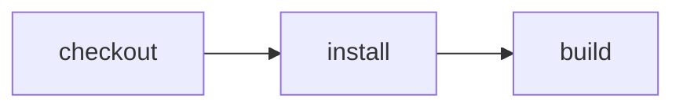

# Deploy Effect CI

> How do I keep source and pull requests on GitHub while every CI run is a native Cloudflare Workflow instance?

The [owned public incident repair implementation](PUBLIC-REPAIR.md) now connects
admission, a fresh bounded proposal, native verification and a proposed-PR Slack
card. A genuine public500 now automatically produced a fresh Flue proposal,
passed exact-commit native Node verification and created unmerged PR4. The final
acknowledgement failed on the renamed bot's login; approved read-only reconciliation
confirmed the existing PR and updated the same Slack card. The linked guide
preserves the original failed Workflow explicitly; no repair merged or deployed.



---

The first slice is a single-tenant service deployed in the repository owner's
Cloudflare account. It is similar in spirit to a hosted CI integration or Workers
Builds, but it is an independently deployable Effect CI service—not an emulation of either product.

Verified on a deployed account: a real GitHub App webhook started native
checkout/install/build with snapshots and returned successful GitHub checks with
command logs. One live-updated Slack checklist and inline approval followed by an
echo-only release are also verified. `cf-ci --remote` completed through an actual
`cloudflared` Access user session: instance `d94238ee-afdf-404f-aa63-ec013f8fcba1`
checked out source `cb851662300487cb033e1f1bd5586351f28c60eb`, installed and built,
streamed command output, and exited successfully after the terminal event.
This run used the Worker API token as well as Access; it did not deploy a release.

## Experience

The same-build candidate controller is documented in
[Demo release integration](./DEMO-RELEASE.md). The enrolled `demo/live` flow is
now live-verified: real push, checked Vite build, one maintained Slack card, four
actual graphs and explicitly authorized browser-delegated test decisions, then
the same prepared candidate committed at 100%. These are not independent human
reviews or general standalone enrollment. The historical HMD lab below remains
separate evidence; its old baseline-reset scripts must not reset this committed target.

1. Install the Effect CI GitHub App on a repository.
2. Push a commit or update a pull request.
3. GitHub immediately shows queued Effect CI checks.
4. A new Workflow instance appears in the Cloudflare dashboard.
5. The Workflow checks out the exact commit in the app's Sandbox-shim image,
   with Git and Node preinstalled by its own [Dockerfile](./Dockerfile).
6. Each action publishes its status and command output back to GitHub Checks.
7. The final GitHub result and Cloudflare Workflow result agree.

No GitHub Actions workflow or runner participates in that path.

```text
GitHub push / pull request
          │
          ▼
Effect CI GitHub App webhook
          │  verify signature + deduplicate delivery
          ▼
Cloudflare Worker ── create({ id: deliveryId, params }) ──▶ Workflow instance
                                                               │
                       GitHub Checks ◀── runtime events ─────────┤
                                                               ▼
                                                    Workspace Container
                                                    checkout → CI actions
```

## Trigger and identity

### GitHub App repair authority

The existing App can have **Contents: write** for the separately scoped repair demo.
GitHub applies that App permission to all repositories selected in its installation;
it is not a per-repository permission toggle. Keep repository access selected, not
account-wide. The application must still constrain every repair to its fixed demo
repository and mint a repository-scoped writer token only for that trusted operation.
Repair proposes a verified PR; it never automatically merges or deploys it.

Ordinary reporting requests explicit reduced token permissions: **Contents: read**
and **Checks: write**. The optional PR-comment provider needs its separate scoped
**Pull requests: write** token; ordinary reporting does not require that permission.
Checkout requests only **Contents:
read** on its one repository. Neither path inherits Contents write just because the
parent App has it. App credentials and installation tokens remain host-only, outside
project containers and model prompts. A compromised App credential remains broader
than a restricted token; this policy does not make the parent credential demo-only.

These token restrictions are library behavior; existing deployments must be rebuilt
and deployed to receive changes. The live repair writer is not implemented by merely
changing the App permissions. See [#159](https://github.com/ericclemmons/effect-ci-testbed/issues/159).
The [fixed repair writer primitive](../../packages/github/REPAIR.md) restricts the
demo to one file and dedicated branch, verifies exact commit/patch identity and
reconciles owned PRs. Its mocked tests are not a deployed repair or permission to
accept model-provided verification; hosted integration remains unfinished.

The private `RepairVerifier` export now provides a separate exact-commit Node
verification boundary: host-pinned source/test/manifest bytes are fetched with
private-fixture Contents read + Checks write, materialized into an owned container
without credentials, and tested under an empty environment. An owned native check
is published only after actual Node exit code 0. The administrative
`effect-ci-owned-repair-verification` Workflow accepts only `{ "mode": "verify-retained" }`
and checks the existing demo fix once, with checkpoint retries disabled. It cannot
create a code change, PR, merge or deployment. The first **actual native Node
verification succeeded**; see the [verifier boundary and recorded evidence](../../packages/github/REPAIR.md#native-node-verifier-boundary).

The next private `RepairWriter`/`OwnedRepairOperations` capability and
`effect-ci-owned-repair-proposal` Workflow compose the **retained** real native
Flue proposal with that verifier before one new proposed PR. One durable operation
identity is claimed before Git writes; completed receipts replay without another
call, while pending/failed/uncertain states reject automatic retry. The App key
stays here and the Flue host gains only a read-only evidence export, not GitHub
permissions. The private writer is now **deployed and natively verified**, creating
one new App-owned proposed PR only after an exact-commit native Node SUCCESS.
Completed-result replay created nothing and spent no inference. This remains a
fixed administrative pilot using the earlier real Flue proposal, not an authentic
Workers Issues trigger, automatic merge or deployment. See the [bounded pilot and
recorded proof](../../packages/github/REPAIR.md#retained-proposal-native-writer-pilot-verified-natively).

### Incident-bound proposed repair (natively verified)

The separate private `IncidentRepairWriter`, `OwnedIncidentRepairOperations` SQLite
DO and `effect-ci-owned-incident-repair` Workflow use the enrolled actual Issue and
fresh native proposal, not the old pilot record. The only new external binding is
`INCIDENT_EVIDENCE` → the agent's private `IncidentProposalEvidence` export. The
App key stays on this App host; the agent receives no writer binding or credential.
The trusted evidence service's seven fields are copied to plain data before strict
validation. A separate fixed owner/key/run/digest pins the Issue/source/version/base
and model tuple. Pending is persisted before any Git write, completion before ACK;
completed replay returns historical identity without another evidence/writer call.
Pending, failed, corrupt and mismatched identities reject recovery automatically.

The host callback uses the existing canonical one-file parser and scoped private
fixture writer. Its own loopback `RepairVerifier` must fetch the exact commit's
three pinned files with a separate read/check token and actually execute the fixed
empty-environment Node command before an App Check and proposed PR. All tokens are
revoked in their existing finally boundaries. No actor/model `passed:true`, arbitrary
command/code, automatic merge, fixture deployment or new inference is accepted.
The result explicitly says authenticated operator continuation, NOT automatic
webhook activation. The original admission's historic false authority flags remain.

Local actual workerd/Workflow/RPC/SQLite tests use FAKE GitHub and a FAKE verifier:
foreign evidence rejects before a claim/write, one proposed PR follows verification,
completed replay and isolate reload call neither writer nor evidence again. The
pure protocol separately tests concurrent claims and lost completion ACK. These
are not native writer/Node execution proof. Separately, exact merged source
`3f808fbcd1ed18cefbd1751d945e9ceb416811b0` rebuilt157modules and the unchanged Dockerfile,
then deployed ONCE as App version `784b836d-0e0d-434c-aea5-d86d94aaf571`. Access302 and
unsigned GitHub/Slack401 remain intact; all existing secret bindings are retained.
The image now resolves to7b2ede4459d6738f1465db630f3fe3794fd9c9ba28f8b5a9dffc3900b8df9924;
unchanged Dockerfile does not mean unchanged upstream image bytes.
Native inspect first found the separate operation absent, then native evidence inspect
verified the fresh original proposal. ONE `coverage-owned-incident-writer-proposal-20261014-1`
completed22:31:45.380UTC, one checkpoint/attempt/zero retries. Actual native Node exit0
produced App5089816 Check116140407284 at22:31:42Z BEFORE new private proposed PR3 at22:31:44Z,
exact commit `979958bfbe39d5d560dd94a73a51220d981c6900`. Independent APIs verify only
`repair-demo/health.js`500→200 changed; PR3 remains OPEN/unmerged. Old PR1/PR2 and main
are unchanged. Writer/verifier tokens are revoked in the trusted completion boundaries.
Separate completed-record replay returned createdfalse/replaytrue with the same commit,
Check and PR, taking no new evidence/writer/verification calls in that completed branch.
Independent inspect-only budget history confirms all five IDs and50/650 cents unchanged.
Queue392ms/execution17391ms/total17783ms, sample1 of writer orchestration, NOT measured
whole500→Issue→model→PR latency or isolated Node latency. The original Issue13:40,
admission15:36 and fresh model17:12 preceded this authenticated operator continuation;
automatic webhook activation remains unfinished. No new error/model call, merge or
fixture deployment. Private full histories/counterparts/intents are retained; never
redispatch them for parsing or proof. Read-only regression below reads retained data.

`LIVE_INCIDENT_WRITER=coverage-owned-incident-writer-proposal-20261014-1 CF_BIN=/Users/eric/Library/pnpm/bin/cf node --test src/live-incident-writer.test.ts`
from this app reads the original writer/replay/budget histories plus independent GitHub
Check/PR/files. Ordinary CI skips it; no native dispatch, deployment or model call.

To reproduce, first follow the [owned Issue enrollment guide](../repair-events/REPRODUCE.md)
and [private proposal host guide](../repair-agent/README.md), reviewing your host-owned
constants and preserving the same budget/history. Configure only the owned App
installation/repository permissions and private evidence binding; App credentials
stay host-only, never in project/model/container input. Then:

```sh
pnpm --filter @effect-ci-testbed/app check
node --test apps/effect-ci/src/incident-repair-writer-runtime.test.ts
cd apps/effect-ci
cf build
# Only after exact merged full CI and current allocation/binding/Access inspection:
cf deploy --prebuilt
cf workflows instances create effect-ci-owned-incident-repair --body '{"instance_id":"owned-incident-inspect-1","params":{"mode":"inspect"}}'
cf workflows instances create effect-ci-owned-incident-repair --body '{"instance_id":"owned-incident-evidence-1","params":{"mode":"inspect-evidence"}}'
# Save a create-only intent first; dispatch once and reconcile the SAME ID on uncertainty:
cf workflows instances create effect-ci-owned-incident-repair --body '{"instance_id":"owned-incident-proposal-1","params":{"mode":"propose-incident"}}'
```

Before proposing, independently check private base/main/old PRs and native evidence
readiness. Preserve full source/version/history plus independent exact-commit Check,
new OPEN PR/files and unchanged budget readbacks. Never emit another error or call
the model for parsing/proof. Host/container/API costs remain metered, but this writer
calls no inference. Cleanup: disable only the owned Issue automation/policy; retain
operation/capture/budget storage and private receipts. Never reset failed operations,
delete owned branches for retry, or merge/deploy any private repair PR unattended.

## Check-suite trigger

The GitHub App subscribes to `check_suite.requested` and
`check_suite.rerequested`. GitHub's default Checks flow emits `requested` after a push,
and `rerequested` gives the normal **Re-run** experience. The webhook supplies the App
installation, repository, and head SHA.

The Worker validates `X-Hub-Signature-256` before accepting a delivery. It uses
the suite's App ID to reject suites belonging to other installed Apps. It uses
`X-GitHub-Delivery` as the Workflow instance ID, making webhook redelivery idempotent,
and responds after the exported Workflow accepts the instance. The durable Workflow—not
the request handler—owns the run.

## Discord / Slack notifications and HITL

This testbed sends outbound cards only for the dedicated remote `target: "release"`
notification/HITL example below. Ordinary GitHub-triggered CI and remote builds stay
quiet, even when Slack credentials are installed. GitHub checks still report those runs.
The reusable runner's `notificationChannels` host policy selects channels per run;
approval callback authentication remains configured independently.

Notifications and approval gates are separate. Configure `DISCORD_WEBHOOK_URL` and/or
`SLACK_WEBHOOK_URL` in the ignored `.secrets.env` file and redeploy with
`pnpm run deploy -- --secrets-file .secrets.env`.

For an existing Slack app, configure `SLACK_BOT_TOKEN` (the **Bot User OAuth Token**
under **OAuth & Permissions**, not the client secret or app-level token) and
`SLACK_CHANNEL_ID`. Install the app with the `chat:write` bot scope and invite the bot
to that channel. No Socket Mode connection, inbound Slack webhook, or Bolt server is
needed for outbound notifications. The starter in `apps/slack-app` in the main checkout
can remain unchanged; this service uses the same installed Slack app identity.

Private confidence images additionally require the `files:write` **bot** scope and
reinstalling the same app into the same workspace. The Worker-side
`packages/github-cloudflare/src/slack-images.ts` helper uploads bounded, trusted PNG
renderer output using [Slack's external upload flow](https://docs.slack.dev/reference/methods/files.getUploadURLExternal/).
It completes without a channel or thread, leaving the file private and avoiding an
extra file-share message. Its file-ID receipt can become a `slack_file` image block
in the existing card. Never use a public image URL or pass the bot token to a container.
The dedicated HMD Workflow below connects this transport to its owned CI card;
its main Slack card is minimal: a live-status title, linked identity, and only
decision content and current Progress/Reject controls when needed. No image or
full checklist is attached by default. One maintained reply per stage holds its
numbered checklist, previous/new metric text and host-safe quoted failure reason.
Sampling updates that reply instead of adding messages to the thread. Root and
thread receipts are separate; ambiguous replies are not blindly reposted and a
thread presentation outages retain the configured review wait/deadline rather
than failing the release immediately. Identity or state-persistence failures
remain fatal. Identical frames reuse receipts.
Detailed windows, bounds and policy remain in native history and the semantic
observation. Images are opt-in detail; the trusted renderer supports compact,
shared-scale sparklines without slide-like titles or subtitles. Missing evidence
stays visibly unavailable; raw exception bodies never enter a failure quote.
recorded live timer and review evidence is described below. PNG
header bounds are not a decoder or an untrusted-image sanitizer: use only output
from the trusted chart renderer. Persist successful receipts before card updates;
ambiguous upload failures are not automatically retried.

### Separate health-mediated approval lab

`HmdReviewWorkflow` deploys as `effect-ci-hmd-review`. It is deliberately not
triggered by ordinary GitHub CI or the generic remote release target. The host
uses `RELEASE_MANAGER` RPC to the dedicated `effect-ci-release-manager` broker;
only that broker holds `HMD_DEPLOY_TOKEN`. No deployment credential or Slack
credential enters a workspace container.

Deploy the broker first using its [setup guide](../release-manager/README.md),
then deploy this app with `cf deploy --secrets-file .secrets.env`. Keep the
existing Access protection and signature-protected `/webhooks/slack` exception.
The ignored host secrets file must include `SLACK_BOT_TOKEN`,
`SLACK_SIGNING_SECRET`, `SLACK_APP_ID`, `SLACK_TEAM_ID`, `SLACK_CHANNEL_ID`, and
`SLACK_APPROVER_IDS`. The bot needs `chat:write` and `files:write`; the existing
HTTP interaction URL remains `/webhooks/slack`. Progress and Reject are direct
buttons by default. Set `HMD_REQUIRE_RATIONALE=true` in the host secrets file
to require the optional rationale modal (`views.open`, no additional scope).

Only start a lab when no other rollout owns the broker. Have the authorized
reviewer ready if testing manual Progress or Reject; the bounded timer lab needs
no human approval. Use an authenticated Cloudflare operator session, not a public
dispatch endpoint:

```sh
cf workflows instances create effect-ci-hmd-review \
  --body '{"instance_id":"hmd-review-unique-run-name","params":{"intent":"hmd-review-lab","revision":"REPLACE_WITH_40_HEX_COMMIT_SHA"}}'
```

Use `--body` with an object-valued `params`: the installed CLI's `--params`
flag currently forwards its JSON text as a string instead of decoding it.
The Workflow rejects that string before any notification or deployment.

#### Experimental native Worker outcomes in the same card

The default remains the verified client-HTTP lab. To opt into the native adapter,
add `"telemetry":"experimental-native-wobs"` to the authenticated Workflow's
`params`. The app config supplies `ANALYTICS_SQL`; no analytics token enters a
container or is copied from a personal session.

This path captures 100 edge-generated request receipts before reading SQL. It
pins the previous version/window and waits at most three 30-second ingestion
intervals for that exact previous cohort. An incomplete previous cohort restores
without promoting; it never generates replacement traffic to get a passing sample.
Each canary cohort captures 100 receipts. Ingestion polls re-read those same
identities and the same request-window end; no new traffic is added until the
pending cohort closes. Once closed, a further cohort may accumulate statistical
power within the same stage. The separate observation clock advances the chart
without pretending the query time closed an ambient ingestion window.
Only native terminal fetch rows supply errors/successes.
Missing or weighted rows remain incomplete, not independent zero-error trials;
foreign attribution or conflicting outcomes abort. Query/schema failures restore
without falling back to HTTP. Native query retries apply only to explicitly
`retryable: true` errors. The compact request and immutable snapshot retain the
evidence source and completeness diagnostics.

Native observations update the same owned message, checklist, private image and
snapshot-bound Progress/Reject controls. The complete previous confidence estimate
stays visible while candidate ingestion is incomplete; partial candidate counts
are labeled partial and do not get fabricated confidence bounds. A promotion is
shown before sampling, so a failed query does not hide a stage that actually ran.
Deadline/emergency acceptance remains risk acceptance, not healthy evidence.
The native policy explicitly sets `earlyRegression: true`: complete independent
bounds that conclusively breach the SLO/regression budget can stop before the
minimum count required for healthy advancement. Missing/weighted/incomplete data
cannot use that shortcut. Existing HTTP and standalone policy defaults are unchanged.

**Compatibility boundary:** Cloudflare's current
[SQL binding documentation](https://developers.cloudflare.com/analytics/sql-api/workers-binding/)
excludes Log Explorer-backed datasets. `logs.workersLogs` binding queries worked in
earlier account-specific labs; this adapter is explicitly experimental, not a
documented production telemetry contract. Local composition tests use mocked SQL
rows with actual native Workflow/RPC/SQLite/PNG execution. They are not live native
telemetry or a four-phase WOBS safety proof. Recorded hosted evidence is added only
after an actual run. `wobsVerified: false` and `releaseCommitted: false` remain
explicit; no matrix coverage flag is upgraded by this integration alone.

Corrected live run `coverage-hmd-native-regression-20261012-2` used frozen receipt
cohorts: baseline 0/100 errors; complete candidate cohorts 8/8 then 18/18 errors.
The final candidate interval was 43.23–100%, above the 10% absolute error limit.
Sticky regression prevented promotion beyond 10%; its deadline failed nonretryably
and the broker automatically restored the full previous allocation at deployment
`432309f9-5a8c-434a-9597-31cd8a5153ab`. No human/agent override was sent.
The same Slack message `1791775191.302659` updated through ingestion, regression
and rollback; signed-in visual inspection verified both versions' rates/bounds in
private image `F0C8KDZQ4FN`, rollback icon, and removed terminal buttons. This proves
that bounded synthetic native regression path, not ambient production completeness,
causal comparison, or a full healthy four-phase safety proof.

`coverage-hmd-native-healthy-20261012-1` then exercised all four actual allocations
10/25/75/100 and the 100% health check. Every stage advanced by configured
**deadline-risk-acceptance**, not health proof or fabricated human approval.
Some native cohorts remained missing/weighted; the final complete 200 candidate
outcomes had zero errors but still inconclusive confidence bounds. The one owned
Slack message `1791775431.939959` received 26 sequential frames and private chart
replacements, then removed controls/queued states on cleanup. Deployment
`d49f157c-1bd6-4794-a137-d70999a87798` restored the exact previous version at100%.
Read-only native/Slack assertions passed for both recorded runs. The strict healthy
WOBS gate remains unverified; `wobsVerified: false`, `releaseCommitted: false`.

```sh
HMD_CF_BIN=/path/to/cf \
HMD_SAMPLING_HEALTHY_INSTANCE=coverage-hmd-native-healthy-20261012-1 \
HMD_SAMPLING_REGRESSION_INSTANCE=coverage-hmd-native-regression-20261012-2 \
HMD_SLACK_SECRETS_FILE=apps/effect-ci/.secrets.env \
node --test apps/effect-ci/src/live-hmd-sampling.test.ts
```

The first live native-card run, `coverage-hmd-native-regression-20261012-1`,
**exposed a sampler bug**, not a successful rollback proof. Native SQL closed
the previous 100 outcomes after 30s. The canary loop then kept adding 100 fresh
requests at each refresh: every read remained 100 outcomes short, even while
23 received candidate outcomes were all failures. The timer accepted uncertainty
and advanced 10% → 25% → 75%. The test was terminated; authenticated broker-owned
operator recovery `coverage-hmd-native-recovery-20261012-1` independently restored
the exact prior 100% allocation in deployment
`89c8bccb-cc3d-43f8-a325-7a3ffd8ae785`.
The same Slack message `1791772497.264069` was corrected in place to **Test stopped ·
Previous version restored**, with stale buttons removed and its original private
graph preserved. This was operator recovery, not automatic HMD success or human
approval. The regression test reproduces perpetual ingestion lag before the fix;
new hosted proof is required for the corrected frozen-cohort loop.

The SHA identifies the reviewed code in the card; this fixed-target lab does
not build or upload that commit. It uses the dedicated demo's already-uploaded
healthy candidate and known baseline. Actual allocations are 10/25/75/100,
with fixed HTTP cohorts, not WOBS-completeness proof. Each observation replaces
the private graph in **one owned Slack message**, preserving its checklist and
inline progression buttons. Historical uncertainty is never relabeled healthy.

Current source policy for this legacy lab requires an authorized decision when
evidence is inconclusive. The historical timer-acceptance runs above and below
remain preserved evidence of their old policy, not current behavior. The normal
source-push demo uses its separate five-minute fail-closed review contract.

Progress or Reject records the decision with one click by default; the actor,
snapshot and acceptance time remain recorded without inventing a human comment.
When `HMD_REQUIRE_RATIONALE=true`, a required rationale modal is used instead.
A fresh Slack signature,
pinned app/team/channel, authorized reviewer, and owner/phase/snapshot-bound
single-use capability are required. The legacy setting `HMD_AUTO_PROGRESS_MINUTES`
still accepts an integer from 1–5 (default **2**) for the review window, but no
longer grants deadline acceptance. The displayed absolute deadline starts at
snapshot creation, not from clicking the button. Clear healthy evidence may
progress immediately; inconclusive or near-margin evidence requires an authorized
**Progress** decision. At the deadline, the lab closes the capability and restores
the prior allocation rather than advancing. Missing delivery or silence is not approval.
The actual local Workflow/SQLite/RPC regression waits one elapsed minute with no
scripted decision: only 10% is promoted, the run errors and the prior allocation is
restored once. This is local runtime evidence, not another native lab dispatch.
While waiting, the hosted flow collects another bounded HTTP cohort every 30s.
Counts accumulate within the same pinned stage window, the graph updates in the
same message, and the original deadline never moves. Clear healthy evidence can
progress before the deadline. A regression observed anywhere in the stage is
latched for release safety, even if later measurements improve: emergency
Progress remains available, but the timer cannot advance that stage.
Each refresh invalidates old buttons before issuing the next snapshot-bound
capability. A consumed Progress/Reject freezes refresh until delivery resolves;
sampling cannot replace or automatically bypass that decision.
Progress verifies
broker ownership and same-phase allocation before sending the native event.
Acknowledging the click (or modal) confirms a consumed intent, not event delivery;
an ambiguous acknowledgement is not blindly resent. A deadline cannot bypass an
unresolved consumed click: the review record is atomically fenced first. Rejection,
stale responses, invalid attribution or lost authority restores the exact prior allocation;
the broker's independent alarm provides recovery if the controller disappears.
Even successful completion restores baseline: **no production release is
committed**. A confirmed regression offers **Progress** as an explicit emergency
override, with the regression warning and original evidence preserved. It never
auto-progresses: without an override it restores at the deadline. This policy
belongs to this opt-in hosted review flow; the strict automatic controller and
the standalone human-review example retain their existing fail-closed policies.
After restoration, the card omits stages that never ran. It retains executed
stages, the failure, comparison graph and restoration result. Skipped statuses
remain in the semantic run history and do not change ordinary CI cards.
Restoration uses **↩️**, not a success checkmark: failed rollouts say **Rolled back**;
successful demo cleanup says **Previous version restored**, not **Passed**.
Neither label changes the native Workflow result or declares the release healthy.
Previously recorded cards below predate this presentation change.
The continuous progression policy has local regression coverage and the real
Cloudflare timer evidence below. The earlier direct-rejection browser evidence
used the previous approval/timeout policy.

For the bounded failing-candidate test, add `"profile":"regression"` to the lab
parameters. The default is `"healthy"`; these two names select only the already
uploaded dedicated demo versions. Arbitrary Worker names, origins and version IDs
are not accepted. Do not run concurrently with another release. The failing
profile holds at 10% for review, never timer-promotes after a detected regression,
and restores the exact previous allocation if no authorized override is given.
These HTTP cohorts are not representative production WOBS telemetry.

The card marks accepted phases Approved, independently of the health decision.
Uncertainty is retained in the comparison, not represented as a failed approval.
The graph shows previous/new observed error rates, errors/request counts, pinned
UTC observation windows, confidence bounds and the error-rate limit. A missing
new-version cohort does not erase the previous version and is never presented
as a zero-error success. The short HTTP demo is not a production WOBS history;
its small samples may remain inconclusive throughout the entire lab.

### Historical live continuous-sampling timer evidence

Merged source `c62f623e700b0d2356ea6a9f138c2a384c0d4978`, host version
`5491d634-d9ae-4008-bfeb-8c2c5b968896`, ran
[`coverage-hmd-sampling-deadline-20261011-1`](https://dash.cloudflare.com/0db135ec469e2f216fcea26426f29755/workers/workflows/effect-ci-hmd-review/instance/coverage-hmd-sampling-deadline-20261011-1)
through real 10/25/75/100 allocations. Each stage collected four cumulative
HTTP observations over its fixed two-minute deadline. Final candidate counts
were 32/91/300/400, all with zero errors; the previous-version cohort had
100 requests and zero errors. All four decisions remained **inconclusive** and
advanced under `deadline-risk-acceptance`, not a human event or healthy proof.
Sixteen private graph receipts and 22 sequential card frames updated
[one Slack message](https://ryanflorencefanclub.slack.com/archives/C0C81FU4B5J/p1791755648791619).
The signed-in browser showed the changing comparison graph and current-stage
Progress/Reject buttons, then all stages complete with no queued checks or buttons.
Final cleanup restored the exact previous 100% allocation at deployment
`f539a11e-2287-4407-90fa-8c36b1bf6201`. No production release was committed,
no manual risk decision was sent, and this is **not representative WOBS proof**.

The subsequent fixed failing-profile run,
[`coverage-hmd-sampling-regression-20261011-1`](https://dash.cloudflare.com/0db135ec469e2f216fcea26426f29755/workers/workflows/effect-ci-hmd-review/instance/coverage-hmd-sampling-regression-20261011-1),
accumulated 10/25/34/49 candidate requests, all failures. Once there were 25
observations, the stage detected a regression and retained the explicit emergency
Progress control without permitting automatic promotion. No override was sent.
Its fixed deadline failed once without retrying and restored the exact previous
100% allocation at deployment `a7e446a6-b5ea-43d3-a76b-68b3fbdf3f8a`.
Four private images and six frames updated
[one card](https://ryanflorencefanclub.slack.com/archives/C0C81FU4B5J/p1791756198049539),
ending with 10% failed, later phases skipped, restoration complete, and no stale
buttons. The signed-in browser verified the real comparison: previous 0/100
errors, new 49/49 errors. This is a controlled failure test, not a human emergency
override test or a causal comparison of production releases.

Read-only recorded-run assertions (never dispatches, approves or uploads):

```sh
HMD_CF_BIN=/path/to/cf \
HMD_SAMPLING_HEALTHY_INSTANCE=coverage-hmd-sampling-deadline-20261011-1 \
HMD_SAMPLING_REGRESSION_INSTANCE=coverage-hmd-sampling-regression-20261011-1 \
HMD_SLACK_SECRETS_FILE=apps/effect-ci/.secrets.env \
node --test apps/effect-ci/src/live-hmd-sampling.test.ts
```

Run from the repository root. The optional secrets-file argument enables a
local read of the existing Slack card; credentials never enter test output.
The assertions require the demo to be restored, so do not run during another lab.

Live browser evidence (2026-10-11):
[`coverage-hmd-direct-reject-20261011-1`](https://dash.cloudflare.com/0db135ec469e2f216fcea26426f29755/workers/workflows/effect-ci-hmd-review/instance/coverage-hmd-direct-reject-20261011-1)
showed the private comparison PNG `F0C8E9M2V9Q` in
[one card](https://ryanflorencefanclub.slack.com/archives/C0C81FU4B5J/p1791751529076689)
at `1791751529.076689`: previous 0 errors/100 requests, new 0 errors/17 requests,
both still inconclusive. An **agent-operated browser rejection**, not human risk
approval, sent the real signed Slack callback without a modal. Native receipt
sequences 0/1/2 retained that timestamp. No 25% promotion occurred, and the exact
100% previous-version allocation was restored at deployment
`fb93a3f8-bb68-479b-9f4f-2cfac890967b`. Host version
`b54b6840-b2b7-45f6-85c2-ed31caaa4fb5` used merged source `53d4ab4`.
That browser test exposed future phases still labelled queued after rejection;
the follow-up marks unexecuted phases skipped, with native regression coverage.
The zero-new-traffic comparison was separately visually verified locally and
retains the valid previous-version interval instead of empty history axes.

Local tests run a real native Workflow, SQLite review/card ledgers and the WASM
renderer with mocked outbound APIs. Four explicitly automated local rationale
submissions resume the workflow, produce four private images, update one
message and restore baseline. This is composition evidence, **not live Slack,
actual human approval, or full healthy WOBS rollout verification**. Delivery
ambiguity intentionally requires reconciliation; do not redispatch to create
another card or repeat an unresolved upload.

Private files may not be usable in a message immediately after upload completion.
For a known-message image update only, an explicit Slack `invalid_blocks`
validation rejection permits at most three delayed retries of the identical
frame (500/1000/2000 ms). Initial posts, network/HTTP failures, malformed replies,
other errors and lost acknowledgements are never retried. Exhaustion retains the
pending intent and fails closed; this is not an exactly-once API guarantee.

Live negative-path evidence (2026-10-11):
[`coverage-hmd-slack-timeout-20261011-3`](https://dash.cloudflare.com/0db135ec469e2f216fcea26426f29755/workers/workflows/effect-ci-hmd-review/instance/coverage-hmd-slack-timeout-20261011-3)
performed a real 10% allocation, uploaded private PNG `F0C8E4KAFJ6`, and updated
[one CI card](https://ryanflorencefanclub.slack.com/archives/C0C81FU4B5J/p1791747551490689)
at timestamp `1791747551.490689` through native receipt sequences 0/1/2. The graph
was visually checked in the signed-in Slack client. The native wait expired
after 301.509 seconds, before any review resolution or 25% promotion. The
controller restored exactly baseline `09593237-23b2-4873-bd04-88c8e8488840` at
100% in deployment `7d9eb71c-d4e1-4416-b137-80ec00dcda3d`; the same card became
Failed with its graph retained and approval controls removed. This verifies
hosted graph delivery and timeout recovery, **not actual human approval, all
four live phases, healthy WOBS gating or a committed production release**.

That run used host version `e527306c-4dec-41aa-b6be-f1fe6fb3ac7e` / source
`855bd240b7921a071ca55cd24fcd9813e0afcea4`. Its terminal checklist still displayed
10% as waiting; the follow-up marks the failed phase explicitly and is covered
by the native rejection test, not by this recorded deployment.
An earlier image-update failure restored baseline before review; its existing
card was deliberately reconciled by the operator rather than redispatched.
Neither that failure nor the first string-payload rejection counts as a
successful timeout test.

Read-only replay of the successful negative-path assertion:

```sh
HMD_CF_BIN=cf \
HMD_SLACK_TIMEOUT_INSTANCE=coverage-hmd-slack-timeout-20261011-3 \
HMD_SLACK_SECRETS_FILE=apps/effect-ci/.secrets.env \
node --test apps/effect-ci/src/live-hmd-timeout.test.ts
```

Omit `HMD_SLACK_SECRETS_FILE` for native/deployment assertions only. The test
never sends an approval or edits a card. Its current-allocation assertion will
need a new recorded instance after a later lab supersedes this restoration.

The host-side `src/hmd-card.ts` observer connects the administrative HMD controller's
immutable observations to that renderer/upload contract and the caller's **existing**
`RunCard`. It checkpoints each phase's small private file receipt and renders the
complete historical envelope, retaining the original uncertain decision after risk
acceptance. An unavailable image clears the previous phase's image and retains the
current textual evidence. The publisher must own and update the existing message;
this bridge has no separate post-message API.

This was initially an isolated local bridge. The hosted HTTP sampling runs above
now verify dispatch, private image updates and one owned message. That proof does
not establish native WOBS completeness or grant authority to approve a release.

`PrivateSlackCards` is a host-only SQLite Durable Object for one owned message per
run. It reserves a delivery intent before posting, then uses the acknowledged
timestamp for all newer card updates. Identical completed replays make no Slack
request; stale/conflicting sequences, another owner/destination or changed bot
credentials are denied. A lost acknowledgement or receipt commit leaves a pending
intent and blocks further delivery rather than creating a duplicate card.
There is deliberately no automatic reconciliation or claim of exactly-once Slack
delivery. The existing CI notifier is unchanged; the dedicated HMD Workflow now
uses this owner. Ambiguous delivery still requires operator recovery. Local workerd tests
exercise the actual SQLite ledger with a simulated Slack transport, not live Slack.

The dedicated lab now classifies unavailable/pending observational delivery
separately from invalid input, owned-message identity and authoritative SQLite
state failures. Only the two availability categories become bounded redacted
checkpoint receipts; unknown RPC/checkpoint errors and required state failures
still propagate. A held acknowledgement never posts again or creates orphan
thread replies. If review controls cannot be delivered, the existing deadline
still expires the exact capability and restores; silence is never approval.
Local actual Workflow/SQLite/RPC tests include a real one-minute unavailable-card
deadline and a wrong-channel acknowledgement that fails before the review wait.
These are mocked Slack/deployment tests, not a live Slack outage or a newly
deployed host claim.

The host-only `PrivateSlackImages` SQLite Durable Object atomically reserves a
run/snapshot/destination identity before allocation, records each upload stage,
and persists completion before returning a usable file ID. Completed receipts replay
without another upload. Changed bytes or credentials fail closed. Incomplete or
lost-ack attempts never reallocate: the last persisted stage and known file ID remain
for operator reconciliation, while the existing card can use a text fallback. Tokens
and upload URLs are not stored in its ledger or exposed to containers. This prevents
duplicate replay; it does **not** prove exactly-once external delivery, automatically
recover orphaned files, or guarantee that Slack has finished processing an image.
The hosted HTTP bridge is verified above. Bounded processing-readiness retries
are implemented; ambiguous upload stages still require operator reconciliation.
The transport uses manual redirects with explicit non-2xx rejection: workerd does
not accept the Node-supported `redirect: "error"` mode. A real workerd regression
checks all three upload boundaries without contacting Slack or forwarding credentials.

The host's private `HealthChartRenderer` RPC entrypoint renders the trusted health
chart template into a bounded 760×300 or 760×460 PNG using bundled resvg WASM and a licensed
font. It accepts structured observations, not SVG or image URLs. Rendering requires
no network, system fonts, runtime WASM compilation, or container execution; both
WASM allocations are freed after copying the result. Node/WASM and local workerd
regressions exercise the actual renderer, and `cf build` includes the compiled WASM
and private font Data module. The hosted HTTP runs above verify deployed private
images in the existing card; this does not turn HTTP outcomes into WOBS evidence.

`RunCard.setHealth(observation, fileId)` presents the phase, original decision and
evidence source alongside the existing checklist and inline approval controls.
Replacing its private file ID replaces the image in that card; it does not send a
second notification. Provider-neutral snapshots carry health status but exclude
Slack file IDs and approval capabilities. The dedicated hosted controller supplies
checkpointed observations and private image receipts. Presentation alone does not authorize
promotion, turn uncertain evidence into a healthy decision, or verify live WOBS.

With a bot token the runner posts one Block Kit status card with a dependency-ordered
checklist and edits it as actions progress. Completed checks stay visible alongside
running, queued, skipped, and optional warning checks. Approval adds **Approve** and
**Reject** buttons to that same card; resolving approval removes them. The linked
`repo@7-character-sha • Details` context replaces the long revision and duplicate
Workflow footer. **Details** opens the native Cloudflare dashboard instance (configure `EFFECT_CI_DETAILS_URL`
with an instance URL template containing `{id}`). The final result updates the
card again. Status icons require only `chat:write`, not reaction permissions.
The template is `https://dash.cloudflare.com/ACCOUNT_ID/workers/workflows/WORKFLOW_NAME/instance/{id}`.
Its message timestamp is checkpointed for replay. If both
Slack bot credentials and a Slack webhook are configured, the bot takes precedence.
Discord also edits one checklist message using its webhook message ID. Slack incoming
webhooks cannot edit messages in this integration: use bot credentials for the single-card
experience; the webhook-only fallback still posts milestone messages.
Command output, event payloads, and exception bodies are not forwarded. Tokens and URLs
remain Worker secrets and never enter the build container. Failed notification
delivery is best-effort and does not fail CI; its result is checkpointed rather than
retried indefinitely. External delivery is not exactly-once: a crash after posting
but before checkpointing can duplicate a message.

Additional destinations can be supplied through `workflowEntrypoint`'s
`notificationProviders(environment, parameters)` option. Each provider has a stable
unique slug `id` and an Effect-returning `deliver(runSnapshot, previousReceipt)`.
Import `Notifications` and `notificationLayer` from
`@effect-ci-testbed/github-cloudflare/notifications` for standalone composition.
One service explicitly fans out to providers; merging competing layers for the same
service does not provide fan-out. Providers own their rendering and API calls, and
return serializable receipts containing message/comment IDs only. The hosted runner
serializes updates and checkpoints each provider independently; replay restores its
receipt without posting again. A provider failure does not fail CI or suppress another
destination. Shared snapshots omit command output, event payloads, approval summaries,
and approval capability tokens. Slack's existing inline approvals remain separate.
The `githubCommentProvider` factory is available from
`@effect-ci-testbed/github-cloudflare/github-comment`. Supply the verified repository,
PR number, App bot's numeric user ID, and a host-only installation-token callback.
It maintains **one comment per run/PR**, updating its checklist rather than posting
every event. Separate runs retain their own comments so a delayed older run cannot
overwrite a newer run. One single latest comment across all runs would additionally
need a shared coordinator; it is not this provider's contract.

HMD observations also enter the immutable snapshot as semantic `health.metrics`:
the exact observation digest, previous/current version IDs, pinned windows,
observed errors/counts, available confidence bounds and release limits. The host
observer supplies these from the same observation used by Slack's private graph.
The GitHub comment renderer presents them as a numeric comparison table, not a
public copy of the Slack image. Incomplete or weighted cohorts have unavailable
rates/bounds; their counts are not independent health trials. Even complete bounds
remain historical estimates, not causal comparisons or forecasts. This is a
presentation extension: it cannot promote, approve or rewrite the gate decision.
Tests cover immutable copies, private-field exclusion, unavailable evidence and
one owned comment updated when only metric evidence changes. Hosted HMD-to-GitHub
delivery remains a separate integration task; this extension does not enable it.

The provider checks author identity, PR scope and the run/revision marker before an
edit, recovers an acknowledged post if its receipt was lost, and fails closed when
bounded discovery is ambiguous or exceeds 500 comments. API error bodies are never
forwarded and POST is not automatically retried. Discovery reduces duplicate posts
on replay, but a concurrent external post or ambiguous API acknowledgement is not
an exactly-once guarantee. Receipts contain only the comment ID and identity digest.

Posting needs **Pull requests: read and write** in the GitHub App's repository
permissions, followed by installation approval if prompted. Checks: write and
Contents: read remain unchanged; Issues: write and Contents: write are unnecessary.
This provider is tested locally against the API contract; it is **not enabled in the
deployed app**, and no live PR-comment integration is claimed until permission and
real delivery are verified. The extension never grants permission automatically.

Root-only `cf-ci run --remote` was also verified through Access in instance
`651bd288-5b3b-47bb-8b6f-b71b70fbd31c`. A deliberately dropped real event stream in
`2d28409b-7efd-45bd-909a-e82cd9830346` resumed at cursor `1`, completed successfully,
and dispatched only once. Bounded reconnects resume the same instance, not a new run.
An exhausted transport retry is not evidence that the Workflow failed; inspect that
instance before starting another run. Remote runs require a clean, pushed revision;
local checks still work on dirty files.

Discord: create a channel webhook under **Channel settings → Integrations → Webhooks**.
Slack: create an incoming webhook for the desired channel in your Slack app.
See [Discord webhooks](https://docs.discord.com/developers/resources/webhook) and
[Slack incoming webhooks](https://docs.slack.dev/messaging/sending-messages-using-incoming-webhooks/).

An action that yields `CI.Approval.request(...)` adds inline decision buttons and
pauses the Workflow until approved or rejected. Posting notifications alone never
creates an approval gate. Possession of a notification webhook does not grant release
permission. Slack decisions require a fresh, valid request signature, the configured
app, workspace and channel, an allowed reviewer, and a capability bound to this run
and approval request. Completed runs reject decisions. The Workflow consumes the first
decision event; button retries are not an exactly-once delivery guarantee.

For inline approvals, set `SLACK_SIGNING_SECRET`, `SLACK_APP_ID`, `SLACK_TEAM_ID`, and
`SLACK_APPROVER_IDS` (comma-separated Slack member IDs) alongside the bot credentials.
Missing approval configuration fails closed. In `.deploy.env`, explicitly enable
`EFFECT_CI_SLACK_CALLBACKS=true` to provision an Access exception **only** for
`/webhooks/slack`. Configure Slack **Interactivity & Shortcuts → Request URL** as
`https://YOUR_HOST/webhooks/slack`. This HTTP handler does not use Socket Mode: disable
Socket Mode for this app before enabling HTTP interaction delivery. Other routes remain
Access-protected. Do not paste credentials into chat or commit them.
The [HITL release example](../../examples/cloudflare-hitl-release) demonstrates the
approval action. The service builds by default. A remote request with `target: "release"`
builds first, updates the Slack card with decision buttons, waits for approval, and
then executes an echo-only deployment command. It never deploys production resources.
Unknown targets are rejected rather than silently running the default build.

### Native Workflow smoke test

From an authenticated `cf` session, the following starts the echo-only release demo.
Use an object-valued `params` in `--body`: the current CLI's `--params` flag delivers
a string payload instead.

```sh
cf workflows instances create effect-ci-github-cloudflare --body '{
  "params": {
    "trigger": "remote",
    "repository": "https://github.com/ericclemmons/effect-ci-testbed.git",
    "revision": "main",
    "target": "release"
  }
}'
```

For a real run, prefer an immutable commit SHA over `main`. Use the Slack card's
inline **Approve** or **Reject** button. **View Workflow** opens Cloudflare, where the
history shows a native `waitForEvent` until that decision. No custom approval page is used.
This tests the runner and approval path directly; GitHub webhook delivery/check
reporting and CLI authentication through Access need their own end-to-end tests.

## Authentication and secrets

This service needs only the GitHub App's minimum repository permissions:

- **Checks: read and write** to receive check-suite events and publish check runs.
- **Contents: read** to clone the selected revision.
- **Metadata: read**, which GitHub Apps receive automatically.

`GITHUB_APP_ID`, the App private key, and `GITHUB_WEBHOOK_SECRET` are Cloudflare
secrets. The webhook payload's installation ID is durable input; installation access
tokens are minted just in time, expire after one hour, and are never stored in Workflow
parameters or snapshots. The token authenticates both the Git clone and check updates.

Cloudflare resource access should use runtime capabilities rather than Cloudflare API
tokens. Because the Workflow and Container-backed Durable Object belong to this Worker,
the bridge reaches them through `ctx.exports`. Cross-Worker installations can provide
explicit bindings instead. Neither form adds a general-purpose Cloudflare credential to
the runtime.

## What is reusable

The implementation composes three reusable libraries:

- `@effect-ci-testbed/github` verifies webhook signatures, mints short-lived GitHub App
  installation tokens, and turns runtime events into plan and per-action checks.
- `@effect-ci-testbed/cloudflare` continues to own Workflow, Container, checkout,
  snapshot, and restore mechanics.
- `@effect-ci-testbed/github-cloudflare` is the small bridge that accepts a verified
  check-suite delivery, starts one native Workflow instance, and connects its runtime
  events to the GitHub reporter.

The deployable service lives in `apps/effect-ci`. Its Worker entrypoint selects the
portable build action from `examples/github-cloudflare-ci` and adds an echo-only
release target in `src/workflow.ts`. Reusable hosting behavior
lives in `packages/github-cloudflare`; examples contain consumer workflows and tests.

## First hosted run

This is the end-to-end setup for the current single-tenant prototype. It deploys the
service from this repository into your Cloudflare account and installs a private GitHub
App on repositories you select. It is not yet a packaged installer for an unrelated
repository.

You need:

- Node.js 24 or newer and pnpm;
- a Cloudflare account with Workers, Workflows, Containers, and Zero Trust available;
- permission to create a GitHub App for your user or organization; and
- a hostname in Cloudflare Access. The generated `workers.dev` hostname is sufficient.

### 1. Install, authenticate, and deploy

From the repository root:

```sh
pnpm install
cd apps/effect-ci
pnpm exec cf auth login
pnpm exec cf auth whoami
cp deploy.example.env .deploy.env
$EDITOR .deploy.env
pnpm run deploy
```

`cf` prints the deployed Worker URL. Save its origin, for example:

```sh
export EFFECT_CI_PUBLIC_URL=https://effect-ci-github-cloudflare.<subdomain>.workers.dev
```

Open the origin in a browser. Access should require a login before showing
`{"service":"Effect CI","status":"ready"}`. A public health response means Access
has not been provisioned correctly. Bearer authentication separately protects run
endpoints even before Access is configured.

### 2. Register the GitHub App

In GitHub, open **Settings → Developer settings → GitHub Apps → New GitHub App**.
For an organization-owned App, use the organization's **Developer settings** instead.

Configure:

| Field                            | Value                                               |
| -------------------------------- | --------------------------------------------------- |
| GitHub App name                  | A unique name such as `Eric's Effect CI`            |
| Homepage URL                     | `$EFFECT_CI_PUBLIC_URL`                             |
| Webhook URL                      | `$EFFECT_CI_PUBLIC_URL/webhooks/github`             |
| Webhook secret                   | A new high-entropy value; save it for the next step |
| SSL verification                 | Enabled                                             |
| Checks permission                | Read and write                                      |
| Contents permission              | Read-only                                           |
| Subscribe to events              | Check suite                                         |
| Where can this App be installed? | Only on this account for this prototype             |

OAuth callbacks, user authorization, and device flow are not needed. After creating the
App:

1. record its numeric **App ID**;
2. select **Generate a private key** and save the downloaded PEM; and
3. select **Install App** and grant it access to the repository you want to build.

GitHub sends `check_suite.requested` after a push and
`check_suite.rerequested` when a user selects **Re-run**. No `push` webhook subscription
is required for this flow.

### 3. Configure Worker secrets

Generate a second secret for the direct `/runs` API. Do not reuse the GitHub webhook
secret:

```sh
export EFFECT_CI_API_TOKEN="$(openssl rand -hex 32)"
```

Copy the ignored secret-file template and fill in its values. Quoted dotenv values
can span lines, so paste the private key as the original PEM rather than flattening it:

```sh
cp secrets.example.env .secrets.env
$EDITOR .secrets.env
pnpm run deploy -- --secrets-file .secrets.env
```

`.secrets.env` is ignored by Git. Do not rename it to the checked-in example filename or
put the PEM, webhook secret, or API token directly in shell history. This second deploy
creates a new Worker version with all secrets atomically; no Wrangler command is needed.

### 4. Protect operator routes with Access

The service deliberately uses two independent trust boundaries:

| Route                                        | Caller                      | Authentication                                                                                  |
| -------------------------------------------- | --------------------------- | ----------------------------------------------------------------------------------------------- |
| `/webhooks/github`                           | GitHub                      | GitHub HMAC signature                                                                           |
| `/webhooks/slack` (opt-in)                   | Slack                       | Slack HMAC, fresh timestamp, app/team/channel checks, reviewer allow-list, run-bound capability |
| All other paths, including `/` and `/runs/*` | `cf-ci` and human reviewers | Cloudflare Access plus the Worker API token or a scoped approval token for execution            |

The owned demo has one explicit exception: its pinned existing Access identity
can use the exact `/demo` remote methods described below. This does not grant
Access-only execution to the general `/runs/*` API or grant release approvals.

The checked-in [`access.config.ts`](./access.config.ts) defines two Access application
request bodies: a protected application covering the entire hostname, and a more
specific bypass application covering only `/webhooks/github`. GitHub cannot complete
an interactive Access login; the Worker continues to require its HMAC signature.
Enabling `EFFECT_CI_SLACK_CALLBACKS=true` adds a third, equally narrow application for
`/webhooks/slack`. It does not bypass Access for the rest of `/webhooks/*`.

The installed `cf/config` API has no Access resource declarations. Consequently,
bare `cf deploy` provisions the Worker, Workflow, and Container, but does **not**
apply Access. This app's `pnpm run deploy` first reconciles `access.config.ts` through
the `cf` Access API commands, then calls `cf deploy`. It fails before deployment
if the account, hostname, reviewer list, or Access provisioning is missing.

The ignored `.deploy.env` supplies the account, public URL, reviewer emails, and
optional existing Access service-token ID. The secret values stay in `.secrets.env`.
Use `pnpm run deploy -- --secrets-file .secrets.env` to upload those with deployment.
`pnpm run deploy:access` applies only the Access configuration to an existing service.
`pnpm run deploy -- --dry-run` prints the Access plan and builds the Worker without
changing either deployment or Access policies.
When the native configuration API supports Access, this companion can move into
`cloudflare.config.ts`.

In **Cloudflare Zero Trust → Access controls → Applications**:

1. create a **Self-hosted** application;
2. use `<worker-hostname>` as the domain to protect the entire service;
3. add an **Allow** policy for the people permitted to review releases;
4. go to **Access controls → Service credentials → Service Tokens** and create an
   `Effect CI CLI` token; and
5. add a **Service Auth** policy to the application that includes that service token;
6. create a second **Self-hosted** application for the exact path
   `<worker-hostname>/webhooks/github`, with a **Bypass → Everyone** policy.

Verify that an unauthenticated visit to `/` redirects to Access, an unauthenticated
request to `/runs` cannot start a run, and GitHub's webhook reaches the Worker without
an Access login. An unsigned webhook must still return `401`.

Save the service token when it is created; Cloudflare shows its secret only once:

For a developer's existing Access identity, no service token is necessary:

```sh
cloudflared access login "$EFFECT_CI_PUBLIC_URL"
export CF_ACCESS_TOKEN="$(cloudflared access token --app "$EFFECT_CI_PUBLIC_URL")"
```

The token expires with your Access session. `cf-ci` sends it as `CF-Access-Token`
and still requires the Worker API token. For unattended execution, use the scoped
service-token pair instead (unset `CF_ACCESS_TOKEN` first):

```sh
export CF_ACCESS_CLIENT_ID='<access-client-id>'
export CF_ACCESS_CLIENT_SECRET='<access-client-secret>'
```

The Worker still checks `EFFECT_CI_API_TOKEN` after Access succeeds. That defense in
depth prevents an accidentally unprotected route from becoming a public execution API.

### Demo package on the same host

The separately enrolled `DemoCIWorkflow` (`effect-ci-demo`) executes the
ordinary scripts from `examples/demo/package.json`, using `CI.fromPackageJson`
and a native container rooted at `examples/demo`. It is mounted at `/demo` on
the existing Access-protected host; `/runs`, GitHub and Slack callbacks and all
existing Workflow/DO namespaces keep their original behavior.

Deploy this integration only from exact merged source after fresh current-resource,
security and idle-controller preflight; periodically audit actual main CI outcomes.
Use the existing host build/deploy setup, preserve all existing secrets and
bindings, and rebuild from that exact merged revision. No extra secret, App
installation, provider or public execution endpoint without authentication is
required. Remote builds never promote or request a release decision; the enrolled
GitHub release requires its separately authenticated phase decisions. The demo export creates one Workflow resource;
native runs use ordinary container, snapshot, storage and npm network costs,
not Workers AI or another paid inference service.

From a clean, committed, pushed checkout with the existing local Access and API
credentials configured:

```sh
export PATH="$PWD/node_modules/.bin:$PATH"
export EFFECT_CI_REMOTE_URL="$EFFECT_CI_PUBLIC_URL/demo"
export EFFECT_CI_REMOTE_TOKEN="$EFFECT_CI_API_TOKEN"
cd examples/demo
cf-ci plan --format=mermaid
cf-ci run --remote
```

The same authentication protects `/demo/runs`, `/demo/runs/:id` and
`/demo/runs/:id/events`. Foreign repositories, mutable revisions and
actor-selected targets are rejected before dispatch; native execution checks
the enrollment again. Only the whole lint/check/typecheck/test/build suite is
enrolled. It has no release, approval, error emission, model, repair writer or
deployment action. Routine runs do not post Slack notifications. Host-held App
and Access credentials are not forwarded into the project container.

This is host-selected manifest data, not importing or evaluating project
TypeScript in the host. A later task-name change requires rebuilding the host's
enrollment; script bodies still come from the selected pushed commit. Existing
GitHub checks continue to use their original workflow. This integration is not
yet a maintained arbitrary-package remote loader or hosted signed reuse.

To inspect an interrupted run, use its returned status URL or the existing
`cf workflows instances get <instance-id> --workflow-name effect-ci-demo` read
command. Do not dispatch a replacement just because streaming disconnected.
Do not delete Workflow histories, existing namespaces or snapshots for cleanup.
To disable new demo dispatch, remove the `/demo` route in a separately reviewed
host update; preserve completed evidence.

The merged enrollment at `e34254d` was deployed with all existing bindings
preserved. The first real `cf-ci run --remote`, through Access with automatic
agent JSON and no format/agent flag, reached `effect-ci-demo` but failed before
install: package-manager discovery was using the host filesystem rather than the
container filesystem. This is a real integration failure, not a successful demo
or infrastructure retry. The shared wrapper now supplies `runner.fileSystem`;
its workerd/Workflow/RPC regression reproduces the old error, passes the normal
package suite after the fix, and still rejects a missing lockfile before executing.
The test container is a fixture, not native execution proof. The original failed
history and CLI output remain retained.

The corrected merged source `2c8a27600b168655c2fd989e4abb200d60f3ffb8` was then
built and deployed as Worker `57135e60-28d7-4700-bd42-4187bdb2820e`, preserving all
16 binding identities, 17 exports, Access and signed callbacks. The actual CLI
from a clean managed checkout ran `cf-ci run --remote` with automatic agent JSON
and no agent/format flag. Native instance `f62fe0db-05e6-4acd-9492-9c8cbfacb6ac`
completed all seven nodes and all six real commands, once each with zero retries:
`npm ci`, lint, formatting checks, type-checking, tests (one source test plus 17
verification tests), and build. The CLI exited `0`. The build emitted
`dist/index.html`, `dist/app.js` and `dist/message.js`.

Observed queue/execution/total times were 634 / 79,629 / 80,263 ms (one sample;
an existing workspace-cache snapshot was restored). These include orchestration,
container commands and snapshots, not isolated task latency or a cold benchmark.
Full original CLI event outputs are retained privately; the history API truncates
some large step previews, so those previews are not claimed as complete output.
This proves same-app native execution, not signed check reuse, browser execution,
artifact publication, Vite-site deployment, a model call or release approval.

Read the same retained native history without dispatching a new run:

```sh
LIVE_DEMO_INSTANCE=f62fe0db-05e6-4acd-9492-9c8cbfacb6ac \
  CF_BIN="$PWD/node_modules/.bin/cf" node --test src/live-demo.test.ts
```

The test is opt-in and skips in ordinary CI. `LIVE_DEMO_RECEIPT` optionally points
to the private original CLI receipt to additionally validate its untruncated
command events; do not publish raw receipts or credentials. No redeployment or
new execution is needed to validate this evidence.

### Local CLI credentials (operator setup, not a demo step)

The owned demo's approved identity can instead use its existing Access login,
then `cf-ci doctor --remote`, without a machine API profile. The host verifies
the JWT signature, trusted issuer, application audience, expiry and pinned opaque
subject digest. Only the enrolled origin's GET capabilities/status/events and
POST run routes accept it; no approval, webhook, other identity or preview-alias
access is added. The alternative rejects cross-origin browser requests, foreign
Fetch Metadata and non-JSON POSTs before verification; API-token clients retain
their existing behavior. The CLI requires authenticated capability enrollment before
Access-only dispatch, including a default run. An old host fails before POST.
JWTs remain in cloudflared's cache/process memory, never project env files.

Other API clients retain their existing token boundary:

`cf-ci run --remote` can read a private user-owned
`~/.config/effect-ci/remotes.json` profile instead of requiring shell exports:

```json
{
  "version": 1,
  "remotes": [
    {
      "repository": "https://github.com/OWNER/REPOSITORY.git",
      "url": "https://YOUR-HOST/demo",
      "token": "YOUR-EXISTING-WORKER-API-TOKEN"
    }
  ]
}
```

Create the file privately (mode `600`), outside repository checkouts. Only the
matching repository uses it. An explicit remote URL override does not inherit a
profile token for another endpoint. Existing environment overrides remain
supported. Do not put App keys, Slack credentials or Access JWTs in the profile.

Without explicit Access headers, the CLI reads the existing application-scoped
session using `cloudflared access token --app <origin>` once per invocation. Its
subprocess receives no API, GitHub App or Slack secrets; token output stays in
memory and is sent only to the selected origin. The CLI does not initiate login.
When the session expires, the operator runs `cloudflared access login <origin>`
and completes the browser login. Outside the explicitly enrolled demo identity,
Access and the Worker API token remain separate authentication boundaries.
Delete the local profile to forget the local service
configuration; this does not revoke the server credential or remove any resources.

The enrollment is trusted host source in `demo-access-policy.ts`, derived from
authenticated account/application metadata and an independently signature-verified
existing owner session. It contains no email, bearer token or private key. JWKS
are fetched only from the fixed team endpoint, without credentials or redirects,
with five-second, 64-KiB and five-minute cache bounds. Removing the host adapter
revokes this alternative path without deleting the Access app or rotating other
credentials. No new resource, account permission, service token or paid provider
is required. Verification uses ordinary Worker CPU and a bounded public JWKS
request on cache misses, not an AI call. The shared JOSE version was already
pinned in this workspace.

### Enrolled demo syntax-check reuse

The `/demo` workflow has one host-enrolled pure `syntax` check. Its trusted command
strips TypeScript and constructs an unlinked `vm.SourceTextModule`; it never
links imports or evaluates project code. This is syntax validation, not a type
check. Source, package manifest and lockfile byte digests, the actual Linux x64
Node executable/versions, full commit, repository, command and host policy are
signed together. Only `demo-node-syntax-v1` is enrolled for that exact tuple.

The private Ed25519 key stays in the operator's mode-600
`~/.config/effect-ci/signers/demo-node-syntax-v1.pem`; only its public JWK is in
the host. `node .cloudflare/ci/attest.ts` from a clean enrolled checkout copies
only three committed inputs, runs the exact immutable Linux image locally with
networking disabled/read-only input mounts, checks exit zero, and then signs
outside Docker. It refuses dirty source, foreign repositories, unowned keys and
overwriting existing exact-commit notes. It retains a private receipt under the
demo's ignored `.verification/` directory. The key is not a general signer for
arbitrary projects, commands or policies.

```sh
git push
node .cloudflare/ci/attest.ts
git push origin refs/notes/effect-ci-hosted-checks-v1
cf-ci run --remote
```

The host inspects actual prepared files/runtime before reading the fixed GitHub
notes ref. It uses the existing App installation `165265172` to mint a token for
only `effect-ci-testbed` with **Contents read** (plus mandatory metadata read),
checks returned permissions, permits only the four fixed note GET endpoint
shapes, and revokes the token in `finally` before the verification step completes.
No Checks/Contents-write/PR permissions or token reach the check adapter, source
code or container. This avoids relying on unauthenticated shared-edge API limits;
it requires no additional App permission or secret beyond the existing host setup.
The reader uses manual redirects because workerd rejects `redirect: "error"`;
3xx responses are misses and never followed. Missing, invalid, unknown-key, policy/toolchain/source mismatch,
revocation or network failure leaves ordinary execution intact. Builds and other
actions cannot hit this cache. Removing the enrolled public key/check revokes
reuse without deleting historical notes. Unsigned/advisory refs never authorize
skipping anything. Publishing notes needs only the operator's existing repository
write access; no signer secret, OAuth token or App key enters the container.

This attested workflow disables **whole-container snapshot transport**: a prior
project could modify system executables inside such a snapshot, invalidating
trusted input inspection. Each source checkout starts from the owned image; only
within-run workspace snapshots are used. GitHub's automatic directory caches and
Vite's own task validation remain distinct. Native caching must restore declared
cache files without restoring project-modified system state before re-enabling
cross-run transport for this host. No new provider or inference cost is involved;
Docker, container, snapshot/storage and GitHub API costs remain ordinary runtime
costs.

**Actual native acceptance, October 15:** all seven runs used source
`b22f6cfc30b7feb480cb25e30a86576a431276cb`. The signed hit and signature negative
used host source `a90da85175a66931379e4e5ff5836ef3b54b2490`, App version
`b189f522-7836-4115-b1e7-efa1ecb1fdb7`, and the unchanged immutable Linux image.

| Evidence                       | Native instance                        | Syntax   | Actual commands | Total wall time |
| ------------------------------ | -------------------------------------- | -------- | --------------- | --------------- |
| Missing                        | `fc3d18a9-cf20-479a-a7c0-c5d67a913443` | Executed | 8               | 95.601 s        |
| Valid signature                | `ce9f3370-2e68-43f4-9a30-7e92b89903cb` | Verified | 7               | 72.118 s        |
| Signature-only tamper          | `56b4f5c0-eefe-4d8a-adfe-728662c767eb` | Executed | 8               | 84.143 s        |
| Wrong commit in note           | `ceeff4ab-0810-45a3-940f-34dd2dcd19e9` | Executed | 8               | 84.575 s        |
| Prepared-input digest mismatch | `3bd07a31-e01a-4479-bc33-b269b0f4ad0a` | Executed | 8               | 82.737 s        |
| Policy digest mismatch         | `b9f855ba-d484-45b8-8353-7536d001031c` | Executed | 8               | 80.837 s        |
| Unknown key identifier         | `e1888545-1b8c-4e0b-8a17-4c781d0d19b9` | Executed | 8               | 70.825 s        |

All eight nodes completed or were verified, and every actual command ran once
with zero retries. The inspector executes in every run; the pure parser is the
only omitted command on a hit. All six ordinary package commands execute in all
seven cases. Signed and invalid-note reads each returned four HTTP 200s; the
negative's reason was signature rejection, not a network miss. The host's token
was revoked before its accepted verification checkpoint completed. Full private
CLI streams preserve complete command outputs; native history previews can be
truncated. These are single orchestration observations including APIs, container
and snapshots, not isolated check timings or a performance comparison. The
missing-note baseline used the earlier host deployment, not the final reader.

```sh
LIVE_DEMO_SIGNED_CHECKS=1 CF_BIN="$(pwd)/node_modules/.bin/cf" \
  node --test src/live-demo-signed-check.test.ts
```

This reads the seven existing histories only: no dispatch, signing, note push,
model call, source write or deployment. The original valid note was restored by
an ordinary descendant notes commit after the signature negative; no history was
force-pushed or deleted.

The original native misses are retained separately. Real workerd exposed an
unsupported `redirect: "error"` mode; manual mode still refuses redirects. The
next run exposed unauthenticated HTTP 403, followed by a legacy token-format
assumption that rejected a real opaque token. Actual workerd and token-shape
regressions cover both fixes. The failed token-shape run's individual token
revocation was not confirmed and is not claimed; its value was never captured or
exposed and its requested authority was only public-testbed Contents read. The
independent local diagnostic token was revoked, and the accepted native runs
complete the helper's `finally` revocation before returning a verdict.

The four additional negatives changed exactly one field in the owned proof:
commit, prepared-input digest, policy digest or key identifier. Each had the
same actual prepared source, command and toolchain, four authenticated HTTP 200
reads, rejected reuse, and successful ordinary execution. The original valid
note was restored after every experiment, through descendant commits and normal
pushes; no other note was modified. These are proof-field mismatches, not a
claim that a new source commit or host policy was deployed in those runs.

This establishes native execute/valid-reuse/invalid-proof fallback for the
enrolled check, not hardware attestation, cross-merge reuse, arbitrary repository
enrollment, conventional GitHub evidence parity or completion of every #144
negative cell. A fresh source-change run and conventional GitHub composition
remain separate evidence requirements; local verifier tests are not relabelled native.

### Same-app Vite build handoff

The current demo uses ordinary workspace dependencies instead of explicit artifact
management: `verify build` calls the build action and reads the returned workspace.
The runner commits/materializes the revision automatically. No manifest publication,
path list, cache selection or explicit restore belongs in the user workflow.
The project-owned `verify-build.ts` only reads the three bounded output files and
reports their sizes/SHA-256; it creates no metadata or external upload.

The automatic commit path also materializes pass-through actions that simply return
a dependency workspace without running a command. A workerd regression rejected the
old empty-container snapshot and now preserves the dependency revision. Same-step
materialization preserves writes already made by the action.

Native instance `0f5761d7-f156-4a8c-bba7-d2452ac54523` completed on exact merged
source `5798f262c54cba2a66fd95ef8c8f4f5a2cfb0d2f`, hosted by Worker version
`9c90faa0-6235-45bb-b312-1c9d9faaf55b`. All nine actions and nine real commands
completed once; command retry limits were zero. The Vite build's automatically
committed revision reached `verify build`, which read the actual HTML/JavaScript
outputs (523/1520/103 bytes) and their SHA-256 identities. No explicit artifact
publish/restore step ran. Queue1922ms/execution87076ms/total88998ms is one native
orchestration sample, not an isolated build benchmark. This is not website
publication, browser verification, or a new signed-reuse proof. No inference ran.

```sh
LIVE_DEMO_HANDOFF=1 CF_BIN=apps/effect-ci/node_modules/.bin/cf \
  node --test apps/effect-ci/src/live-demo-handoff.test.ts
```

This opt-in test reads only that retained history; ordinary CI skips it. Private
full CLI/history/deployment receipts are retained. The following runs describe
the **earlier explicit artifact API**, not the current adoption API. Their
histories remain unchanged.

The demo adds ordinary `publish build` and `verify artifact` actions after its
real Vite build. The producer computes SHA-256 and byte size for the actual
`dist/index.html`, `dist/app.js` and `dist/message.js`, writes a generated manifest,
and calls `CI.Artifact.publish`. The consumer restores that checkpoint into its
own action container and verifies the raw file bytes against the manifest.
Neither action is eligible for signed-check reuse.

The project-owned `examples/demo/.cloudflare/ci/artifact.ts` has no network or
deployment capability. It accepts only those three regular files, rejects
symlinks/foreign metadata, limits each file to 2 MiB and all files to 4 MiB, and
atomically replaces only its recognized generated metadata under
`.effect-ci/artifacts/demo-build.json`. This is ordinary build metadata, not a
signature or permission to skip execution. No new secret, binding, provider or
repository permission is needed; the existing container and snapshot costs apply.

The Cloudflare runner must materialize a publishing action's dependency snapshot
even when no command ran first, and return the restored artifact revision to all
subsequent reads/commands. A workerd/RPC regression reproduces both failures and
tests their fixes, including rejection of another run's workspace. Its container
is a fake; it does not substitute for the native handoff acceptance run.

`CI.Artifact` currently transports the full immutable workspace snapshot; its
path list describes the build output, not a path-only public artifact export.
The default local runner verifies files in its worktree and is not evidence of
native container transport. No website or GitHub Artifacts upload is implied.

```sh
node --test apps/effect-ci/src/artifact-revision-runtime.test.ts \
  apps/effect-ci/src/demo-filesystem-runtime.test.ts \
  examples/demo/verification/artifact.test.ts
```

After deploying this exact merged host through the documented preflight, a clean
pushed commit containing the artifact helper can run the ten-node suite using
`cf-ci run --remote`. Retain the producer manifest, actual artifact snapshot ID,
consumer restore and successful raw-byte verification together before recording
native acceptance. Do not dispatch an older source revision lacking that helper.

**Actual native acceptance, October 15:** merged source
`7a64ae82ac7b4a24496b58b36412968a0d4e1f72`, host Worker
`4d579704-d315-4cc2-ad36-d360af2fcc94`, unchanged pinned Linux image:

| Existing native instance               | Syntax                       | Ordinary build and artifact actions |
| -------------------------------------- | ---------------------------- | ----------------------------------- |
| `cd92c09c-9f8a-421b-8609-0195bea5889a` | Executed; no signed evidence | All completed                       |
| `3559464e-1234-4787-b093-8a1498b3232c` | Verified signed evidence     | All completed                       |

Both ran ten nodes; unsigned execution ran ten commands, signed execution nine.
Only the enrolled parser was omitted. Producer and restored consumer independently
reported identical SHA-256 identities for HTML (523 bytes), app JavaScript (1,520)
and message JavaScript (103), and the consumer returned `verified: true`. Actual
snapshot publication and restore completed on their first attempts (their ordinary
transport policy permits retries; commands have retries disabled). Private full
histories, CLI events and receipts are retained; no raw credential or diagnostic
capture is published here. This proves native artifact handoff, not website
deployment, browser verification or a general performance claim.

Read these existing histories without executing another build:

```sh
LIVE_DEMO_ARTIFACT=1 CF_BIN="$PWD/apps/effect-ci/node_modules/.bin/cf" \
  node --test apps/effect-ci/src/live-demo-artifact.test.ts
```

### 5. Run the first Workflow

First exercise the same deployed service directly from the checkout:

```sh
cd ../..
export EFFECT_CI_REMOTE_URL="$EFFECT_CI_PUBLIC_URL"
export EFFECT_CI_REMOTE_TOKEN="$EFFECT_CI_API_TOKEN"

pnpm exec cf-ci run --remote
```

The CLI should create a native Workflow instance, stream action events, and exit with
the Workflow result. Remote execution uses the service's configured workflow; it
does not upload or execute an arbitrary local workflow module. The CLI supplies the
Git repository and pushed commit, not dirty working-tree files. Run locally for
pre-commit validation; commit and push before using `--remote`.
No local workflow is required to dispatch the hosted suite from a repository root.
If one exists (or `--workflow` is explicit), its configured custom remote runner
still takes precedence.

Then push a commit to the repository where the GitHub App is
installed. The successful GitHub path is:

1. GitHub App **Advanced → Recent deliveries** shows a successful `check_suite`
   delivery;
2. the commit immediately receives an **Effect CI / Cloudflare** queued check;
3. a new Workflow instance appears in the Cloudflare dashboard;
4. checkout, install, and build update their GitHub checks as they execute; and
5. both the summary check and Workflow finish with the same conclusion.

Select GitHub's **Re-run** action once as the final smoke test. It should create a new
Workflow for the new webhook delivery; redelivery of the same delivery ID remains
idempotent.

### Troubleshooting

- **No webhook delivery:** confirm the App is installed on that repository, **Checks**
  is read/write, and **Check suite** is selected.
- **Webhook returns 401:** the value stored in `GITHUB_WEBHOOK_SECRET` differs from the
  App's webhook secret. Inspect the response under the App's **Advanced** page.
- **Check stays queued:** inspect the Workflow instance and Worker logs in the
  Cloudflare dashboard.
- **Private clone fails:** confirm **Contents** is read-only and the App installation
  includes the repository. Installation tokens are minted just in time, scoped to
  that repository with **Contents: read**, and retained only in the host Durable
  Object during checkout. Git receives a token-free `github-checkout.ci` URL;
  the host proxy forwards only that repository's clone/fetch endpoints over HTTPS.
  It denies pushes, redirects and other repositories, and revokes access before
  project checkout/commands and on failure. No token enters VM arguments,
  environment, Git config, snapshots or durable storage. Worker restarts fail closed.
  Export `GitCheckoutOutbound` as a Worker entrypoint alongside `WorkspaceContainer`
  (see this app's `cloudflare.config.ts`); missing wiring fails closed, with no
  credential-in-command fallback. Reporting uses a separate host-only token.
- **Checkout isolation evidence:** real GitHub delivery
  `29e9eff0-c670-11f1-8e3e-5ac45bcf077b` completed both source/cache checkout
  paths, install/build, snapshots and GitHub checks on deployment
  `69b0e290-1b9e-4785-b163-ab094ff1c79f` at source
  `4d32bc9357a0d63123cbdddbb29d5006556f65a5`. The App currently has access to
  this public repository only: this is real authenticated Git smart HTTP proof,
  not private-repository authorization proof. Command-recorder regressions check
  no credentials in VM argv/environment/origin and revocation before project
  checkout and after failure; they are not a live VM forensic scan.
  Read-only replay assertion:

  ```sh
  LIVE_GITHUB_CHECKOUT_INSTANCE=29e9eff0-c670-11f1-8e3e-5ac45bcf077b \
  LIVE_GITHUB_CHECKOUT_REVISION=4d32bc9357a0d63123cbdddbb29d5006556f65a5 \
  node --test apps/effect-ci/src/live-github-checkout.test.ts
  ```

- **`cf-ci --remote` redirects to login:** the Access application needs a
  **Service Auth** policy containing the service token—not only a human Allow policy.
- **`cf-ci --remote` returns 401 after Access:** `EFFECT_CI_REMOTE_TOKEN` does not match
  the Worker's `EFFECT_CI_API_TOKEN` secret.

The Worker returns `202 Accepted` only after its exported Workflow accepts the delivery.
Repeating the same `X-GitHub-Delivery` returns the existing instance rather than
starting duplicate CI.

The complete userland Worker is deliberately this small:

```ts
import * as GitHubCloudflare from "@effect-ci-testbed/github-cloudflare";

import workflow from "./workflow.ts";

export { WorkspaceContainer, GitCheckoutOutbound } from "@effect-ci-testbed/github-cloudflare";

export default GitHubCloudflare.worker();
export const EffectCIWorkflow = GitHubCloudflare.workflowEntrypoint(workflow, {
  root: "examples/github-cloudflare-ci",
});
```

The repository's integration test injects fake GitHub APIs and a fake Workflow
capability into the reusable bridge. It proves that one valid signed delivery creates one
queued check and one Workflow instance, while redelivering the same
`X-GitHub-Delivery` creates neither again:

```sh
node --test examples/github-cloudflare-ci/.cloudflare/ci/tests/webhook.test.ts
```

These protocol tests do not count as hosted GitHub-to-Cloudflare coverage. That matrix
row remains unchecked until a real GitHub delivery completes; the native build and Slack
approval smoke tests already passed on the deployed service.

Run the app's local regression suite without credentials:

```sh
node --test packages/github-cloudflare/src/*.test.ts apps/effect-ci/src/workflow.test.ts apps/effect-ci/access.config.test.ts
```

## First-slice contract

- A real GitHub webhook starts exactly one native Workflow instance.
- The instance is visible and inspectable in the Cloudflare dashboard.
- The commit receives the existing plan and per-action GitHub checks.
- Check details contain action command output; failure output is visible on GitHub.
- Success, failure, and GitHub **Re-run** all work without GitHub Actions.
- A duplicate webhook delivery does not start duplicate CI.
- A failure concludes both the action check and Workflow as failed.

The same service also exposes Access-protected `/runs` and `/runs/:id/events`
endpoints. They power `cf-ci run --remote` without changing the GitHub webhook path.
Durable release approval and Discord notification are kept in the focused
[`cloudflare-hitl-release`](../../examples/cloudflare-hitl-release/README.md) example.

PR comments, annotations, cancellation, artifacts, and multi-tenant installation
management remain follow-up slices.

## Relevant platform behavior

- [GitHub's default Checks flow](https://docs.github.com/en/rest/guides/using-the-rest-api-to-interact-with-checks)
  sends `check_suite.requested` to installed Apps with Checks write permission.
- [Check runs](https://docs.github.com/en/rest/checks/runs) support Markdown summaries,
  detailed text, annotations, external IDs, and links back to the execution provider.
- [GitHub App installation tokens](https://docs.github.com/en/apps/creating-github-apps/authenticating-with-a-github-app/authenticating-as-a-github-app-installation)
  can authenticate API requests and HTTP Git clones.
- [Cloudflare Workflow bindings](https://developers.cloudflare.com/workflows/build/workers-api/)
  create and inspect native Workflow instances without managing an API token.
- [Cloudflare Access application paths](https://developers.cloudflare.com/cloudflare-one/access-controls/policies/app-paths/)
  allow the execution API to be protected without intercepting GitHub's webhook.
- [Cloudflare Access service tokens](https://developers.cloudflare.com/cloudflare-one/access-controls/service-credentials/service-tokens/)
  authenticate the non-interactive `cf-ci` client.

## Effect logging

Hosted CI installs the [structured WOBS logger](../../packages/cloudflare/src/wobs-logging.md).
Effect logs retain workflow, step and retry-attempt context; terminal failures
still propagate. These diagnostics are not HMD health denominators.

Non-interactive preview links and post-decision settled frames use the optional
observational path. Their delivery failure must not undo a valid build or release
decision. A real local Workflow/SQLite/RPC regression simulates failure of the
final known-parent/known-reply updates after four fake local review decisions:
one commit, no rollback, no replacement post. That is not a native Slack outage
or independent human review. Review capabilities, identity validation, required
state persistence, deployment mutation and review deadlines remain authoritative;
missing review delivery is never approval. The remaining review-delivery and
legacy HMD-lab policy audit is tracked separately in #167.

The demo's review presentation distinguishes typed transport/checkpoint
unavailability from invalid message identity or required state failures. Only
the former leaves the existing five-minute decision wait in control: no repost,
no inferred acceptance, and the normal timeout recovery still applies. Invalid
parent/reply identity remains a hard failure. Local workerd/Workflow/SQLite tests
inject a failed review delivery and a simulated deadline (not five minutes of
native elapsed time), plus a mismatched reply: neither can commit; both restore
the previous allocation. The legacy HMD lab and native outage proof remain
separate unfinished work; these tests do not claim independent human review.

The native action adapter also distinguishes an
[uncertain checkpoint acknowledgement](../../packages/cloudflare/src/action-checkpoints.md)
from an unapplied external operation. Reconcile the exact retained artifact;
neither an internal platform error nor an existing publication authorizes a blind retry.
