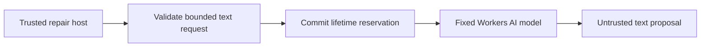

# Bound repair inference before calling a model

The Friday repair demo has a **$2 lifetime inference authorization**, not $2 per
run. This private service owns the Workers AI binding outside project code and
containers. A single SQLite-backed Durable Object commits a ten-cent reservation
before each model request. Twenty reservations exhaust the authorization; a run
can consume at most four. Failed requests and lost responses remain charged.
Retries need new reservation IDs and consume the same global budget. Replayed IDs
are rejected, not re-executed. There is no reset, refund, caller-selected budget,
public administration route, or paid-provider fallback.



Only `@cf/meta/llama-3.3-70b-instruct-fp8-fast` is allowed. Requests are limited to
16 text messages / 32 KiB and 2,048 output tokens, with streaming disabled.
No tools, gateway options, arbitrary model, or caller-controlled provider options
are accepted. The response cannot execute code or mutate GitHub.

The [official model page](https://developers.cloudflare.com/workers-ai/models/llama-3.3-70b-instruct-fp8-fast/)
checked October 13, 2026 lists a 24,000-token context and $0.293/M input,
$2.253/M output. Charging the entire context plus capped output costs less than
$0.012 at those rates; reserving $0.10 leaves conservative headroom. Re-check
pricing before activation. Reservations are authorization accounting, **not an
invoice or an account-wide spending limit**: unrelated apps, infrastructure, and
provider billing behavior are outside this service. No reliance on free quota.

## Use

```sh
pnpm --filter @effect-ci-testbed/repair-ai test
pnpm --filter @effect-ci-testbed/repair-ai check
cd apps/repair-ai
cf build
cf deploy
```

Deployment is private (`workersDev: false`); HTTP always returns 404. Only a
trusted host should receive its service binding. Call
`env.REPAIR_AI.run(runId, uniqueReservationId, model, { messages, max_tokens })`.
Do not bind this service or its exported Durable Object to untrusted project
Workers. The fixed namespace/name/storage ledger must survive redeployments;
renaming/deleting it would create a new authorization and requires operator
approval. Do not retry an ambiguous invocation with a new ID automatically.

## Verification / remaining work

Unit tests cover limits, replays, corruption, redacted errors and charge retention.
A local workerd test exercises real SQLite/RPC concurrent reservations with a
**fake inference binding**. This is not a native Workers AI or repair proof.
No model call, deployed service, Flue tool integration, GitHub patch or proposed
PR is claimed by these tests. This first slice transports text only; a future
Flue adapter must preserve reservations for every invocation and explicitly
disable its default AI Gateway, without bypassing this broker for tool calls.

Video: not recorded. Native verification and measured timings: not yet verified.
