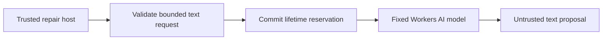

# Bound repair inference before calling a model

The Friday repair demo has a **$2 lifetime inference authorization**, not $2 per
run. This private service owns the Workers AI binding outside project code and
containers. A single SQLite-backed Durable Object commits a ten-cent reservation
before each model request. Twenty reservations exhaust the authorization; a run
can consume at most four. Failed requests and lost responses remain charged.
The original text method rejects replayed reservation IDs. Streaming calls persist
their run/request digest and original bounded SSE before returning: a completed
same-ID request replays those bytes without another reservation or model call.
Pending or uncertain calls fail closed, including after restart; a changed prompt,
run or token limit cannot reuse the receipt. Never automatically retry uncertainty
with a new ID. There is no reset, refund, caller-selected budget,
public administration route, or paid-provider fallback.



Only `@cf/meta/llama-3.3-70b-instruct-fp8-fast` is allowed. Requests are limited to
16 text messages / 32 KiB and 2,048 output tokens. The original text method
disables streaming; the bounded stream probe is described below.
No tools, gateway options, arbitrary model, or caller-controlled provider options
are accepted. The response cannot execute code or mutate GitHub.

The [official model page](https://developers.cloudflare.com/workers-ai/models/llama-3.3-70b-instruct-fp8-fast/)
checked October 13, 2026 lists a 24,000-token context and $0.293/M input,
$2.253/M output. Charging the entire context plus capped output costs less than
$0.012 at those rates; reserving $0.10 leaves conservative headroom. Re-check
pricing before activation. Reservations are authorization accounting, **not an
invoice or an account-wide spending limit**: unrelated apps, infrastructure, and
provider billing behavior are outside this service. No reliance on free quota.

## Use

```sh
pnpm --filter @effect-ci-testbed/repair-ai test
pnpm --filter @effect-ci-testbed/repair-ai check
cd apps/repair-ai
cf build
cf deploy
```

Deployment is private (`workersDev: false`); HTTP always returns 404. Only a
trusted host should receive its service binding. Call
`env.REPAIR_AI.run(runId, uniqueReservationId, model, { messages, max_tokens })`.
Do not bind this service or its exported Durable Object to untrusted project
Workers. The fixed namespace/name/storage ledger must survive redeployments;
renaming/deleting it would create a new authorization and requires operator
approval. Do not retry an ambiguous invocation with a new ID automatically.

## Verification / remaining work

Unit tests cover limits, replays, corruption, redacted errors and charge retention.
A local workerd test exercises real SQLite/RPC concurrent reservations with a
**fake inference binding**. This is not a native Workers AI or repair proof.
No model call, deployed service, Flue tool integration, GitHub patch or proposed
PR is claimed by these tests. This first slice transports text only; a future
Flue adapter must preserve reservations for every invocation and explicitly
disable its default AI Gateway, without bypassing this broker for tool calls.

`src/flue-policy.ts` validates the **input** shape emitted by the pinned Flue
2.2.2 Workers AI provider: `stream: true`, usage requests and
`max_completion_tokens`. It copies text messages into the existing bounded
request and rejects tools, gateway/header overrides, other models, accessors
and already-aborted requests. This guard is not connected to a provider yet.
The original text method returns buffered text, while Flue expects OpenAI-style SSE with a
real finish reason. An adapter must resolve that transport mismatch without
inventing completion, usage or streaming evidence. Cancellation after a durable
reservation must never refund it. No inference is invoked by the guard tests.

The optional host-only `runStream` method reserves against the **same ledger**
before requesting native streaming. It collects at most 64 KiB of original SSE
within 45 seconds, cancels stalled/oversized streams, retains failure charges,
and never retries. It does not invent deltas, finish reasons or usage. Native
transport is recorded below; actual Flue provider consumption and agent execution
still require their own verification.
Its create-only call records are separately capped at twenty, with one bounded
response per storage key. Old reservations without a response record still fail
closed through the unchanged ledger. The recovery tests use fake model responses;
durable replay is not yet deployed or verified against a new native AI call.
The authenticated probe's explicit `{"mode":"stream"}` spends one reservation
on a fixed “Reply with only OK” prompt and reports protocol shape only—not raw
model text or repair success. A `[DONE]` sentinel alone is not a finish reason.

The administrative `effect-ci-repair-budget-probe` Workflow requires an explicit
`{"mode":"inspect"}`, `{"mode":"proposal"}`, or `{"mode":"stream"}` payload. Inspect is read-only.
Proposal spends **one** reservation on a fixed owned failing function and returns
untrusted proposed text; it never applies a patch or creates a PR. Model calls
have zero native retries. Native step replay uses the same consumed reservation
ID, so an ambiguous call fails closed rather than sending a second inference.
The probe has a shared four-call lifetime cap within the global twenty-call cap.
Only authenticated account operators can dispatch it; there is no HTTP trigger.

```sh
cf workflows instances create effect-ci-repair-budget-probe \
  --body '{"instance_id":"owned-budget-inspect-1","params":{"mode":"inspect"}}'
cf workflows instances get owned-budget-inspect-1 \
  --workflow-name effect-ci-repair-budget-probe
```

Use a fresh instance ID for intentional executions; never blindly redispatch a
proposal after a timeout. Inspect the durable reservations first. Avoid `--params`
for object payloads: the installed CLI treats that option as a string.

### Recorded native proof

At source `27ee536001f2e9c7a316ed2d5ab8e760268ad7e0`, private Worker version
`6834dfd0-3b93-4a94-857c-e444c9100017` / Workflow version
`b7e3ff29-19e6-4cc8-8b06-cd6d55631f50` ran:

1. `coverage-repair-budget-inspect-20261013-1`: complete, zero reservations,
   no inference.
2. `coverage-repair-budget-proposal-20261013-1`: complete, one real Workers AI
   call, durable authorization went from $2.00 to $1.90. All three native
   checkpoints used one attempt with retry limit zero. The proposed function
   returned 200, but included Markdown fences despite the instruction not to:
   **model output remains untrusted**, not an executable patch.
3. `coverage-repair-budget-inspect-after-20261013-1`: independent read-only
   Workflow confirmed the same consumed reservation; no second model call.

Observed proposal checkpoint: **406 ms**; native execution: **586 ms**; queue
wait: **2,207 ms**, one sample on October 13, 2026. These are administrative
probe timings, not full repair benchmarks. $0.10 is the reservation, **not
measured billed usage**. No Flue, patch, proposed PR, deployment repair or
Workers Issues delivery was verified by this probe. Private version metadata
reported no public URLs. No account secrets were passed in the fixed prompt.

```sh
CF_BIN=/Users/eric/Library/pnpm/bin/cf \
LIVE_REPAIR_BUDGET_INSTANCE=coverage-repair-budget-proposal-20261013-1 \
node --test src/live-budget.test.ts
```

That test only reads the retained instance; it never dispatches or spends.
The initial live assertion expected logical checkpoint names and failed because
the native API adds `-1`; it now asserts the exact recorded native names and
zero-retry/single-attempt configuration, without changing the Workflow.

Initial `cf deploy` uploaded a private version but failed post-upload with API
10007 before registering the Workflow. Read-only APIs confirmed its allocation
and absent Workflow. One bounded `cf deploy --prebuilt` reconciliation completed
registration without changing privacy or the fixed ledger identity. The failed
not-found inspection created no instance or inference; no blind retry loop.

Video: not recorded. Full Flue repair verification: not yet verified.

### Recorded native streaming proof

The stream code built at `a803b60eb0734ff7660dd313e24aa4cca2c0f391` was
deployed after merge `d8193def5cc6793db927d241546088b0039995e9`, using the
same private service and unchanged durable ledger. Worker version
`3c1e18e1-61ec-4dff-97af-6a49b6e26be9` serves 100% at deployment
`575426cf-4e0a-4060-8285-79793ce92050`.

1. `coverage-repair-stream-inspect-before-20261013-1` read the existing ledger:
   10 cents reserved, no inference.
2. `coverage-repair-budget-stream-20261013-1` completed one native streaming
   call, with all three checkpoints at one attempt / zero retries. The ledger
   moved from 10 to 20 cents reserved, leaving **$1.80 authorized**, not a
   measured invoice. Original output was 1,964 bytes / six SSE events, including
   actual OpenAI `choices`, an `OK` delta, `finish_reason: "stop"`, reported
   usage and `[DONE]`. No finish reason or usage was synthesized.

The fixed requested model remains `@cf/meta/llama-3.3-70b-instruct-fp8-fast`.
The provider's raw events identify `@cf/meta/llama-3.3-70b-instruct-sd`; that
reported identity is retained, not rewritten to match the request. Observed
stream checkpoint: **907 ms**; native execution: **1,193 ms**; queue: **433 ms**,
one sample October 13, 2026. This proves bounded native transport and preserved
budget state—not Flue execution, a repair, a billing benchmark or a video.

```sh
cd apps/repair-ai
CF_BIN=/Users/eric/Library/pnpm/bin/cf \
LIVE_REPAIR_STREAM_INSTANCE=coverage-repair-budget-stream-20261013-1 \
node --test src/live-stream.test.ts
```

The test reads the retained instance and full untruncated step. It never spends
or redispatches. Raw original bytes and an ignored local receipt are preserved
in `.verification/native-stream-20261013-1.json`.

### Flue provider bridge

`budgetedFlueProvider` uses the actual pinned `@flue/runtime@2.2.2` Cloudflare
provider with `gateway: false`. Its catalog exposes only the fixed model, and
every binding request independently passes the input guard before budget RPC.
The trusted host supplies the run identity and reservation IDs. The bridge
checks the returned reservation/byte count and reconstructs a Response from
**unchanged** native SSE; it does not synthesize usage or a finish reason.
There is no transport retry or paid-provider fallback in this bridge. A binding
failure halts that provider instance, preventing another RPC on an automatic
retry. This in-memory latch is not durable recovery; the future native host must
persist its identities and ambiguity state across restarts.

Flue's transitive provider packages include `@google/genai` and `protobufjs`.
Their install scripts are explicitly **disabled** in `pnpm-workspace.yaml`;
the Cloudflare bridge does not need them. The first full-suite attempt exposed
`ERR_PNPM_IGNORED_BUILDS` until that explicit denial was added. A fresh archived
workspace reproduces the failure before the policy change and installs normally
afterward, without approving either script or weakening release-age policy.

Four offline tests exercise the actual Flue parser, rejected model/tools/headers,
bad receipts and a missing finish reason. An opt-in local replay also consumed
the **original retained native stream**, SHA-256
`a53e23adafa3c96b117e82978f5c95ca7c4e170b695625bbd55d3226716ef8bd`:
Flue returned text `OK`, stop reason `stop`, and the provider's reported 47
tokens. That replay used a fake budget RPC returning recorded bytes—**no new
inference**, not a live agent or billing verification.

```sh
cd apps/repair-ai
LIVE_FLUE_REPLAY_RECEIPT=.verification/native-stream-20261013-1.json \
node --test src/live-flue-replay.test.ts
```

This provider is not wired into the deployed Worker. A native Flue agent still
needs durable per-call identities, explicit retry/ambiguity handling, bounded
tools and a tested `cf` configuration. Session-affinity headers are currently
rejected along with arbitrary headers; do not quietly bypass the guard to enable
them. Neither the bridge nor the replay implements incident delivery, a hosted
GitHub writer, proposed-PR verification or an autonomous repair.

The offline lifecycle regression also starts Flue's actual Node submission
coordinator with only this provider and an empty environment. A submission is
admitted, then settles **failed before requesting a reservation**; reading that
settlement again spends nothing. This is intentional fail-closed evidence, not
a successful agent run. Even a no-sandbox agent includes Flue's framework
`task` tool, and Flue can supply session-affinity headers: the text-only bridge
does not accept those capabilities yet. Native integration must explicitly
bound its tools, host-owned session identity and durable retry policy rather
than remove the guard or mistake admission for success.

The [local private-fixture proof](scripts/README.md) can intentionally replay that
retained proposal through the fixed GitHub writer and a real exact-commit Node
check. It does not add credentials to this deployed AI broker or claim a hosted
Flue/Workers Issues repair. Its fixture and denied-input tests run without network;
live repository writes require the explicit operator commands.
