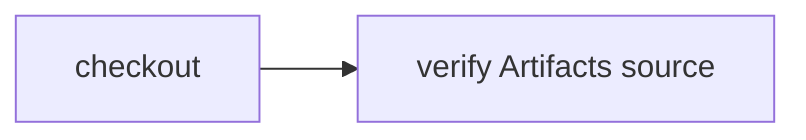

# Checkout from Cloudflare Artifacts

> How do I materialize commit-pinned source through a Worker binding without putting Git credentials in the container?



---

This directory owns its deployable Worker, Artifacts binding, native Workflow,
Dockerfile, Vite configuration, portable actions, and source fixture. It imports
reusable library packages, not another example or app.

## Follow the wiring

1. [cloudflare.config.ts](./cloudflare.config.ts) declares `ARTIFACTS` in the
   `default` namespace and registers `effect-ci-artifacts-source-checks`.
2. [src/worker.ts](./src/worker.ts) explicitly reads `env.ARTIFACTS.get(repository)`,
   exports an immutable commit and materializes files into its own container.
3. It injects that checkout as `CI.Source` into the portable
   [.cloudflare/ci/workflow.ts](./.cloudflare/ci/workflow.ts).

No inference selects Artifacts: dispatching this native Workflow selects its
explicit provider. `repository` is an **Artifacts repository name**, not a GitHub
URL. The repository may originally have been imported from GitHub.

## Deploy this example

Install this monorepo's dependencies with `pnpm install`, then deploy from here:

```sh
cd examples/artifacts-source
cf deploy
cf artifacts namespaces repos import my-ci-source --namespace default --url https://github.com/OWNER/REPO --branch main --read-only
cf workflows instances create effect-ci-artifacts-source-checks --body '{"instance_id":"my-artifacts-run","params":{"repository":"my-ci-source","revision":"FULL_COMMIT_SHA","directory":"examples/artifacts-source"}}'
cf workflows instances get my-artifacts-run --workflow-name effect-ci-artifacts-source-checks
```

Use your repository URL and full commit SHA. `directory` selects the folder in
the imported commit. If you copy this example into its own repository root, omit
`directory` (the default is the root). Do not export this monorepo's entire root;
the materializer deliberately supports only small source trees.

The import command may issue a Git token; this provider does not use it. Revoke
that token if unused. The exporter rejects mutable refs, symlinks, submodules,
traversal, missing objects, and manifests exceeding its bounded limits: 64 KiB
decoded content, 96 KiB encoded manifest, 1,000 entries, and 32 directory levels.
This is a small source materializer, not a full clone or streaming exporter.
Binary contents and executable bits are preserved. Checkout creates a snapshot;
the downstream check restores it and reads `source.txt`. This recipe still uses a
container. The public Worker endpoint returns 404; native dispatch is authenticated
through Cloudflare's Workflow APIs. No Slack integration or release broker is installed.

## Local execution is different

Run the portable workflow against local files:

```sh
cf-ci run --workflow examples/artifacts-source/.cloudflare/ci/workflow.ts
```

That command does **not** verify the Artifacts binding. `cf dev` from this directory
instead starts this example's own Worker and native Workflow explorer. No shared
example host is required.

## Verification

The prior shared-host run `coverage-artifacts-focused-20261010-1` remains historical
provider evidence: three native steps completed after the import-issued token was
revoked, with downstream output `source from artifacts`. It is not proof of this
new independently deployed configuration.

The independently deployed Worker `effect-ci-artifacts-source` is now verified by
`coverage-artifacts-standalone-20261012-1` on deployment
`543d37eb-c7c8-49cd-9cd5-d11727f7fa0d`, native Workflow version
`88285523-ea4a-477c-ac9c-8b8f0334fcd9`. It read repository
`effect-ci-artifacts-focused` at `e8faf6e46a9dde90067658d87d128c71796ed8c0`,
materialized through its own binding, created snapshot
`08ce9d69-6204-496d-a3ba-5c515a255ae3`, and returned `source from artifacts` in
the downstream restored workspace. All three native steps passed once.

`coverage-artifacts-standalone-reject-20261012-1` rejected a GitHub URL as an
Artifacts repository name before any step: there is no guessed GitHub fallback.
Anonymous requests to the example Worker return 404. The proof reused the immutable
fixture already stored in Artifacts; no new import or Git token was created. Its
previous import-issued token remained revoked. This verifies the standalone deployment.

The separate `coverage-artifacts-private-root-20261012-1` run verifies a private
repository-root fixture at `5d063b0c6f57635c77195f19f560ea7fe3edf40e`, without a
`directory` selector. Its same owned Workflow completed all three steps once and
restored snapshot `c99cd865-25d6-4209-8e0e-1bac28c61faa`. The
[retained setup record](https://github.com/ericclemmons/effect-ci-testbed/issues/163)
records revoked upload tokens and anonymous Git 401 before dispatch. Private fixture
contents stay private. This is Artifacts Git upload/binding proof, **not** proof of
remote import from a private GitHub repository.

Read those histories without redispatching:

```sh
LIVE_STANDALONE_ARTIFACTS=1 CF_BIN=cf node --test examples/artifacts-source/src/live.test.ts
LIVE_PRIVATE_ROOT_ARTIFACTS=1 CF_BIN=cf node --test examples/artifacts-source/src/live.test.ts
```

See the [Artifacts binding API](https://developers.cloudflare.com/artifacts/api/workers-binding/).

## Verification proof

**Video:** Pending.

**Measured results:** Pending.

[Proof requirements](../PROOF-PAGES.md) · [Backend coverage](../../README.md#recipes-by-feature).
