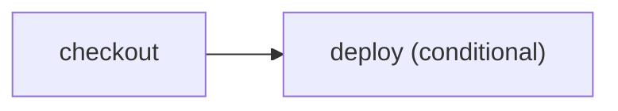

# Deploy only when needed

> How do I deploy only when this project changes, or only for a push to `main`?

Use ordinary `if/else` to call a source function and choose a branch. Use `CI.when`
when the condition must stay inspectable in the serialized plan. Both are supported;
neither requires a task runner or remote cache.

## Start with a source query

```ts
const source = yield* CI.Source

if (yield* source.changed([
  "apps/website/**",
  "packages/ui/**",
  "pnpm-lock.yaml",
])) {
  yield* actions.deploy()
} else {
  // Nothing to deploy.
}
```

[`if-else.ts`](./.cloudflare/ci/if-else.ts) is the executable version for this
recipe. Paths are repository-relative, even when checkout selects a subdirectory.
Include shared inputs explicitly: this is a watchlist, not dependency discovery
or permission to reuse an attested result.

```sh
pnpm cf-ci --workflow examples/conditional-deploy/.cloudflare/ci/if-else.ts
```

Matching paths execute the echo-only deploy. A complete nonmatching comparison
selects `else` without constructing deployment or its checkout prerequisite.
Computing the Git diff itself still needs source access.

`source.changes()` returns `status: "known"` with `base`, `head`, and
`paths`, or `status: "unknown"`. `changed` matches any supplied glob and supports
`*`, `**`, `?`, and literal alternatives such as `**/*.(ts|tsx|json)`.
Braces, negation, and character classes are not implemented.
Added/deleted files and both sides of renames count. Missing history, dirty
checkouts, incomplete diffs, and provider failures conservatively return `true`.
No baseline also returns `true`, unless the source provider supplies a complete
comparison. Don't negate that result to claim unknown changes are safe.

The workflow normally does not choose a baseline. In GitHub Actions the CLI reads
the event: PR heads compare from the branch point; synthetic PR merge commits
compare against the base; merge groups compare against the queue base; pushes
compare before/after. Local runs use the merge base with the recorded remote
default branch (`origin/HEAD`), without assuming it is named `main`. Missing
history or event metadata runs work, rather than guessing a comparison.

Other hosts supply normalized `event.comparison` or a provider `changes` function.
The existing check-suite-only host does not yet supply a previous revision, so
its default remains unknown/run. This is not a claim of new webhook support.
For a deployment that must account for previously failed/skipped releases, the
host can select the last successfully deployed revision. An explicit override is
`source.changed(patterns, { base, head, mergeBase: true })`; the CLI also accepts
`EFFECT_CI_BASE_REVISION`. `HEAD^` is not deployment history. This first version
does not persist deployment baselines.

In plan mode queries perform no source IO and report unknown, so this positive
`if` takes its conservative branch. JavaScript does not preserve both branches
or a predicate in the plan. Use the inspectable form for that contract.

## Compare built output

Source watchlists select work before a build. Output comparisons answer a different
question: did the deployable change, including changes from shared packages?

```ts
const workspace = yield* build()
if (yield* workspace.changed("dist/**")) {
  yield* deploy()
}
```

The host binds a destination and its last successful deployment. A new commit or
snapshot alone does not count; changed bytes, file paths, executable bits or serving
configuration do. A failed publication does not advance the baseline. Unknown
state runs deployment.

Run the [working output example](./.cloudflare/ci/output-changes.ts) twice:

```sh
pnpm ci:changed-outputs
pnpm ci:changed-outputs
```

The first run publishes a local directory; the second skips `deploy`. Change
[`outputs/shared/message.mjs`](./outputs/shared/message.mjs) and run again: the app
source is unchanged, but its output changes and deploys. State persists under
`.effect-ci/deployments/site` in this example, ignored by Git.

This uses the [directory deployment adapter](../../packages/ci/src/directory-deployment.md),
not a simulated deploy. It copies and reads back the selected files before atomically
advancing its current deployment. It is local-only. Cloudflare hosts can use the
[snapshot-backed provider](../../packages/cloudflare/src/snapshot-deployment.md)
and [deployable HTML site](../../apps/effect-ci/verification/snapshot-site): save
the successfully deployed workspace snapshot and compare selected content, not
snapshot IDs. Without a destination provider, `workspace.changed` returns `true`.
These adapters compare complete configured scopes, not arbitrary subsets.
Separate destinations need separate baselines.

## Keep a condition inspectable



---

`CI.when` accepts a small serializable condition algebra. The plan can display and
validate the branch before execution, and every runner evaluates the same predicate.
Ordinary Effect control flow remains available alongside it.

Property-based tests are useful for exercising combinations of events and refs, but
they cannot make an arbitrary JavaScript `if` inspectable. The declarative predicate is
what makes planning possible; tests verify its algebra.

## Current boundary: one desired action

Today `CI.when` wraps one action and the plan marks that desired node as conditional:

```ts
yield* CI.when(production, actions.deploy())
```

Its prerequisites are still discovered by executing the action in plan mode. At
runtime the condition is evaluated before the action, so a skipped deploy does not run
checkout. The plan renderer treats the condition as applying to that action's reachable
prerequisites.

That is not sufficient for an arbitrary Effect block:

```ts
if (["pull_request", "push"].includes(event.type)) {
  yield* actions.lint()
  yield* actions.test()
  yield* actions.build()
}
```

The JavaScript predicate is absent from the serialized plan, while wrapping each leaf
duplicates the condition and wrapping a synthetic gate can draw the gate after its
children. A future conditional-scope API must make the branch itself a plan node and
place every enclosed action beneath it. Until that shape is implemented, use
`CI.when` for a single desired action and ordinary Effect control flow for branches
you do not need to serialize. Source queries are not yet a `CI.when` condition;
the imperative example comes first, before adding another abstraction.

Run the canonical workflow locally:

```sh
pnpm cf-ci --workflow examples/conditional-deploy/.cloudflare/ci/workflow.ts
```

Compare [the conventional GitHub workflow](./.github/workflows/github.yml) with
[Effect on GitHub](./.github/workflows/effect-on-github.yml). The exhaustive event/ref
assertions live in
[`tests/conditional-deploy.test.ts`](./.cloudflare/ci/tests/conditional-deploy.test.ts),
not in the workflow entry point.

## Hosted coverage

The [hosted example runner](../../test/apps/example-runner) verifies both branches:
`coverage-conditional-push-20261008-1` executes the echo-only deployment for a main
push; `coverage-conditional-pull_request-20261008-1` skips deployment without
starting checkout. Its returned plan retains the inspectable condition.

That event/ref proof does not establish the new changed-file query on native
Cloudflare. Changed-file coverage currently consists of real local Git diffs and
provider-boundary example tests; native hosted acceptance is separate. The native
runner uses a fixed, non-login Git read rather than the mutation command adapter,
so inspecting changes cannot claim ownership of the selected action's workspace.
Missing checkout history still means unknown/run; this does not fetch a base or
add comparison metadata to check-suite events.
