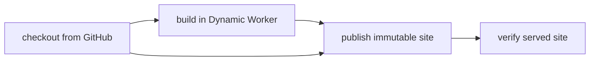

# Build and serve a static site without a container

> Can I checkout source, build a complete static website and serve it using only Workers?

This standalone example runs project-owned JavaScript in a restricted Dynamic
Worker, then serves its HTML, CSS and interactive JavaScript through another
Dynamic Worker. It owns its Cloudflare config, source fixture, Workflow and
SQLite-backed revision registry. No other example host is required.



## Run it

From this directory, build the trusted host with `cf build`. Deploying the
dedicated public `effect-ci-containerless-site` demo target requires operator
approval; it has not yet been deployed or verified here.

```sh
cf deploy
cf workflows instances create effect-ci-containerless-site-build --body \
  '{"instance_id":"my-site-run","params":{"revision":"FULL_40_CHARACTER_COMMIT"}}'
```

Use a commit containing this recipe's five `site/` files, pushed to
`ericclemmons/effect-ci-testbed`. The DO fetches only those public, pinned paths;
no GitHub token is needed. The completed run returns its site URL:
`https://effect-ci-containerless-site.ericclemmons.workers.dev/r/COMMIT/index.html`.
Open it and click the counter. The CSS and client script must load too.

The registry is create-only: replaying identical output returns the same site;
different bytes at the same source revision are rejected. An older revision's
URL continues to serve its own bytes. There is no mutable "latest" alias.
Only authenticated Workflow dispatch can build/publish; the public Worker
accepts GET/HEAD for already-published assets, never a build or write request.

```sh
node --test src/site.test.ts
cf-ci --workflow .cloudflare/ci/workflow.ts plan
```

Plain local `cf-ci run` has no implicit Node fallback for the build service.
Local workerd tests cover the primitive pipeline, not a local native Workflow
or hosted build proof. The native Workflow runs the actual Effect CI definition
with a host-owned service and four bounded, zero-retry checkpoints. Its executor
has no container command capability. Normal runs send no Slack messages.

## Supported boundaries

- Source: fixed repository, five exact-commit files, 64 KiB total, manual
  redirects rejected. The DO retains at most 16 immutable source revisions.
- Build: two project ESM modules plus bounded input data; empty bindings,
  outbound network disabled, zero subrequests, 250 ms CPU policy and five-second
  host deadline. No credentials, filesystem/process capability or npm install
  is supplied to the project. The trusted host's Node compatibility is separate.
- Output: exactly HTML, CSS and client JS, restricted paths, 128 KiB total,
  source/output SHA-256 identities, create-only SQLite publication and byte-for-byte
  served verification. A corrupt stored digest fails closed.
- Serving: another Dynamic Worker, empty bindings, no network, 50 ms CPU policy;
  immutable cache headers and a restrictive browser CSP. This is a real interactive
  static site, not a server-side API or arbitrary project-code hosting.

The build is a small portable JavaScript template transform. It does **not**
prove Vite/npm/native binary/plugin compatibility. Local tests do not prove hosted
CPU enforcement. Publishing a Dynamic Worker-backed revision is not a Workers
Static Assets upload, a new deployment API call per build, or evidence that the
`cf` CLI runs inside a DO. The separate direct-assets upload recipe remains pending.
The operator uses `cf` locally; no OAuth or deployment secret is stored here.

## Verification proof

**Video:** Pending — no same-run browser recording has been published.

**Measured results:** Pending — no hosted run or structured timing summary exists.

Local actual workerd tests prove the owned build and all three served assets,
empty child bindings/network denial, invalid manifests, immutable replay/conflict,
wrong source identity, failed project code and corrupt stored output. Source fetch
tests use owned fixtures, not a live GitHub checkout. Hosted source-to-browser
verification remains pending. Follow the [proof-page contract](../PROOF-PAGES.md).
