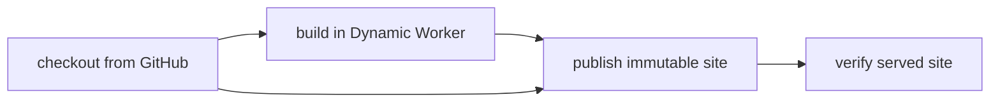

# Build and serve a static site without a container

> Can I checkout source, build a complete static website and serve it using only Workers?

This standalone example runs project-owned JavaScript in a restricted Dynamic
Worker, then serves its HTML, CSS and interactive JavaScript through another
Dynamic Worker. It owns its Cloudflare config, source fixture, Workflow and
SQLite-backed revision registry. No other example host is required.



## Run it

From this directory, build the trusted host with `cf build`. Deploying the
dedicated public `effect-ci-containerless-site` demo target requires operator
approval. The owner approved this target, and the recorded hosted run below is
now verified; this is not authority to deploy someone else's Worker.

```sh
cf deploy
cf workflows instances create effect-ci-containerless-site-build --body \
  '{"instance_id":"my-site-run","params":{"revision":"FULL_40_CHARACTER_COMMIT"}}'
```

Use a commit containing this recipe's five `site/` files, pushed to
`ericclemmons/effect-ci-testbed`. The DO fetches only those public, pinned paths;
no GitHub token is needed. The completed run returns its site URL:
`https://effect-ci-containerless-site.ericclemmons.workers.dev/r/COMMIT/index.html`.
Open it and click the counter. The CSS and client script must load too.

The registry is create-only: replaying identical output returns the same site;
different bytes at the same source revision are rejected. An older revision's
URL continues to serve its own bytes. There is no mutable "latest" alias.
Only authenticated Workflow dispatch can build/publish; the public Worker
accepts GET/HEAD for already-published assets, never a build or write request.

```sh
node --test src/site.test.ts
cf-ci --workflow .cloudflare/ci/workflow.ts plan
```

Plain local `cf-ci run` has no implicit Node fallback for the build service.
Local workerd tests cover the primitive pipeline, not a local native Workflow.
The recorded native Workflow runs the actual Effect CI definition
with a host-owned service and four bounded, zero-retry checkpoints. Its executor
has no container command capability. Normal runs send no Slack messages.

## Supported boundaries

- Source: fixed repository, five exact-commit files, 64 KiB total, manual
  redirects rejected. The DO retains at most 16 immutable source revisions.
- Build: two project ESM modules plus bounded input data; empty bindings,
  outbound network disabled, zero subrequests, 250 ms CPU policy and five-second
  host deadline. No credentials, filesystem/process capability or npm install
  is supplied to the project. The trusted host's Node compatibility is separate.
- Output: exactly HTML, CSS and client JS, restricted paths, 128 KiB total,
  source/output SHA-256 identities, create-only SQLite publication and byte-for-byte
  served verification. A corrupt stored digest fails closed.
- Serving: another Dynamic Worker, empty bindings, no network, 50 ms CPU policy;
  immutable cache headers and a restrictive browser CSP. This is a real interactive
  static site, not a server-side API or arbitrary project-code hosting.

The build is a small portable JavaScript template transform. It does **not**
prove Vite/npm/native binary/plugin compatibility. Local tests do not prove hosted
CPU enforcement. Publishing a Dynamic Worker-backed revision is not a Workers
Static Assets upload, a new deployment API call per build, or evidence that the
`cf` CLI runs inside a DO. The separate direct-assets upload recipe remains pending;
its [specific target and credential proposal](../static-assets-source/PROPOSAL.md)
records the approval boundary, not a deployed recipe.
The operator uses `cf` locally; no OAuth or deployment secret is stored here.

## Verification proof

**Video:** [Watch the recorded browser verification](https://github.com/ericclemmons/effect-ci-testbed/releases/download/proof-containerless-site-cf6dd38/video.webm) · [transcript](./verification/published/transcript-cf6dd38.md) · [source/run/media receipt](./verification/published/browser-cf6dd38.json).

[](https://github.com/ericclemmons/effect-ci-testbed/releases/download/proof-containerless-site-cf6dd38/video.webm)

The public clip is browser footage of the exact built revision, recorded after
the native run—not a continuous CLI/dashboard build recording. All three
assertions passed, and the final PNG shows Count2. The film visibly ends at
Count1 before cleanup; that last update is not reconstructed into the video.
All distinct decoded frames were agent-reviewed as blank startup/public site only.
Original incomplete framework redaction and quarantine flags remain preserved;
the separate review is not human approval or general privacy certification.

The historical proof release is a non-latest prerelease, not an immutable release.
`pnpm proof:verify-published` anonymously checks its tag, asset metadata and actual
downloaded SHA-256 bytes; it never rebuilds or redeploys. No proof asset authorizes
cache reuse or skipping a CI action. Source and recorder commits are separately
bound in the receipt; this is not footage of whichever commit is latest today.

**Measured results:** [Recorded native timings](./verification/published/native-cf6dd38.json) — one original run and one replay, not a benchmark distribution.

| Environment / run                 |    Queue | Execution |    Total | Isolated build | Cache   |
| --------------------------------- | -------: | --------: | -------: | -------------: | ------- |
| Cloudflare / original             | 2,671 ms |  1,675 ms | 4,346 ms |          37 ms | Unknown |
| Cloudflare / same-revision replay | 2,014 ms |    627 ms | 2,641 ms |          48 ms | Unknown |

### Recorded hosted run

`coverage-containerless-site-20261013-1` completed on source
[`cf6dd38`](https://github.com/ericclemmons/effect-ci-testbed/commit/cf6dd38f2cbb6e89840fb7dc75b6ee681c5eb3c0),
Worker version `ddf5abfa-3eb6-4bd6-bcfc-47e088dbea7e`. All four native steps
completed with one attempt and zero retries; the Effect CI plan contains no
commands, secrets or container work. Independent reads matched all five original
GitHub files and the three served output assets to their source/output digests.

[Open the built site](https://effect-ci-containerless-site.ericclemmons.workers.dev/r/cf6dd38f2cbb6e89840fb7dc75b6ee681c5eb3c0/index.html).
In the built-in browser, the styled page loaded and the counter changed from 0
to 1. The replay run `coverage-containerless-site-replay-20261013-1` completed
at the same URL with identical digests. Mutable revision `main` was rejected by
`coverage-containerless-site-rejected-20261013-1` with zero steps; public POST
was denied with 405 and an unknown asset returned 404. The existing site remained.

Read-only historical assertions (no deploy, dispatch or rebuild):

```sh
CF_BIN=cf LIVE_CONTAINERLESS_SITE=1 node --test src/live-site.test.ts
```

To retain the original public-source histories locally, run
`CF_BIN=cf node verification/record-native.ts` once. It is read-only and writes a
create-only ignored receipt. Do not loop on API throttling or redispatch these
instances just to regenerate proof. The first read-only assertion was corrected
for the API's omitted failed-output field; immediate duplicate full-output reads
then hit 429. Neither failure changed or reran the native workflows. Independent
receipt validation succeeded after the cooldown.

The recorder owns its pinned open-source `e2e`/web config and three exact browser
assertions. With an existing retained native receipt, `pnpm verify:browser` records
the public site's heading and two counter clicks, without another native run or
any model call. Commit the recipe first. New capture directories are create-only;
report cleanup, assertions and actual media bytes/digests must all pass. Footage
stays quarantined until frames are reviewed. It is browser footage of this built
revision, not a reconstruction of CLI/Cloudflare dashboard interaction.

Local actual workerd tests prove the owned build and all three served assets,
empty child bindings/network denial, invalid manifests, immutable replay/conflict,
wrong source identity, failed project code and corrupt stored output. Source fetch
tests use owned fixtures; the recorded hosted run independently verifies GitHub
checkout and served bytes. Hosted CPU exhaustion, full CLI/dashboard footage and
arbitrary Vite compatibility remain unverified. Follow the [proof-page contract](../PROOF-PAGES.md).
