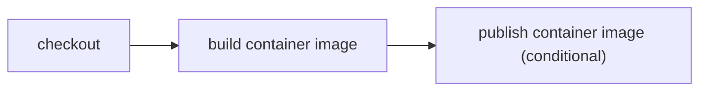

# Build and publish a container image

> How do I build a project-owned container image in the same CI program as my other work?



---

The image is intentionally tiny and uses `FROM scratch`, so the example tests the
Docker build boundary without downloading a base image:

```text
checkout → build container image → publish container image
```

`publishImage()` yields `buildImage()`, inspects the resulting local image, and prints a
harmless stand-in for the registry push. Authentication and registry selection belong
to the runner layer or its secret services; the action graph only expresses that a
publish consumes a successfully built image.

This is also the escape hatch for CI that handles both Cloudflare products and work
Cloudflare does not build, such as a Kubernetes workload's custom image.

Compare the conventional [GitHub Actions workflow](./.github/workflows/github.yml) with
the portable [actions](./.cloudflare/ci/actions.ts) and
[workflow](./.cloudflare/ci/workflow.ts).

## Verification proof

**Video:** Pending — no same-run recording has been published for this recipe.

**Measured results:** Pending — no structured per-environment timing summary has
been published here. Existing recorded runs and coverage claims remain as documented;
missing media or measurements do not imply those runs failed or were never verified.

Use the [proof-page contract](../PROOF-PAGES.md) for exact revision/environment,
assertions, video/transcript, outcome and cold/warm timings. See the
[coverage matrix](../../README.md#recipes-by-feature) for current backend support.
