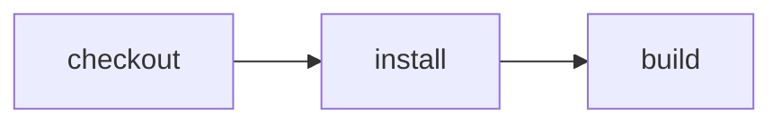

# Walkthrough

Create a React app with a Worker API, build it without a CI workflow, cache the
build, and open a GitHub PR with checks. Run the same build on an enrolled Effect
CI host using OIDC, deploy with temporary credentials, and send the result to Slack.

An existing Node project can start at **Inspect before running**. Your
`package.json` scripts are already CI actions. Vite+ is optional; this example
uses it for task caching.

## 1. Make the CLI available

Install [Vite+](https://viteplus.dev/guide/), Node 24.11+ or 26+, pnpm,
[GitHub CLI](https://cli.github.com/), and Git. Remote execution also needs an
Effect CI host, its GitHub App installed on your repository, and permission to
sign in through its Cloudflare Access policy. Ask your operator for the service
origin and App installation link. [Self-hosting](../../apps/effect-ci/SELF-HOST.md)
is a separate operator task.

The prototype CLI is unpublished. Install it in a separate directory:

```sh
git clone https://github.com/ericclemmons/effect-ci-testbed.git
cd effect-ci-testbed
pnpm install --frozen-lockfile
export EFFECT_CI_SOURCE="$PWD"
export PATH="$EFFECT_CI_SOURCE/node_modules/.bin:$PATH"
effect-ci --help
gh auth login
```

Keep this shell open. `EFFECT_CI_SOURCE` is used below to install the runnable
GitHub Actions examples into your app.

## 2. Create a Cloudflare app

From the directory where you keep projects:

```sh
vp create cloudflare
```

Use [Cloudflare's React starter](https://developers.cloudflare.com/workers/framework-guides/web-apps/react/):
name the app `walkthrough`, choose **Framework Starter**, **React**, TypeScript,
and pnpm. Enable Git and commit hooks. Skip deployment for now.

```sh
cd walkthrough
vp dev
```

Open the printed URL. Click **Name from API** to call the Worker. It returns
`{ "name": "Cloudflare" }`. Stop the server with Ctrl-C.

## 3. Inspect before running

```sh
effect-ci list
effect-ci plan build --format=mermaid
```

Every package script is an action, including `dev`, `build`, and `lint`.
Vite+ tasks under `run.tasks` in `vite.config.ts` are actions too. Choose a finite
task such as `build` for CI; `dev` stays running.



Both commands inspect the project without running scripts or writing a CI file.
Auto-discovered projects require an action name; bare `effect-ci run` explains
how to choose one.

### Give an agent the same interface

```sh
AI_AGENT=demo effect-ci list
effect-ci plan build --format=json
```

The first command previews automatic agent detection. A typical discovery result
looks like this; available targets depend on the starter version:

```json
{
  "schemaVersion": 1,
  "ok": true,
  "command": "list",
  "workflow": "walkthrough",
  "targets": ["build", "dev", "lint", "preview"],
  "commands": ["effect-ci run build", "effect-ci run dev", "effect-ci run lint", "effect-ci run preview"]
}
```

An agent discovers commands, inspects the plan, runs a selected goal, and reads
the JSON result and process exit code. `--format=json` makes that contract
explicit. No agent-specific workflow is needed.

## 4. Run the build

```sh
effect-ci run build --local
```

The starter's build script checks TypeScript and bundles the SPA and Worker.
The first local run creates an empty `.cloudflare/ci/ci.ts` discovery marker.
You haven't authored a CI graph or deployed anything.

Before enrollment, `effect-ci run build` also runs locally. **After OIDC
enrollment, it defaults to remote execution.** Keep `--local` for quick feedback
on edits before committing. `list` and `plan` stay local throughout this guide.

## 5. Run again from cache

Move the build command from `package.json` into Vite+'s `run.tasks` in
`vite.config.ts`. Keep the starter's imports and plugins. Add `run: cachedBuild`
to its existing `defineConfig({ ... })` object, using this value:

[Cached build task](./tutorial/cache-task.ts#symbol=cachedBuild "source")

Place the declaration above `defineConfig`, or inline its object as the `run`
property. Remove `scripts.build` from `package.json`. Change any remaining
`pnpm run build` callers, such as the preview script, to `vp run build`.
A task name must exist in one place: package scripts or Vite+ tasks.

```sh
effect-ci list
effect-ci run build --local
effect-ci run build --local
```

Inspect the second run for Vite+'s cache-hit output. The unchanged bundle can be
replayed; TypeScript may still run. Change `name: "Cloudflare"` to
`name: "Effect CI"` in `worker/index.ts`, then run again:

```sh
effect-ci run build --local
```

The changed input should produce a bundle cache miss. Effect CI invokes the task
through `vp run build`; Vite+ owns its cache.
[Vite+ caching](../vite-plus-cache) explains inputs and outputs. A local cache hit
does not prove a fresh hosted container has the same cache.

## 6. Create a GitHub repository with signed commits

Use your existing signing setup if you have one. Otherwise, register an existing
SSH public key as a **signing key** on GitHub and configure this repository:

```sh
gh ssh-key add "$HOME/.ssh/id_ed25519.pub" --type signing --title "Walkthrough signing"
git config --local gpg.format ssh
git config --local user.signingkey "$HOME/.ssh/id_ed25519.pub"
git config --local commit.gpgsign true
```

This assumes the matching private key exists and is available for signing. If
you need a key, follow [GitHub's signing setup](https://docs.github.com/en/authentication/managing-commit-signature-verification/telling-git-about-your-signing-key).
Set `git config --local user.email` to an email verified on your GitHub account.
Agents use this Git configuration too; an interactive signer may ask you to
unlock the key. Keep the private key on your machine.

```sh
git branch -M main
git add .
git commit -S -m "feat: Build the walkthrough app"
gh repo create walkthrough --private --source=. --remote=origin --push
```

The [repository command](https://cli.github.com/manual/gh_repo_create) creates a
private repository in your account and pushes the current branch. Use an unused
name if `walkthrough` already exists. The starter's earlier commit is unchanged;
the commits made here are signed.

<a id="6-run-on-a-host"></a>

## 7. Enroll OIDC and run on a host

Install your operator's GitHub App on the new repository. Its allowed-owner policy
must include your GitHub account or organization. Install
[cloudflared](https://developers.cloudflare.com/cloudflare-one/connections/connect-networks/downloads/)
for Access authentication. Set your actual service origin, then enroll:

```sh
export EFFECT_CI_REMOTE_URL=https://your-ci-host.workers.dev
cloudflared access login --quiet "$EFFECT_CI_REMOTE_URL"
effect-ci oidc --service "$EFFECT_CI_REMOTE_URL"
git add .cloudflare/ci/oidc.json
git commit -S -m "ci: Enroll hosted execution"
git push
effect-ci doctor --remote
effect-ci run build --remote --format=text
```

Enrollment writes the public service origin and repository name to
`.cloudflare/ci/oidc.json`. It contains no credential. `doctor` checks access and
available goals without starting a Workflow. The host must report project
discovery or advertise `build`.

Remote execution checks out the **pushed commit**. Commit and push first; a dirty
working tree is rejected. The CLI streams progress and returns a failing exit
code when the run fails. A remote error never silently executes locally.

After enrollment, these select the same remote execution path:

```sh
effect-ci run build
effect-ci run build --remote
```

For uncommitted edits and fast local feedback:

```sh
effect-ci run build --local
```

OIDC enrollment enables repository identity. Deployment additionally needs the
operator's Cloudflare account and approved deployment scope.

## 8. Open a PR and see its check

Install this complete GitHub Actions workflow into your app:

```sh
mkdir -p .github/workflows
cp "$EFFECT_CI_SOURCE/examples/demo/tutorial/checks.example.yml" .github/workflows/checks.yml
```

[GitHub checks and Slack update](./tutorial/checks.example.yml "source")

The job installs the unpublished CLI outside your app checkout and dispatches
`build` to the enrolled host. `id-token: write` lets GitHub supply a short-lived
identity. No stored Effect CI API token or Cloudflare deployment token is needed.
The toolchain revision is pinned; update it deliberately when upgrading the CLI.

```sh
git switch -c feat/github-checks
git add .github/workflows/checks.yml
git commit -S -m "ci: Run the build on Cloudflare"
git push -u origin feat/github-checks
gh pr create --title "ci: Run the build on Cloudflare"
gh pr checks
gh pr view --json headRefOid,statusCheckRollup
```

GitHub prompts for the PR description. In the PR, **Checks** shows the `build` job
from **Effect CI**; its log contains the remote Workflow ID and execution output.
`gh pr checks` takes a snapshot; run it again when you want another status.

This workflow runs on **push**, including pushes to your PR branch. Its check
belongs to that branch's head commit. The host currently rejects workload
identities from `pull_request` and `pull_request_target` events, so this does not
dispatch fork PR code. GitHub Actions reports the job check; it is separate from
the native App checks used by this repository's own hosted recipes.

Confirm GitHub verified the signed head commit:

```sh
gh api "repos/{owner}/{repo}/commits/$(git rev-parse HEAD)" --jq '.commit.verification | {verified, reason}'
```

Expect `verified: true`. Otherwise, check the key registration and committer
email. A commit signature identifies its signer; signed CI receipts are a
separate host capability that this setup does not grant automatically.

### Give your agent this working loop

```text
Use effect-ci list --format=json to discover the project's goals.
Inspect effect-ci plan build --format=json before running work.
Run effect-ci run build --local --format=json while editing.
Create a signed commit and push the branch before remote execution.
Run effect-ci run build --remote --format=json; inspect its exit code and result.
Open a PR and inspect gh pr checks and the head commit's signature verification.
Do not treat a local cache hit as proof that a remote run passed.
```

## 9. Deploy with short-lived credentials

If your operator has enabled Cloudflare deployment scopes, install the optional
manual deployment job:

```sh
cp "$EFFECT_CI_SOURCE/examples/demo/tutorial/oidc.example.yml" .github/workflows/deploy.yml
git add .github/workflows/deploy.yml
git commit -S -m "ci: Deploy with OIDC credentials"
git push
```

[OIDC deployment job](./tutorial/oidc.example.yml "source")

After this file reaches your default branch, start **Deploy the app with
short-lived credentials** from GitHub's **Actions** tab, or run:

```sh
gh workflow run deploy.yml --ref main
```

The job builds the app, then runs `effect-ci oidc -- pnpm exec wrangler deploy`.
The wrapper exchanges job identity for a 15-minute Cloudflare credential,
passes it only to the deployment child, and revokes it on exit, including failure.
Your local Access login alone is not a deployment workload identity.
Use a host and Cloudflare account where you intend to create this Worker.

## 10. Send the result to Slack

Create an [incoming webhook](https://api.slack.com/messaging/webhooks) for your
Slack channel, then store its URL in the app repository:

```sh
gh secret set SLACK_WEBHOOK_URL
```

Enter the URL at the prompt. The checks workflow's final **Update Slack** step
posts the build status, exact commit, and GitHub run link. It runs after success
or failure and skips posting until the secret exists. The secret is scoped to
that step. Trigger another signed push to see the update:

```sh
git commit --allow-empty -S -m "ci: Exercise Slack notification"
git push
gh pr checks
```

The Slack message links to the run for this new commit. Check that link and the
PR's head SHA before treating an earlier green check as the current result.

For a human approval gate, use the [Slack release recipe](../cloudflare-hitl-release).
It calls `CI.Approval.request` before release and requires a host adapter with an
authorized reviewer list and verified Slack callbacks. A webhook status message
does not grant approval authority. Generic repository runs on the shared host do
not automatically inherit that adapter.
