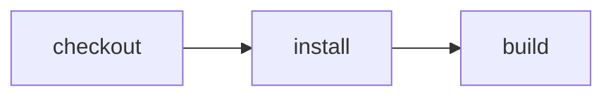

# Adopt Effect CI, one capability at a time

> How far can an existing Vite project go without replacing its scripts or rewriting its CI?

This is a hands-on adoption guide, not a presentation script. Each step adds a
capability: make the change, run the command, inspect the result. Stop or skip
wherever you want. There is no three-minute schedule or prescribed narration.

Start with an existing Vite/Vite+ package with a lockfile and ordinary
`lint`, `test`, and `build` scripts. This checked-in fixture is a small Vite+
web application: HTML entrypoint, JavaScript source, lint, types, tests and build.
The build also retains an exported message module for the existing verification
harness. Making every hosted stage below operate on this same application remains
work to finish—not a reason to substitute unrelated historical runs.

The CLI and libraries are currently private workspace packages, not a published
npm onboarding path. In this testbed, from the repository root:

```sh
pnpm install --frozen-lockfile
export PATH="$PWD/node_modules/.bin:$PATH"
cd examples/demo
```

Run `npm run dev` to edit the application, or `npm run preview` after a build to
inspect the built application. Both print their local URL.

Use Node 24.11+ or Node 26+. Keep agent implementation work in managed worktrees;
the primary checkout stays clean on main. Local source edits below are intentional
feedback experiments, not signed proof.

## 1. Discover what this project can do

No workflow, CI marker, or YAML change is needed:

```sh
cf-ci
cf-ci list
cf-ci plan
cf-ci plan lint
cf-ci plan --format=mermaid
```

Help and list show exact runnable commands, including `cf-ci run lint`,
`cf-ci run test`, and `cf-ci run build`. Plan resolves dependencies without
executing them or creating files. Mermaid describes the selected graph; it is not
a promise that package scripts have arbitrary parallel-safe dependencies.

**Inspect:** [package.json](./package.json) and [vite.config.ts](./vite.config.ts).
Discovery uses conventional package scripts and their lifecycle hooks.
[Zero-config details](../zero-config).

## 2. Run the existing scripts before pushing

```sh
cf-ci run lint
cf-ci run test
cf-ci run build
cf-ci run
```

The last command runs the whole inferred workflow. A selected target runs only its
own setup and lifecycle prerequisites, not every check. Here build includes
`prebuild` (types and lint); test includes `pretest` (types).
The first explicit local run creates an empty ignored
`.cloudflare/ci/ci.ts` marker; it does not replace the package scripts.

Change the exported string in [src/message.js](./src/message.js), then:

```sh
cf-ci run build
cat dist/message.js
```

Add a bare `asdf` line to that source file and run `cf-ci run lint`.
Expect an undefined-variable diagnostic and a nonzero exit. Remove the line and
rerun. Do not edit generated output to fix a source failure.

## 3. Use the same commands as an agent

An agent runs exactly the same commands:

```sh
cf-ci --help
cf-ci list
cf-ci plan lint
cf-ci run lint
```

`@vercel/detect-agent` detects `AI_AGENT` and tool-specific environment signals.
Human terminals default to text; agent environments default to JSON.
No `--agent` flag is required. To inspect that interface from a human terminal:

```sh
AI_AGENT=demo cf-ci list
AI_AGENT=demo cf-ci plan lint
AI_AGENT=demo cf-ci run lint
```

JSON list includes both target names and exact runnable commands. Explicit
`--format=text` or `--format=json` overrides detection. Detection changes output,
not trust, permissions, execution location, or whether a check passed.

**Current wrinkle:** JSON failures name the failed command but do not yet include
the complete tool diagnostic. Use `cf-ci run lint --format=text` to inspect it.
That is an ergonomics gap to fix, not the intended final agent workflow.

## 4. Reuse task output, then invalidate it

```sh
time cf-ci run build
time cf-ci run build
```

Inspect Vite+'s cache-hit/miss output. Change the string in `src/message.js` and
repeat: the changed input must invalidate the task; an immediate repeat can hit.
Delete only the generated `dist/message.js` and repeat to inspect output
restoration. A README-only edit should not invalidate a task that does not read it.

Optional task-cache-cold comparison, **only in a disposable checkout**:

```sh
vp cache clean
time cf-ci run build
time cf-ci run build
```

Do not clean the shared checkout for a presentation. This clears Vite task cache,
not the package store or every machine cache. Installation still runs on each
inferred invocation. A tiny cached task need not be faster than executing it.
[Vite+ caching](../vite-plus-cache) owns task reuse; this is not attestation.

## 5. Adopt on GitHub without moving execution yet

Keep the existing workflow and package scripts first. Compare these checked-in files:

- [Conventional GitHub Actions](./.github/workflows/github.yml): runs the scripts directly.
- [Effect on GitHub](./.github/workflows/effect-on-github.yml): selects `examples/demo`
  in the repository's [reusable runner](../../.github/workflows/effect-ci.yml).

For this monorepo, the essential job change is:

```yaml
permissions:
  contents: read
  checks: write

jobs:
  ci:
    uses: ./.github/workflows/effect-ci.yml
    with:
      workflow: examples/demo
      cache-key: demo-vite-task
      cache-key-files: examples/demo/package-lock.json
      cache-path: |
        node_modules/.vite/task-cache
        examples/demo/node_modules/.vite/task-cache
    secrets: inherit
```

This is repository-specific setup, **not** a self-contained snippet to paste into
an unrelated repo: the reusable workflow and its explicitly scoped GitHub App
credentials must exist there. Do not add unrelated secrets. Keep the old job while
comparing actual results, then remove duplication deliberately.

Both local and Effect-on-GitHub plan/execution for the renamed demo passed in
[PR228's exact full suite](https://github.com/ericclemmons/effect-ci-testbed/actions/runs/38660283645).
That proves this fixture on GitHub, not native Cloudflare execution of arbitrary
zero-config packages.

## 6. Make orchestration explicit when scripts stop being enough

The marker is optional scaffolding, not the end of adoption. Add
`.cloudflare/ci/actions.ts`:

```ts
import * as CI from "@effect-ci-testbed/ci";

const checkout = CI.action("checkout", function* () {
  const source = yield* CI.Source;
  return () => source.checkout();
});

const install = CI.action(
  "install",
  () =>
    function* () {
      const workspace = yield* checkout();
      const npm = yield* CI.PackageManager.JavaScript(workspace);
      return yield* npm.install();
    },
);

export const lint = CI.action(
  "lint",
  () =>
    function* () {
      const workspace = yield* install();
      const npm = yield* CI.PackageManager.JavaScript(workspace);
      return yield* npm.run("lint");
    },
);

export const build = CI.action(
  "build",
  () =>
    function* () {
      const workspace = yield* install();
      const npm = yield* CI.PackageManager.JavaScript(workspace);
      return yield* npm.run("build");
    },
);
```

Add `.cloudflare/ci/workflow.ts`:

```ts
import * as CI from "@effect-ci-testbed/ci";
import * as actions from "./actions.ts";

export default CI.workflow("demo", function* () {
  yield* actions.lint();
  return yield* actions.build();
});
```

```sh
cf-ci
cf-ci plan --format=mermaid
cf-ci run lint
cf-ci run
```

The explicit workflow takes precedence over the empty marker. This minimal example
intentionally selects lint then build; add test/check/typecheck explicitly if they
belong in the whole workflow. Exported actions become runnable commands.
[Complete package-manager composition](../node-npm) and
[exported targets](../exported-actions).

## 7. Run a pushed commit remotely

First configure the [hosted service](../../apps/effect-ci/README.md#5-run-the-first-workflow)
and its Access credentials locally. The service selects the workflow; the CLI
does **not** upload arbitrary local TypeScript or dirty source files.

After an authorized commit and push, from a clean repository checkout:

```sh
export EFFECT_CI_REMOTE_URL="$EFFECT_CI_PUBLIC_URL/demo"
export EFFECT_CI_REMOTE_TOKEN="$EFFECT_CI_API_TOKEN"
cf-ci run --remote
```

Expect a native Workflow instance and streamed action events with a terminal
success/failure. Do not redispatch if the stream disconnects without first
inspecting the original instance. Never pass personal credentials into project
code, containers, or agent prompts.

The host's `DemoCIWorkflow` selects this package's manifest and uses the same
`CI.fromPackageJson` discovery as the local CLI. Its `/demo` mount has separate
dispatch, status and event-stream routes, without changing the existing root
workflow. Host policy permits only this repository, a full commit SHA and the
whole suite. It does not accept an incoming module or deployment target.

**Live verification pending:** the first actual CLI run authenticated and reached
this workflow, but failed package-manager discovery because the host wrapper did
not supply the remote filesystem. The fix wires the existing runner filesystem;
a corrected native run must still pass before counting this step complete. The
root service's older build receipt is not evidence for this new workflow.
[GitHub-to-Cloudflare composition](../github-cloudflare-ci).

## 8. Attest a pure check, then let hosted CI verify reuse

The intended next increment is: commit → execute exact inputs → sign evidence →
push commit and notes → hosted verification → skip only the eligible pure check.
Build artifacts, deploys, migrations, and releases must still execute.

The [verification-evidence recipe](../verification-evidence) has real local
Ed25519/Git-note execution and verification. The hosted reader and enrolled-key
verifier also exist. **The complete native execute → signed reuse → invalid-proof
fallback path is not finished.** There is no `cf-ci attest` command to paste here.

Required live acceptance before this becomes a runnable step:

- Derive source, dependencies, toolchain, command and policy from actual trusted inputs.
- Keep the approved demo-restricted private signing key local; enroll only its public key.
- Execute a clean committed pure check, then prove native reuse without executing it again.
- Tamper with evidence and change inputs/key/policy; each case must execute normally.
- Keep ordinary actions executing even when a pure check hits.

This is [#144](https://github.com/ericclemmons/effect-ci-testbed/issues/144).
[Cross-merge reuse](https://github.com/ericclemmons/effect-ci-testbed/issues/229)
must issue new commit-bound evidence; copying a signature onto a merge/squash/rebase
SHA does not make it valid.

## 9. Carry real build output across jobs

After the build action, publish the actual output:

```ts
const built = yield * actions.build();
const artifact =
  yield *
  CI.Artifact.publish(built, {
    name: "demo-build",
    paths: ["dist/message.js"],
  });
const restored = yield * CI.Artifact.restore(artifact);
yield * restored.exec("test -s dist/message.js");
```

Add this inside an explicit workflow and inspect `cf-ci plan --format=mermaid`,
then `cf-ci run`. The receiver restores the recorded workspace rather than
assuming another machine has the same local path.
[Portable artifacts](../portable-artifacts) documents the actual hosted transport
fixture. Wiring this Vite output through the hosted demo remains to verify.

## 10. Assert the built application in a browser

```sh
npm run verify:browser
npm run verify:browser -- --negative
```

The first runs a real build and local browser assertion. The second deliberately
expects the wrong result and must retain failed footage. These are verification
commands, not inferred default CI targets. Retain actual output, revision, outcome,
and timing; review recordings before publication. See the proof section below.

For a containerless build/serve increment, start with the
[containerless site](../containerless-site). Its native build and browser proof
are real but belong to a separate portable-JavaScript fixture, not a Vite/npm build
silently running inside an isolate. Moving this project's build there is a
separate compatibility step.

## 11. Add controlled release, human decisions, and repair

Next integrations, each with its own genuine execution requirement:

- [Health-mediated rollout](../health-mediated-release): upload a candidate,
  shift traffic, observe each cohort, roll back the exact prior allocation on failure.
- [Human approval](../health-mediated-approval): request a real decision, bind it to
  the exact release phase, and resume only after the authorized human responds.
- [Incident repair host](../../apps/effect-ci/README.md): authentic Worker Issue →
  bounded proposal → exact-commit native Node verification → proposed PR.

These have separate hosted ingredient proofs, not one verified end-to-end
brownfield onboarding run. The existing incident PR was an authenticated operator
continuation; automatic webhook activation remains unfinished. Never self-approve
a human gate or merge/deploy a proposed repair to manufacture a complete demo.
No new failure or paid model call is needed just to replay old evidence.

## 12. Let an agent onboard the next project

First work through these increments by hand and fix the ergonomics. Then use this
bounded onboarding prompt against a fresh, comparable brownfield project:

> Inspect this project's scripts and existing CI. Run cf-ci --help to discover the
> installed interface. Preserve current build/test behavior. Propose the smallest
> incremental adoption: local discovery and plans, local checks, then GitHub CI.
> Execute each supported step and show its real result before proceeding. Explain
> setup and scoped permissions before remote execution, signing, publication or
> release. Do not claim a capability works from a mock or historical receipt.
> Do not invent commands or infer permission to push, deploy, sign, spend money,
> approve a human gate, or merge a repair. Report unsupported steps with the exact
> missing integration. Once local/GitHub behavior matches, propose remote execution,
> pure-check attestation, artifacts, browser assertions and controlled release one
> increment at a time.

This prompt is provisional until the same sequence works by hand. It is not an
acceptance substitute. The goal is one real application accumulating capabilities,
not a tour that jumps between unrelated successes.

Historical captures keep their original `developer-loop` recipe name, source
paths, release tags and digests after the rename to `examples/demo`.

## Verification proof

### Record the local user journey

After installing dependencies, **commit the recipe first**, then run:

```sh
npm run verify:browser
npm run verify:browser -- --negative
```

The recipe owns its preview, browser config and test fixtures. The first command
runs the real `cf-ci run build`, opens its built application in a fresh local
Chromium context, clicks **Show message**, and asserts a nonempty visible result.
The second deliberately uses a wrong expectation: it must retain a failed E2E
outcome and failed-run video. The verification wrapper succeeds only when that
expected negative outcome is preserved; it does not relabel the application test.
No agent steps/model calls or signed-in account pages are involved.

Both retain separate, uniquely named ignored `.e2e/` recordings/traces (reruns do
not replace prior media) and a create-only `.verification/`
manifest: exact commit, scenario, expected/actual outcome, real browser/runner,
independently timed build/browser processes, observed warm-input conditions and
media SHA256. Source changes during the run fail verification. The preview binds
only loopback and refuses to reuse an unrelated existing server. First use may
download the framework's official Chromium binary.

These are **local, quarantined outputs**, not hosted Cloudflare proof, signed
attestation or an automatic public upload. The framework marks videos as
redaction-incomplete; review captured content and validate playback before
publication. Timing is one observed sample, not a benchmark or assumed cache hit.
Kitesurf remains a separate compatibility probe, not a silent fallback.

To review an existing capture without rerunning CI or the browser:

```sh
npm run proof:preview -- <recorded-run-UUID>
```

This validates the report's actual assertions, outcome, timing and video digest,
then creates `.verification/<run-UUID>.md` with the selected command's generated
plan, same-run video/transcript links and raw timings. It refuses to overwrite an
existing review. Failed tests stay labelled failed; unknown queue/wait times stay
unknown. Open that Markdown file locally to inspect the footage and transcript.
It neither uploads media nor edits this README, and it does not certify redaction,
playback or signed trust. Publish only after those separate reviews.

**Video:** [Local browser recording + original manifest and assertion transcript](https://github.com/ericclemmons/effect-ci-testbed/releases/tag/proof-developer-loop-4ebc193).
The WebM shows the actual generated build preview, click and visible assertion;
it does not show the CLI or a hosted deployment. Footage is unedited and was
played through to completion and reviewed before publication. It is deliberately
small: a proof of interaction, not a polished Friday demo recording.

**Measured results:** [Published capture receipt](./verification/published/local-4ebc193.json),
historical source [`4ebc193`](https://github.com/ericclemmons/effect-ci-testbed/commit/4ebc193aba8b828b87bff44b6328e860583d8dea),
recorded October 13, 2026 — **not a latest-HEAD badge**.

Recorded command's plan (from that same-run manifest, not the full inferred suite):



| Environment                  | This recorded result                                    | Observed timing                                                               |
| ---------------------------- | ------------------------------------------------------- | ----------------------------------------------------------------------------- |
| Effect CI Local              | Build + browser assertion passed                        | Build process 1286 ms; browser process 1436 ms; total recorder window 2860 ms |
| GitHub Actions               | Historical checks linked above; no browser capture here | Not measured by this recording                                                |
| Effect CI GitHub             | Historical checks linked above; no browser capture here | Not measured by this recording                                                |
| Hosted Cloudflare / Kitesurf | Not verified by this capture                            | Unknown                                                                       |

One sample on Node 26.8.2 / darwin arm64, e2e 0.19.0 / web 0.14.0,
Chromium 153.0.8010.12. Dependencies and a prior build artifact were present;
cache hits were not independently measured. Queue and decision waits are unknown,
not zero. Timing includes process startup/cleanup and is not a speedup benchmark.

The original manifest retains recording-time quarantine/redaction-incomplete
labels; the separate receipt documents the capture-specific agent content review.
The positive video is public. The intentional negative capture stays local with
its actual failed assertion and is not falsely presented as a successful test.
Assets have pinned SHA256 values; GitHub release immutability is **not** enabled,
so the links alone do not guarantee the files cannot be replaced. This is unsigned
explanatory evidence, not attestation or permission to skip CI.

Run `npm run proof:verify-published` to check the public tag/source, release asset
metadata, downloaded bytes/digests and original manifest against the receipt.
This is an explicit read-only network check; normal unit tests do not fetch media
or dispatch CI. Missing/replaced media and source drift fail verification rather
than silently refreshing the proof. It does not recertify playback or privacy.

Use the [proof-page contract](../PROOF-PAGES.md) for exact revision/environment,
assertions, video/transcript, outcome and cold/warm timings. See the
[coverage matrix](../../README.md#recipes-by-feature) for current backend support.
