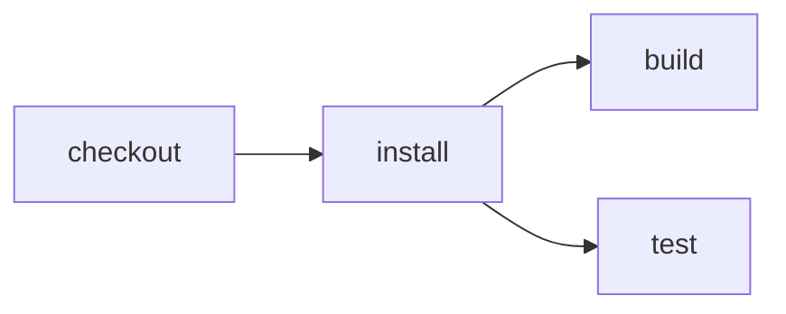

# Walkthrough

Run an app's existing checks. Inspect the graph. Run again. Then choose whether
to use a remote host. No GitHub or Cloudflare setup in the local steps.

> **Prototype.** This is Eric's CI laboratory. Use a disposable repository.
> This walkthrough proves local execution, not trusted signing or hosted reuse.

## 1. Make the CLI available

Node 24.11+ or Node 26+, pnpm, and Git. The CLI is not published. From a clone of
[this repository](https://github.com/ericclemmons/effect-ci-testbed):

```sh
pnpm install
export PATH="$PWD/node_modules/.bin:$PATH"
effect-ci --help
```

Keep this shell open.

## 2. Start a separate app

Copy the supplied Vite+ app into a fresh directory **outside** the Effect CI
checkout, so discovery cannot pick up the laboratory's own workflow:

```sh
cd "$(mktemp -d)"
npx tiged ericclemmons/effect-ci-testbed/examples/demo walkthrough
cd walkthrough
pnpm install
git init
git add .
git commit -m "Start walkthrough"
pnpm dev
```

Open the printed Vite URL. Stop the server with Ctrl-C.
This is one package, not a monorepo. Its scripts are the starting point:

[Package scripts](./package.json#json=scripts "source")

Already have a Node app? Use that instead. Discovery supports conventional
`format`, `lint`, `check`, `typecheck`, `test`, and `build` scripts with npm or pnpm.
[Vite+](../vite-plus-cache) supplies caching here; it is not an Effect CI requirement.

## 3. Inspect before running

```sh
effect-ci list --format=text
```

```text
Workflow: effect-ci-tutorial
Run commands:
  effect-ci run  (whole workflow)
  effect-ci run build
  effect-ci run check
  effect-ci run lint
  effect-ci run test
  effect-ci run typecheck
```

An agent gets structured output from the same command. Preview detection with
`AI_AGENT=demo`:

```sh
AI_AGENT=demo effect-ci list
```

```json
{
  "schemaVersion": 1,
  "ok": true,
  "command": "list",
  "workflow": "effect-ci-tutorial",
  "targets": ["build", "check", "lint", "test", "typecheck"],
  "commands": [
    "effect-ci run",
    "effect-ci run build",
    "effect-ci run check",
    "effect-ci run lint",
    "effect-ci run test",
    "effect-ci run typecheck"
  ]
}
```

Text or JSON is automatic. `--format` overrides it.

```sh
effect-ci plan test build --format=mermaid
```



No commands executed. No workflow written. The plan shows a shared installation
before the two selected goals.

## 4. Run the checks

```sh
effect-ci run test build --format=text
```

Captured output, shortened:

```text
✓ src/message.test.ts (1 test)
...
CI execution summary: effect-ci-tutorial/test+build
Environment: development

✓ checkout
✓ install depends on checkout
✓ build depends on install
✓ test depends on install
```

The CLI runs the existing scripts. Its first local run writes an empty
`.cloudflare/ci/ci.ts` discovery marker, not a generated workflow.

Need custom ordering, branching, or deployment? Add an authored workflow later:
[exported actions](../exported-actions). It replaces script discovery.

## 5. Run again

```sh
effect-ci run build --format=text
effect-ci run build --format=text
```

The supplied app enables Vite+ task caching in its
[task configuration](./vite.config.ts). Vite+ tracks reads and writes; Effect CI
keeps invoking the same script. This does not sign a result or skip the entire CI run.

The previous step warmed the cache, so both commands may hit. Compare these
captured excerpts from a fresh copy. Cold build:

```text
$ vpr build:source
$ vp build
transforming...
✓ 7 modules transformed.
...
CI execution summary: effect-ci-tutorial/build
Environment: development

✓ checkout
✓ install depends on checkout
✓ build depends on install
```

Warm build:

```text
$ vpr typecheck:source
$ vp lint --type-aware --type-check --allow all src ◉ cache hit, replaying
...
$ vpr build:source
$ vp build ◉ cache hit, replaying
...
CI execution summary: effect-ci-tutorial/build
Environment: development

✓ checkout
✓ install depends on checkout
✓ build depends on install
```

The build command was replayed from cache; checkout and installation still ran.
Replayed build logs are not evidence of a second compilation. Timings vary.

Change the greeting and repeat:

```sh
printf 'export const greeting = "Changed greeting";\n' > packages/greeting/message.ts
effect-ci run build --format=text
```

```text
$ vp build ○ cache miss: 'packages/greeting/message.ts' modified, executing
transforming...
✓ 7 modules transformed.
```

The app imports that file through `src/message.ts`. The changed input invalidates
the build even though the entrypoint did not change.
[Cache ownership and limits](../ECOSYSTEM.md#caching-has-separate-owners).

## 6. Run on a host

Optional. Stop here unless an operator has enrolled your pushed repository and
advertised the requested goals. Self-hosting is a [reference](../../apps/effect-ci/README.md),
not a prerequisite for learning the local CLI.

```sh
effect-ci doctor --remote
effect-ci run test build --remote
```

`doctor` checks access without starting work. Remote runs use a pushed commit;
local edits are not uploaded. `--remote` does not turn caching on.

[Signed check reuse](../verification-evidence) needs a trusted host and exact
committed inputs. An ordinary local success does not become trusted evidence
when pushed. Cross-commit reuse is not the default.

## Add one thing

| Problem                                       | Example                                       |
| --------------------------------------------- | --------------------------------------------- |
| Keep GitHub Actions, or receive GitHub checks | [GitHub](../GITHUB.md)                        |
| Keep Turbo's task graph                       | [Turborepo](../turborepo-cache)               |
| Approve a small safe change                   | [Safe-change approval](../small-change)       |
| Keep secrets out of the process               | [Outbound authentication](../secret-outbound) |
| Compare output before deploying               | [Changed output](../deploy-changed-output)    |

[Complete authored example](./tutorial/workflow.ts) · [All recipes](../README.md)
