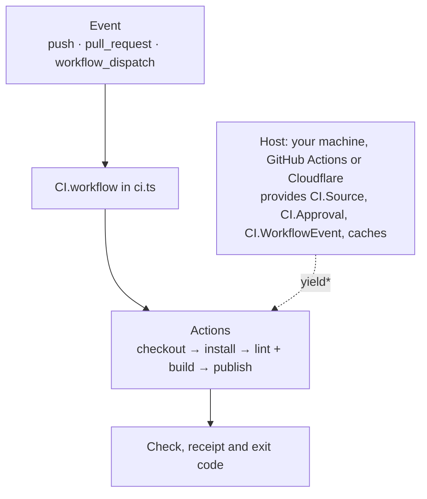

# Walkthrough

Terminal output is excerpted; hosted examples are illustrative. `<…>` values vary.

- [ ] Build a React app and Worker API.
- [ ] Inspect, cache, and run the build on Cloudflare.
- [ ] Write `ci.ts`; skip Markdown-only changes and unchanged output.
- [ ] Deploy with OIDC; notify Slack and gate publication.
- [ ] Lint while you build; publish only from `main`.

## How a run works

An event starts every run. A push, pull request or manual dispatch reaches the
host, which runs your workflow with that event. The workflow asks for
capabilities with `yield*`, such as `CI.Source`, `CI.Approval` and
`CI.WorkflowEvent`, and the host provides them. Your machine, GitHub Actions and
a Cloudflare host each provide their own versions, so the same `ci.ts` runs on all
three.



The steps below provide each capability locally first: `EFFECT_CI_APPROVAL`
answers `CI.Approval`, `EFFECT_CI_EVENT` and `GITHUB_REF` describe the event, and
the [source providers recipe](../source-providers) swaps `CI.Source`.

## 1. Make the CLI available

Prerequisites: Git, Node 24.11+ or 26+, pnpm, Vite+, `gh`, `cf`,
`cloudflared`, and `beautiful-mermaid`.

1. Clone the prototype in your projects directory:

   ```sh
   git clone https://github.com/ericclemmons/effect-ci-testbed.git
   cd effect-ci-testbed
   pnpm install
   export PATH="$PWD/node_modules/.bin:$PATH"
   gh auth login
   ```

2. Confirm the CLI is on your path, then return to your projects directory in
   this shell:

   ```console frame="terminal"
   $ command -v effect-ci
   <source-directory>/node_modules/.bin/effect-ci

   $ cd ..
   ```

- [ ] The CLI is available in this shell.

## 2. Create the app

1. Run:

   ```sh
   vp create cloudflare
   ```

2. Choose **walkthrough → Framework Starter → React → TypeScript → pnpm**.
   Enable Git. Skip deployment.

3. Start the app:

   ```sh
   cd walkthrough
   vp dev
   ```

4. Open the printed URL. Click **Name from API**.

   ```json
   { "name": "Cloudflare" }
   ```

5. Stop the server with Ctrl-C. Commit the starter if needed, then migrate its
   Wrangler configuration for `cf`:

   ```sh
   git add .
   git commit -m "feat: Create the app"
   ```

   ```console frame="terminal"
   $ cf migrate
   Updated 3 file(s):
   ├─ cloudflare.config.ts
   ├─ package.json
   └─ pnpm-lock.yaml
   …
   ✔ Migration complete.

   $ pnpm add -D @cloudflare/vite-plugin@beta
   …
   ```

6. Ignore generated output and local publication state:

   [`.gitignore`](./tutorial/ignore.diff "source")

- [ ] React reaches the Worker API.
- [ ] `cf` configuration preserves the Worker entrypoint and SPA assets.

## 3. Inspect before running

1. Inspect the build without executing it:

   ```console frame="terminal"
   $ effect-ci list
   Workflow: walkthrough
   Run commands:
     effect-ci run build
     …

   $ effect-ci plan build
   CI plan: walkthrough/build
   Environment: development
   …
   ○ checkout
   …
   ○ install depends on checkout
   …
   ○ build depends on install
   …

   $ effect-ci plan build --format=mermaid | beautiful-mermaid ascii
   ┌──────────┐     ┌─────────┐     ┌───────┐
   │          │     │         │     │       │
   │ checkout ├────►│ install ├────►│ build │
   │          │     │         │     │       │
   └──────────┘     └─────────┘     └───────┘
   ```

2. Preview the agent interface:

   ```console frame="terminal"
   $ AI_AGENT=demo effect-ci list
   {
     "schemaVersion": 1,
     "ok": true,
     "command": "list",
     "workflow": "walkthrough",
     …
   }
   ```

- [ ] Human and agent can inspect the same goals without running a build.

## 4. Run the build

1. Build locally before adding a workflow:

   ```console frame="terminal"
   $ effect-ci run build
   $ tsc -b
   …
   $ vp build
   …
   CI execution summary: walkthrough/build
   Environment: development
   …
   ✓ checkout

   ✓ install depends on checkout

   ✓ build depends on install
   ```

- [ ] The app builds locally without an authored CI workflow.

## 5. Cache the build

1. Apply these changes:

   [`package.json`](./tutorial/package.diff "source")

   [`vite.config.ts`](./tutorial/cache.diff "source")

2. Run twice to prove unchanged inputs reuse the build:

   ```console frame="terminal"
   $ effect-ci run build
   …

   $ effect-ci run build
   $ tsc -b ◉ cache hit, replaying
   $ vp build ◉ cache hit, replaying
   …
   ```

3. Change the API response:

   [`worker/index.ts`](./tutorial/worker.diff "source")

4. Run again to prove source edits invalidate the cache:

   ```console frame="terminal"
   $ effect-ci run build
   …
   $ vp build ○ cache miss: 'worker/index.ts' modified, executing
   …
   ```

- [ ] Unchanged inputs reuse the build; source edits invalidate its cache.

## 6. Create a GitHub repository

1. Commit and push:

   ```sh
   git branch -M main
   git add .
   git commit -m "feat: Cache the build"
   gh repo create walkthrough --private --source=. --remote=origin --push
   ```

2. Confirm the repository and pushed commit:

   ```console frame="terminal"
   $ git remote get-url origin
   <repository-url>

   $ git rev-parse HEAD
   <commit>

   $ git ls-remote origin refs/heads/main
   <commit>  refs/heads/main
   ```

- [ ] The app's commit is on GitHub.

<a id="6-run-on-a-host"></a>

## 7. Enroll OIDC and run on a host

Prerequisite: the host's GitHub App is installed on `walkthrough`, and your
account can sign in through its Access policy.

1. Enroll with the current host:

   ```sh
   export EFFECT_CI_REMOTE_URL=https://effect-ci-github-cloudflare.eclemmons.workers.dev
   cloudflared access login --quiet "$EFFECT_CI_REMOTE_URL"
   ```

   ```console frame="terminal"
   $ effect-ci oidc --service "$EFFECT_CI_REMOTE_URL"
   OIDC enabled for <owner>/walkthrough. …
   ```

   ```sh
   git add .cloudflare/ci/oidc.json
   git commit -m "ci: Enroll hosted execution"
   git push
   ```

   ```console frame="terminal"
   $ effect-ci doctor --remote
   Remote access ready. … No workflow started.
   ```

2. Run twice to check remote execution and cache reuse:

   ```console frame="terminal"
   $ effect-ci run build
   Remote Workflow <first-run-id>
   …
   ✓ Workflow completed

   $ effect-ci run build
   Remote Workflow <second-run-id>
   …
   $ vp build ◉ cache hit, replaying
   …
   ✓ Workflow completed
   ```

   A cold host can report a cache miss.

3. Edit the API response without committing. Bypass remote execution:

   ```console frame="terminal"
   $ effect-ci run build --local
   …
   CI execution summary: walkthrough/build
   Environment: development
   …
   ✓ build depends on install
   ```

- [ ] The pushed build runs remotely; the second run reports its cache result.
- [ ] Uncommitted edits build locally with `--local`.

## 8. Open a PR with checks

1. Create `.github/workflows/checks.yml`:

   [`.github/workflows/checks.yml`](./tutorial/checks.example.yml "source")

2. Open the PR:

   ```sh
   git switch -c feat/github-checks
   git add .github/workflows/checks.yml
   git commit -m "ci: Run the build on Cloudflare"
   git push -u origin feat/github-checks
   gh pr create --title "ci: Run the build on Cloudflare"
   ```

3. After the check finishes, inspect its result:

   ```console frame="terminal"
   $ gh pr checks
   …
   ✓  build  <duration>  <run-url>
   ```

- [ ] The PR's pushed commit has a passing remote build check.

This job uses push events; fork PR events are not enrolled.

## 9. Own the workflow

1. Link the SDK from the source clone beside `walkthrough`:

   ```console frame="terminal"
   $ pnpm link ../effect-ci-testbed/packages/ci
   …

   $ node -p "require.resolve('@effect-ci-testbed/ci')"
   <source-directory>/packages/ci/src/index.ts
   ```

2. Add a Node TypeScript scope for the workflow:

   [`.cloudflare/ci/tsconfig.json`](./tutorial/ci.tsconfig.json "source")

3. Replace the discovery marker:

   [`.cloudflare/ci/ci.ts`](./tutorial/ci.exec.ts "source")

4. Inspect your graph, then run its default goal:

   ```console frame="terminal"
   $ effect-ci plan
   CI plan: walkthrough
   …
   ○ build depends on install
   …

   $ effect-ci run --local
   …
   CI execution summary: walkthrough
   …
   ✓ build depends on install
   ```

- [ ] `ci.ts` owns the default build goal.

### Replace shell plumbing with SDK methods

1. Apply:

   [`.cloudflare/ci/ci.ts`](./tutorial/sdk.diff "source")

2. Inspect the detected package manager, then run the same build:

   ```console frame="terminal"
   $ effect-ci plan
   …
   ○ install depends on checkout
     $ pnpm install --frozen-lockfile
   …
   ○ build depends on install
     $ pnpm exec vp run build
   …

   $ effect-ci run --local
   …
   ✓ build depends on install
   ```

- [ ] SDK methods detect pnpm and preserve the build's behavior.

### Skip Markdown-only changes

1. Apply:

   [`.cloudflare/ci/ci.ts`](./tutorial/docs.diff "source")

   [`.github/workflows/checks.yml`](./tutorial/checks.diff "source")

2. Commit the workflow upgrade first:

   ```sh
   git add .
   git commit -m "ci: Skip Markdown-only changes"
   ```

3. Edit only `README.md`, commit, and compare with the previous commit:

   ```sh
   git add README.md
   git commit -m "docs: Update the readme"
   ```

   ```console frame="terminal"
   $ EFFECT_CI_BASE_REVISION=HEAD~1 effect-ci run --local
   CI execution summary: walkthrough
   Environment: development

   $ echo $?
   0
   ```

4. Push the Markdown-only commit:

   ```sh
   git push
   ```

5. Open GitHub Actions. Confirm this commit has no **Effect CI** run.

- [ ] A Markdown-only commit succeeds with zero local actions and no remote dispatch.

Unknown source comparisons run CI.

## 10. Skip unchanged build output

This lesson publishes to a local directory. The shared Cloudflare host has no
successful-deployment baseline adapter yet.

1. Apply:

   [`.cloudflare/ci/ci.ts`](./tutorial/output.diff "source")

2. Run twice to prove identical build output skips publication:

   ```console frame="terminal"
   $ effect-ci run --local
   …
   ✓ build depends on install
   …
   ✓ publish local site depends on build

   $ shasum .effect-ci/deployed-site/current.json
   <receipt-hash>  .effect-ci/deployed-site/current.json

   $ effect-ci run --local
   …
   CI execution summary: walkthrough
   Environment: development
   …
   ✓ checkout

   ✓ install depends on checkout

   ✓ build depends on install

   $ shasum .effect-ci/deployed-site/current.json
   <receipt-hash>  .effect-ci/deployed-site/current.json
   ```

3. Change the API response again. Confirm new output publishes:

   ```console frame="terminal"
   $ effect-ci run --local
   …
   ✓ publish local site depends on build

   $ shasum .effect-ci/deployed-site/current.json
   <new-receipt-hash>  .effect-ci/deployed-site/current.json
   ```

- [ ] Identical output preserves the receipt; changed output publishes once.

## 11. Deploy with temporary credentials

Prerequisite: this host permits deployment to your intended Cloudflare account.
This job deploys independently of the local publication lesson.

1. Add the manual deployment workflow:

   [`.github/workflows/deploy.yml`](./tutorial/deploy.diff "source")

2. Commit, push, and merge the PR. Once `deploy.yml` reaches `main`, run:

   ```sh
   gh workflow run deploy.yml --ref main
   ```

3. After the job finishes, inspect its authentication and cleanup logs:

   ```console frame="terminal"
   $ gh run view --log
   …
   Temporary Cloudflare credentials are available to subsequent steps.
   …
   Temporary Cloudflare token revoked.
   ```

4. Open the deployed URL from the job log. Click **Name from API**.

   ```json
   { "name": "<your-current-API-response>" }
   ```

- [ ] The deployed React app reaches its Worker API.
- [ ] The job uses a temporary token and revokes it on exit.

Token expiry covers interrupted cleanup.

## 12. Add Slack

### Notify the channel

1. Create a Slack incoming webhook. Store it in the repository:

   ```sh
   gh secret set SLACK_WEBHOOK_URL
   ```

2. Append this step to the deployment job:

   [`.github/workflows/deploy.yml`](./tutorial/slack.diff "source")

3. Commit and push. After merge, trigger another deployment:

   ```sh
   gh workflow run deploy.yml --ref main
   ```

4. Open Slack and check the message:

   ```text
   <owner>/walkthrough: success — <GitHub-run-link>
   ```

- [ ] The channel receives the deployment result and its run link.

### Require approval before publication

1. Add the gate to `ci.ts`:

   [`.cloudflare/ci/ci.ts`](./tutorial/approval.diff "source")

2. Change the API response so the build output differs. Reject, then approve locally:

   ```console frame="terminal"
   $ shasum .effect-ci/deployed-site/current.json
   <receipt-hash>  .effect-ci/deployed-site/current.json

   $ EFFECT_CI_APPROVAL=rejected effect-ci run --local
   …
   Error [CI_APPROVAL_REJECTED]: publish local site was rejected

   $ echo $?
   4

   $ shasum .effect-ci/deployed-site/current.json
   <receipt-hash>  .effect-ci/deployed-site/current.json

   $ EFFECT_CI_APPROVAL=approved effect-ci run --local
   …
   ✓ publish local site depends on build

   $ shasum .effect-ci/deployed-site/current.json
   <new-receipt-hash>  .effect-ci/deployed-site/current.json
   ```

- [ ] Rejection blocks publication; approval publishes the changed output.
- [ ] The baseline advances only after publication succeeds.

Live Slack buttons require a host approval adapter with an authorized reviewer
list and verified callbacks. Generic repository runs on this host do not have
that adapter. The webhook above only sends notifications; the local environment
switch previews the gate.

## 13. Lint while you build

1. Add a lint check and run it beside the build:

   [`.cloudflare/ci/ci.ts`](./tutorial/parallel.diff "source")

2. Inspect the graph. Lint and build both wait only for install, and publication
   waits for both:

   ```console frame="terminal"
   $ effect-ci plan
   …
   ○ install depends on checkout
   ○ build depends on install
   ○ lint depends on install
   ○ publish local site depends on build, lint
   ```

3. Change the API response, then run. Both commands start together:

   ```console frame="terminal"
   $ EFFECT_CI_APPROVAL=approved effect-ci run --local
   …
   ✓ build depends on install

   ✓ lint depends on install

   ✓ publish local site depends on build, lint
   ```

4. Introduce a lint error, change the API response again and run:

   ```console frame="terminal"
   $ EFFECT_CI_APPROVAL=approved effect-ci run --local
   …
   Error [CI_COMMAND_FAILED]: Command failed (1): pnpm exec vp lint

   $ echo $?
   1
   ```

   Fix the lint error before continuing.

- [ ] Lint and build run at the same time; install runs once.
- [ ] A lint failure blocks publication.

`lint` is a `CI.check`. A trusted host can skip a check that already passed for the
same commit; see [reuse verified checks](../verification-evidence).

## 14. Publish only from main

The event that started the run is available to the workflow. `CI.when` records the
condition in the plan, so you can see it before anything runs. For a runtime-only
decision, read the event directly with `yield* CI.WorkflowEvent`.

1. Publish only for pushes to `main`:

   [`.cloudflare/ci/ci.ts`](./tutorial/event.diff "source")

2. Inspect the condition:

   ```console frame="terminal"
   $ effect-ci plan
   …
   ○ publish local site depends on build, lint
     if: event in [push] and ref in [refs/heads/main]
     approval: Publish the walkthrough?
   ```

3. Change the API response. Simulate a push to a feature branch, then to `main`:

   ```console frame="terminal"
   $ EFFECT_CI_EVENT=push GITHUB_REF=refs/heads/feat/github-checks EFFECT_CI_APPROVAL=approved effect-ci run --local
   …
   ✓ lint depends on install

   – publish local site depends on build, lint
     if: event in [push] and ref in [refs/heads/main]

   $ shasum .effect-ci/deployed-site/current.json
   <receipt-hash>  .effect-ci/deployed-site/current.json

   $ EFFECT_CI_EVENT=push GITHUB_REF=refs/heads/main EFFECT_CI_APPROVAL=approved effect-ci run --local
   …
   ✓ publish local site depends on build, lint

   $ shasum .effect-ci/deployed-site/current.json
   <new-receipt-hash>  .effect-ci/deployed-site/current.json
   ```

- [ ] A feature-branch push builds and lints but does not publish.
- [ ] A push to `main` publishes.

On GitHub Actions, the runner sets `GITHUB_EVENT_NAME` and `GITHUB_REF`, so no
variables are needed. Local runs without them skip publication.
