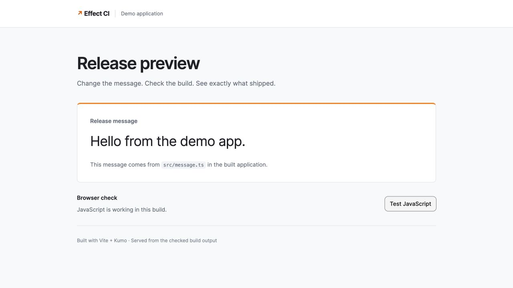

# Corrected real main release — October 16, 2026 UTC

Normal PR306 merge `f240bd06a71fbec1b14a5e1e89b69048cbdeda9e` created native run
`09197290-c92d-11f1-9009-78a9ef81cc07`. Its corrected head `1ae9924` passed all
284 success checks before merge. No special deployment branch, manual Workflow
dispatch, new error, model call or repair replay was used.



The screenshot is the actual immutable **f240bd0** build after its browser button
reported success. It is not a mockup, a video or a retagged capture of a newer run.
Independent readback matched all three build files, production redirect and health
identity while this candidate was committed. The app now uses a genuine Kumo
secondary button without CSP-blocked style attributes. Actual computed styles
showed dark text, a white button background and the intended page layout.

The first browser pass caught blocked styles despite correct bytes; that unstyled
failure stays private. The serving fix permits only exact embedded CSS hashes,
not unsafe-inline, unsafe-hashes, inline scripts, arbitrary style attributes or
network requests. A transient GET/HEAD propagation mismatch was preserved and
resolved with GET-only readback, not another deployment. The later formatting
failure on `d1d4205` also remains errored; the fixed formatter changed only the
reported test file, and the corrected commit obtained its own full CI.

## Native acceptance

- Eleven actions and nine commands completed; the native history has 271 entries
  and no failed steps. Command checkpoints ran once with zero retries. All twelve
  checks tied to this exact Dashboard instance succeeded.
- Each real promotion was followed by the actual phase's optional status update
  **before** its two-minute settling interval. Status did not invent observations
  or expose review controls before a real snapshot existed.
- One maintained Slack root `1792133073.110299`, fifteen maintained replies and
  four private charts retained the latest evidence. Every review control was
  removed after its matching decision.
- Candidate cohorts were 11/18/73/100 with zero observed failures. All verdicts
  stayed **uncertain**. Four normal signed-in browser decisions were explicitly
  delegated TEST risk acceptance, not independent human review or a conclusive SLO.
- Candidate `c16d7b0b-06ee-4e51-9344-cedab110a5b7` committed at 100% in deployment
  `7e6f7275-86d2-4cd5-a245-ded56aa96aef`. The captured prior candidate was
  `24e0ff19-3c7a-4673-b300-cb2bf5374a29`; success did not restore an obsolete baseline.

Asset digest: `8165a25e1670ed567b43c11eee03c622743c9d834d19f639bd3ae99a0cd724cf`.
HTML137898B/app983B/message54B matched native SHA-256 byte identities. The serving
Worker `0797942d-3a46-469f-92d5-cfd8995b4675` and CI host
`7df0880e-9e2e-4972-aa58-4e70a667b3d2` retained their exports, bindings, secrets,
URLs and container image. This work did not write a signer key/note, repair resource
or AI ledger, or invoke inference.

```sh
LIVE_POLISHED_RELEASE=1 CF_BIN=apps/effect-ci/node_modules/.bin/cf \
  node --test apps/effect-ci/src/live-polished-release.test.ts
```

GET-only historical acceptance. Add `LIVE_POLISHED_RELEASE_CURRENT=1` only while
this is the currently committed deployment; a legitimate newer main release must
not invalidate its immutable history. Do not rebuild, redispatch or approve an old
operation to refresh proof. Slack screenshots and full capabilities remain private.
