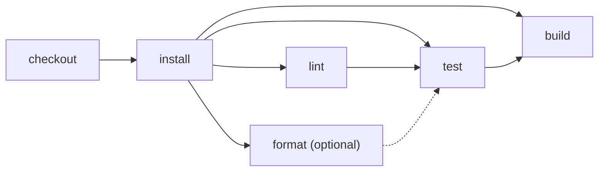

# Rerun only affected checks

> If one action is rerun, which successful actions can Effect CI safely reuse?



---

Effect CI derives dependencies from actions yielding other actions. It reruns the
requested action and everything that consumed it, while preserving unrelated siblings.
Plain sequencing controls order without pretending that the later action consumed the
earlier action's output.

Run the workflow locally:

```sh
pnpm cf-ci --workflow examples/dependency-aware-reruns/.cloudflare/ci/workflow.ts
```

The rerun-selection assertions live separately in
[`ci/tests/dependency-aware-reruns.test.ts`](./.cloudflare/ci/tests/dependency-aware-reruns.test.ts).

The example proves these cases:

- rerun `test` → rerun `test` and `build`; reuse `lint` and `format`
- rerun `install` → rerun all checks and `build`; reuse `checkout`
- rerun optional `format` → rerun only `format`

The main recipe demonstrates the selection primitive. See
[`immutable-attempts`](../immutable-attempts) for creating a new attempt, restoring
reusable node outputs, and executing the selected subgraph without changing history.

### Source and checkpoint fixture

```sh
node --test examples/dependency-aware-reruns/verification/source-rerun.test.ts
```

The [owned fixture](./verification/source-rerun.test.ts) reads pinned public Git
commits and executes real Node commands. Missing commits are fetched read-only.

| Change | Execute | Reuse |
| --- | --- | --- |
| Left input | left, bundle | right |
| Missing right checkpoint | right, bundle | left |
| Nothing | — | all |
| Tampered bundle checkpoint | bundle | left, right |
| Program or runtime flags | all | — |

A full rerun checks the same output. Logs retain reasons, source revisions,
checkpoint lineage and signed observations. Inputs are explicit for this small
program; this is not automatic input discovery. Snapshots are owned filesystem
copies, not Cloudflare snapshots. Signing keys are ephemeral fixture keys, not a
deployed issuer. GitHub execution proof is pending CI; matrix cells stay unchanged.

## Verification proof

**Video:** Pending.

**Measured results:** Pending.

[Proof requirements](../PROOF-PAGES.md) · [Backend coverage](../../README.md#recipes-by-feature).
