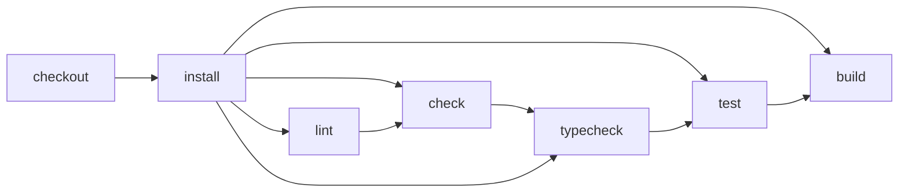
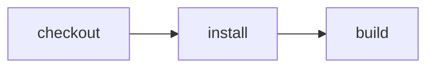

# Demo: check changes before pushing

> Can a human and an agent use one CI command without writing a workflow or
> repeating a task whose inputs have not changed?

Composition recipe: [zero-config discovery](../zero-config) +
[Vite+ task caching](../vite-plus-cache). Continue to
[verification evidence](../verification-evidence) when the result must be attested.



---

For copyable commands, expected output, and spoken narration, use the
[step-by-step talking script](./TALKING-SCRIPT.md). The diagram is the inferred
suite's execution order, not a declaration of Vite task prerequisites. Direct
`cf-ci run build` runs build's setup and package lifecycle hooks, not the whole suite.

The demo starts without a CI marker or custom Effect workflow. Bare `cf-ci`
shows help and inferred targets. `cf-ci list` and `cf-ci plan --format=mermaid`
inspect ordinary package scripts without creating files. The first explicit
`cf-ci run` creates an empty, ignored `.cloudflare/ci/ci.ts` marker and executes
the whole inferred workflow; `cf-ci run build` selects only the build target.
There is no input glob or output manifest. Vite configuration
selects the library entrypoint, lint rules, and cached task bodies.
Ordinary package scripts expose those tasks and their lifecycle hooks; Effect CI discovers
`check`, `lint`, `typecheck`, `test`, and `build`, installs dependencies, and
invokes those scripts.

```json
{
  "check": "vpr check:source",
  "lint": "vpr lint:source",
  "typecheck": "vpr typecheck:source",
  "pretest": "vpr typecheck",
  "test": "vpr test:source",
  "prebuild": "vpr typecheck && vpr lint",
  "build": "vpr build:source"
}
```

The wrapper scripts call distinct tasks in `vite.config.ts`, with `cache: true`
on each task. No package script needs a cache flag or recursively calls itself.
The task bodies are Vite+'s built-in linter and builder, not custom programs.
`no-undef` is explicitly an error in `vite.config.ts`, so a bare `asdf` fails lint
even though it is valid JavaScript syntax. Plain `vp lint` discovers the project
files without a directory argument. This example keeps its source in `src/`.
The config excludes the generated `dist/` output and empty `.cloudflare/` CI marker.

`check` runs formatting and lint only. `typecheck` uses the TypeScript checker
through Vite+'s lint driver with lint rules disabled. `tsconfig.json` enables
`allowJs` and `checkJs` for `src/`, so the JavaScript source and tests get static
type checking without conversion to TypeScript. `test` requires type checking;
`build` requires type checking and lint, but not formatting or test execution.
`pretest` and `prebuild` express these prerequisites as package lifecycle hooks.
Vite+ caches each configured task independently. A failed prerequisite prevents
its dependent command from running. Run `cf-ci run build`, `npm run build`, or
`vpr build` to include the hook; bare `vp build` invokes only the built-in bundler.
Type-check flags stay in the configured `typecheck:source` task rather than global
`lint.options`, because enabling them globally would also type-check `check`.

The test checks that the exported message is a non-empty string, not a particular
sentence, so the human and agent can change the message during the demo.

This example joins [zero config](../zero-config) and [Vite+ caching](../vite-plus-cache)
into a developer loop. Vite+ owns cache validity and output restoration. Effect CI
owns discovery, planning, execution, and human/agent result formatting. A cache hit
is not signed verification evidence.

Local text output preserves tool colors when the terminal supports them, including
Vite+ cache replay. `NO_COLOR`, `NODE_DISABLE_COLORS`, and explicit `FORCE_COLOR`
settings are respected. Redirected output does not automatically enable colors,
and JSON output remains separate from command logs.

## Hosted browser transport (development boundary)

The recorder still defaults to local Chromium. The owned
[CDP relay](./verification/cdp-relay.mjs) is a tested building block for a
future authenticated Kitesurf browser provider, not an enabled hosted recipe.
It accepts an explicit **trusted host** authorization callback only after checking
the exact Cloudflare account and browser session endpoint. It gives the browser
engine a random, loopback-only WebSocket capability; the bearer token stays in
the upstream TLS handshake, never in the page or returned endpoint.

The listener expires within 60 seconds, closes on cancellation, rejects page
Origins and concurrent clients, bounds buffered traffic, and refuses redirects.
Its tests use real loopback WebSockets with inert credentials, not a Cloudflare
session. An owning provider must still create/delete its remote session on every
exit path and retain a server-side expiry if the host crashes. Do not publish
the temporary CDP capability in verification reports or supply personal OAuth
credentials to hosted Workers or project containers. A maintained session/auth
adapter and same-run hosted recording remain pending.

```sh
node --test verification/cdp-relay.test.mjs
```

## Set up once

Use Node 24.11+ or Node 26+. From the testbed repository root:

```sh
pnpm install
export PATH="$PWD/node_modules/.bin:$PATH"
cd examples/developer-loop
cf-ci
cf-ci list
cf-ci plan --format=mermaid
```

No `--workflow` flag is needed. Start in this package directory for marker-free
inference. After the first explicit run creates the marker, discovery walks up
and also works inside `src/`. The PATH setup exposes the workspace's CLI once;
there is no package-manager prefix on subsequent CI commands.
The product command is `cf-ci`, not yet `cf ci`.

## Human demo

1. Run `cf-ci run` for the full workflow, or `cf-ci run build` for just the build
   target and prerequisites. Human terminals default to readable text.
2. Run the build again. Look for Vite+'s `cache hit` output. Do not use replayed
   build output as proof that the build executed again.
3. Delete only the generated `dist/message.js` and rerun the build. Vite+ should
   restore the output from cache.
4. Change a sentence in this README and rerun the build. It does not read this
   README, so the build should remain a hit.
5. Change the string in `src/message.js`, without committing or pushing. Rerun
   lint and build. The changed source should invalidate both tasks; inspect
   `dist/message.js` to see the new string. An immediate repeat should hit.
6. Add a bare `asdf` line to `src/message.js`. Run lint with `--agent`:
   it must return `ok: false` and a nonzero exit code. Rerun with `--format=text`
   to see the undefined-variable diagnostic, remove that line, and rerun.

Compare total command times with `time`, keeping dependencies and task scope the
same. Do not promise a speedup: this deliberately tiny build may be faster to
execute than to validate. The point is visible reuse, correct invalidation, output
restoration, and no push required—not an artificial slow task.

Every inferred invocation still runs an installation action. Cache hits skip the
Vite+ task body, not installation or the CLI. Output replay is tool-owned reuse,
not a `CI.check` signed-evidence hit. Environment, network, time, and other inputs
that filesystem observation cannot capture need a separate tracking policy.

## Agent demo

Compare `cf-ci list` with `cf-ci list --agent`, or `cf-ci run build` with
`cf-ci run build --agent`. These execute the same workflow; the flag deterministically
selects machine-readable JSON. Otherwise am-i-vibing detects direct-agent environment
signals, with process scanning disabled. Explicit `--format` overrides either mode.

Give the agent this task:

> Change the exported message to "Checked before pushing". Discover the available
> CI targets, inspect the lint plan, then run lint, test, and build with JSON output.
> Fix any failure and rerun. Confirm the generated artifact contains the new
> message. If committing is authorized, commit the intended changes and verify that
> exact revision before attaching signed evidence. Do not push without authorization.

The agent uses the same entrypoint as the human:

```sh
cf-ci list --format=json
cf-ci plan lint --format=json
cf-ci run lint --format=json
cf-ci run test --format=json
cf-ci run build --format=json
```

JSON mode suppresses command logs so stdout remains a structured CLI result.
The current local executor does not include linter diagnostics in a JSON
failure; rerun the failed target in text mode to read them. Use text mode to show
Vite+ cache diagnostics. An `ok: true` result means this
target succeeded, not that every possible check passed. Here `lint` runs Oxlint
with undefined identifiers treated as errors. `build` first checks types and
lint, then bundles the source into an ES module at `dist/message.js`. Run
`cf-ci run check` for formatting/lint and `cf-ci run test` for behavioral tests.

Working-file checks provide feedback, not reusable proof for old `HEAD`. Commits do
not need to wait for checks to pass: an authorized agent can commit, run checks,
fix failures in a new commit, then attest the passing revision with a signed Git
note. See [verification evidence](../verification-evidence#commit-first-then-attest)
for that separate contract; no dirty-tree attestation handoff is needed.

## GitHub checks

The root E2E workflow includes this discovered entrypoint in the existing
Effect-on-GitHub matrix. Its plan and execute jobs use the shared runner and
existing GitHub App reporter. No new App, secret, deployment, or hosted Worker is
required. This example does not claim Cloudflare zero-config hosting coverage.

The local plan/execute matrix runs the same example. The conventional
[GitHub workflow](./.github/workflows/github.yml) runs these identical package
scripts directly and is included in the native comparison matrix. Its caching
comes from Vite+ too; the difference is the portable CI entrypoint and result
contract, not a faster underlying build algorithm.

At source `b5e2a663aeef5e87a993001ea446e000a2447584`, all five developer-loop
jobs in [the full E2E run](https://github.com/ericclemmons/effect-ci-testbed/actions/runs/37958032547)
passed: conventional GitHub Actions, local plan/execution, and Effect-on-GitHub
plan/execution. Hosted Cloudflare zero-config execution remains unverified.

## Verification proof

### Record the local user journey

After installing dependencies, **commit the recipe first**, then run:

```sh
npm run verify:browser
npm run verify:browser -- --negative
```

The recipe owns its preview, browser config and test fixtures. The first command
runs the real `cf-ci run build`, opens its generated module in a fresh local
Chromium context, clicks **Show message**, and asserts a nonempty visible result.
The second deliberately uses a wrong expectation: it must retain a failed E2E
outcome and failed-run video. The verification wrapper succeeds only when that
expected negative outcome is preserved; it does not relabel the application test.
No agent steps/model calls or signed-in account pages are involved.

Both retain separate, uniquely named ignored `.e2e/` recordings/traces (reruns do
not replace prior media) and a create-only `.verification/`
manifest: exact commit, scenario, expected/actual outcome, real browser/runner,
independently timed build/browser processes, observed warm-input conditions and
media SHA256. Source changes during the run fail verification. The preview binds
only loopback and refuses to reuse an unrelated existing server. First use may
download the framework's official Chromium binary.

These are **local, quarantined outputs**, not hosted Cloudflare proof, signed
attestation or an automatic public upload. The framework marks videos as
redaction-incomplete; review captured content and validate playback before
publication. Timing is one observed sample, not a benchmark or assumed cache hit.
Kitesurf remains a separate compatibility probe, not a silent fallback.

To review an existing capture without rerunning CI or the browser:

```sh
npm run proof:preview -- <recorded-run-UUID>
```

This validates the report's actual assertions, outcome, timing and video digest,
then creates `.verification/<run-UUID>.md` with the selected command's generated
plan, same-run video/transcript links and raw timings. It refuses to overwrite an
existing review. Failed tests stay labelled failed; unknown queue/wait times stay
unknown. Open that Markdown file locally to inspect the footage and transcript.
It neither uploads media nor edits this README, and it does not certify redaction,
playback or signed trust. Publish only after those separate reviews.

**Video:** [Local browser recording + original manifest and assertion transcript](https://github.com/ericclemmons/effect-ci-testbed/releases/tag/proof-developer-loop-4ebc193).
The WebM shows the actual generated build preview, click and visible assertion;
it does not show the CLI or a hosted deployment. Footage is unedited and was
played through to completion and reviewed before publication. It is deliberately
small: a proof of interaction, not a polished Friday demo recording.

**Measured results:** [Published capture receipt](./verification/published/local-4ebc193.json),
historical source [`4ebc193`](https://github.com/ericclemmons/effect-ci-testbed/commit/4ebc193aba8b828b87bff44b6328e860583d8dea),
recorded October 13, 2026 — **not a latest-HEAD badge**.

Recorded command's plan (from that same-run manifest, not the full inferred suite):



| Environment                  | This recorded result                                    | Observed timing                                                               |
| ---------------------------- | ------------------------------------------------------- | ----------------------------------------------------------------------------- |
| Effect CI Local              | Build + browser assertion passed                        | Build process 1286 ms; browser process 1436 ms; total recorder window 2860 ms |
| GitHub Actions               | Historical checks linked above; no browser capture here | Not measured by this recording                                                |
| Effect CI GitHub             | Historical checks linked above; no browser capture here | Not measured by this recording                                                |
| Hosted Cloudflare / Kitesurf | Not verified by this capture                            | Unknown                                                                       |

One sample on Node 26.8.2 / darwin arm64, e2e 0.19.0 / web 0.14.0,
Chromium 153.0.8010.12. Dependencies and a prior build artifact were present;
cache hits were not independently measured. Queue and decision waits are unknown,
not zero. Timing includes process startup/cleanup and is not a speedup benchmark.

The original manifest retains recording-time quarantine/redaction-incomplete
labels; the separate receipt documents the capture-specific agent content review.
The positive video is public. The intentional negative capture stays local with
its actual failed assertion and is not falsely presented as a successful test.
Assets have pinned SHA256 values; GitHub release immutability is **not** enabled,
so the links alone do not guarantee the files cannot be replaced. This is unsigned
explanatory evidence, not attestation or permission to skip CI.

Run `npm run proof:verify-published` to check the public tag/source, release asset
metadata, downloaded bytes/digests and original manifest against the receipt.
This is an explicit read-only network check; normal unit tests do not fetch media
or dispatch CI. Missing/replaced media and source drift fail verification rather
than silently refreshing the proof. It does not recertify playback or privacy.

Use the [proof-page contract](../PROOF-PAGES.md) for exact revision/environment,
assertions, video/transcript, outcome and cold/warm timings. See the
[coverage matrix](../../README.md#recipes-by-feature) for current backend support.
