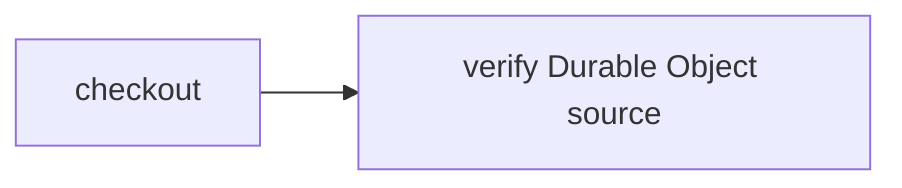

# Checkout from a Durable Object

> How do I run CI against an immutable Durable Object source revision without handing the storage binding to the container?



The same `CI.Source` actions used by the [source-provider](../source-providers)
recipe receive a workspace, not a storage client. The host reads a SHA-256-pinned
regular-file manifest over RPC, verifies the exact bytes, materializes them into
the workspace, then checkpoints it. A separate downstream check restores that
checkpoint and reads `source.txt`. Compare [R2 source](../r2-source) for the same
input boundary with object storage; [portable artifacts](../portable-artifacts)
instead publishes build outputs.

`SourceRevisions` is a host-only SQLite Durable Object with `put(revision, bytes)`
and `get(revision)`. Writes are create-only; identical replay is idempotent.
There is no mutable `latest`, overwrite, delete, public HTTP writer, or source
binding in the container. Every read verifies its content address, including
persisted storage corruption. A transaction bounds each object to 32 revisions.
The shared manifest validator rejects traversal, links, conflicting paths,
noncanonical base64, and manifests over 96 KiB encoded / 64 KiB decoded / 1,000 files.

## Owned private deployment

This directory owns [config](./cloudflare.config.ts), [native wrappers](./src/worker.ts),
[fixed fixture](./src/fixture.ts), [minimal image](./Dockerfile), and
[standalone actions](./.cloudflare/ci/standalone.ts). It imports the public
`@effect-ci-testbed/cloudflare/durable-source` package, not another app's implementation.
The SQLite namespaces are private Worker exports selected by host code via
`ctx.exports`, never container environment bindings.

The normal Workflow accepts exactly the fixed repository `owned-source` and
revision `c79e699009991bf593f593ae81b03241c6de16447d4598ba66bee96d8b2eeed9`.
It seeds those host-authored bytes, copies a plain write receipt before checkpointing,
then reads and validates the stored bytes before materialization. Downstream actions
automatically restore the checkout snapshot and run a fixed Node byte/hash check.
Both actions return their workspaces to commit and release the containers.
This is a **container-backed source materializer**, not containerless build/deploy.

A second authenticated Workflow accepts only `{ "mode": "verify-owned-boundaries" }`.
It fills a separate fixed capacity-fixture object to 32 revisions, verifies replay
still works and rejects mismatched content/overflow. A **different SQLite class and
object** intentionally corrupts its own fixed record once and verifies read rejection.
That isolated corruption fixture has no caller-selected key, bytes, target or reset;
the normal immutable source class has no corruption method. No public writer exists.
These are explicit verification fixtures, not claims that damaged source is healthy.

Local checks (workspace packages are still private/unpublished):

```sh
CI=true pnpm_config_pm_on_fail=ignore pnpm install --frozen-lockfile
node --test examples/durable-object-source/src/runtime.test.ts
examples/durable-object-source/node_modules/.bin/tsc -p examples/durable-object-source/tsconfig.json
node packages/cli/src/bin.ts run --workflow examples/durable-object-source/.cloudflare/ci/standalone.ts --format=json
```

The local CLI uses filesystem bytes, not DO storage. The local integration test
uses actual Workflow/SQLite RPC bindings for bounds, replay, reload and corruption;
it does not run a native container. Fresh standalone native evidence is pending.

Before deployment, confirm `effect-ci-durable-source`, both Workflow names below,
and container application `effect-ci-durable-source-workspace` are absent; stop on
existing resources. Build/deploy exact committed source with authenticated `cf`:

```sh
cf workers deployments list --worker effect-ci-durable-source --per-page 1
cf containers applications list --name effect-ci-durable-source-workspace
cd examples/durable-object-source
cf build
cf deploy --prebuilt
cf workflows instances create effect-ci-durable-source-checks --body '{"instance_id":"my-owned-do-source-first","params":{"repository":"owned-source","revision":"c79e699009991bf593f593ae81b03241c6de16447d4598ba66bee96d8b2eeed9"}}'
cf workflows instances get my-owned-do-source-first --workflow-name effect-ci-durable-source-checks
cf workflows instances create effect-ci-durable-source-checks --body '{"instance_id":"my-owned-do-source-replay","params":{"repository":"owned-source","revision":"c79e699009991bf593f593ae81b03241c6de16447d4598ba66bee96d8b2eeed9"}}'
cf workflows instances create effect-ci-durable-source-boundaries --body '{"instance_id":"my-owned-do-source-boundaries","params":{"mode":"verify-owned-boundaries"}}'
cf workflows instances get my-owned-do-source-boundaries --workflow-name effect-ci-durable-source-boundaries
```

The first normal run should return `seed.created:true`, the replay `false`, with
the same digest and downstream byte hash. Source seed/read, boundary checks and
commands have retry limit zero; ordinary snapshot transport retains its policy.
After an ambiguous ACK inspect the existing resource/history; never blindly retry
creation or reset immutable state to repeat a first-write claim.

The operator needs existing account authorization for Workers, Workflows, SQLite
Durable Objects and Containers; no new account scope, credentials, GitHub App,
AI or Slack integration is needed. The private Worker has no environment secrets,
public workers.dev/preview URL, execution route or writable HTTP source endpoint.
Costs include Workflow steps, SQLite storage/operations, snapshots, image storage
and short-lived `standard-1` container runtime. The two-action wrapper releases
each container; it is not a promise of free execution.

Optional cleanup requires explicit owner approval and retained evidence first.
In Cloudflare's dashboard remove only these two owned Workflows, the owned Worker,
its three SQLite namespaces (workspace, source, isolated corruption), container
application and snapshots. Never delete shared example storage or old histories
to hide failures. No deletion/reset operation is part of the normal recipe.

## Historical shared-host proof

The administrative shared demo Workflow seeds only a fixed, tiny source manifest into
object `demo-source`; unknown object IDs or revisions fail before seeding.
General producers can use the RPC writer from trusted host code, not untrusted
container/project code. This is source storage, not arbitrary filesystem checkout.

Local filesystem variant (not proof of the DO provider):

```sh
pnpm cf-ci --workflow examples/durable-object-source/.cloudflare/ci/workflow.ts
```

Real SQLite/RPC adapter test (local Workers runtime):

```sh
node --test apps/example-runner/src/durable-source-runtime.test.ts
```

After deploying the [example host](../../apps/example-runner) with `cf deploy`,
dispatch its authenticated native Workflow:

```sh
cf workflows instances create effect-ci-example-durable-source --body '{"instance_id":"my-do-source-run","params":{"repository":"demo-source","revision":"c79e699009991bf593f593ae81b03241c6de16447d4598ba66bee96d8b2eeed9"}}'
```

The reference is `{ kind: "durable_object", id, revision }`; parameters retain
the portable `repository`/`revision` shape. The demo manifest's SHA256 pins the
exact canonical bytes produced by [the host](../../apps/example-runner/src/durable-source.ts).
Hosted run `coverage-do-source-20261012-1`, Workflow version
`836817de-4c45-44fc-9975-3368e9998fea`, host deployment
`9ec15a33-51b4-402a-a221-cf4597a60a6e`, completed the real DO seed/read,
materialization and checkpoint `94e936dc-b227-4717-817c-a7b21668a24e`. The separate
downstream native read restored `source from durable object`. Local SQLite/RPC
tests and the local filesystem recipe also passed. GitHub columns remain
unverified until their actual jobs pass. No notification is sent by this recipe.

## Verification proof

**Video:** Pending — no same-run recording has been published for this recipe.

**Measured results:** Pending — no structured per-environment timing summary has
been published here. Existing recorded runs and coverage claims remain as documented;
missing media or measurements do not imply those runs failed or were never verified.

Use the [proof-page contract](../PROOF-PAGES.md) for exact revision/environment,
assertions, video/transcript, outcome and cold/warm timings. See the
[coverage matrix](../../README.md#recipes-by-feature) for current backend support.
