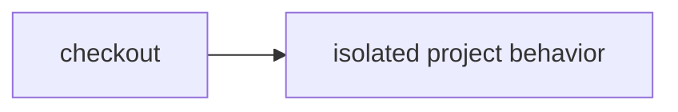

# Execute untrusted project modules without a container

> How do I check a project's HTTP behavior in an isolate without giving its code host capabilities?



Builds on [the source formatter](../dynamic-worker-checks), but executes the
project's own multi-module ESM handler, not just a trusted tool processing text.
The trusted runner retrieves two immutable source files and asserts HTTP status
and bounded body values. Only the code and synthetic credential-free requests
enter the child. Source never executes in the parent Worker or Node.

Each assertion gets a fresh `WorkerLoader.load` isolate with empty bindings,
`globalOutbound: null`, no requested compatibility flags, 50 ms CPU and zero subrequests.
The host bounds the manifest to 16 modules / 64 KiB, assertions to 16, each response
to 4 KiB, and waiting to five seconds. The deadline aborts the request; it is not a
claim of a general-purpose isolate kill API or independent memory quota.
There are no container commands, workspace snapshots, npm installs, or credential
fallback. This deliberately supports Worker-compatible JavaScript only—not
arbitrary Node/Vitest, native binaries, or Vite+ compatibility.

The fixture checks a local module import, an unknown route, empty child bindings,
and denied HTTPS. Host assertions determine success, not an untrusted "passed"
payload. Failed response bodies and exception text are not copied into host
diagnostics. A project can still tailor its behavior to a test: these checks are
behavioral evidence, not proof that arbitrary malicious code is honest.

## Run and verify

Deploy [the example host](../../apps/example-runner), then create an
`effect-ci-example-dynamic-project` instance with `repository` (GitHub URL) and
`revision` (full immutable commit SHA). No extra secrets or permissions are needed.
Normal runs do not send Slack notifications.

Local real-workerd boundary tests:

```sh
node --test apps/example-runner/src/dynamic-project-runtime.test.ts
```

These execute actual child modules, HTTPS/TCP denial, parent-binding isolation,
locally unsupported Node filesystem imports, oversized output and failing behavior. They
are not evidence of hosted CPU enforcement. Hosted execution and hostile CPU proof
are pending; the coverage matrix must not mark those verified before real runs.

The hosted runtime may resolve a Node built-in even without requested Node flags;
import rejection is not a portable security promise. The administrative hosted
probe instead checks that native host files are inaccessible. This does not promise
that Worker virtual filesystems are absent or that every Node package works.
