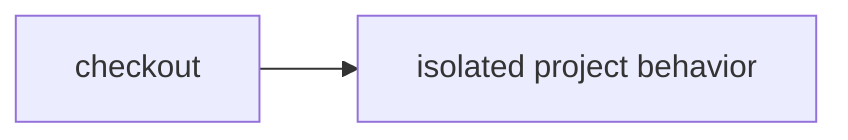

# Test untrusted code without a container

> How do I check a project's HTTP behavior in an isolate without giving its code host capabilities?



Builds on [the source formatter](../dynamic-worker-checks), but executes the
project's own multi-module ESM handler, not just a trusted tool processing text.
The trusted runner retrieves two immutable source files and asserts HTTP status
and bounded body values. Only the code and synthetic credential-free requests
enter the child. Source never executes in the parent Worker or Node.

Each assertion gets a fresh `WorkerLoader.load` isolate with empty bindings,
`globalOutbound: null`, no requested compatibility flags, 50 ms CPU and zero subrequests.
The host bounds the manifest to 16 modules / 64 KiB, assertions to 16, each response
to 4 KiB, and waiting to five seconds. The deadline aborts the request; it is not a
claim of a general-purpose isolate kill API or independent memory quota.
There are no container commands, workspace snapshots, npm installs, or credential
fallback. This deliberately supports Worker-compatible JavaScript only—not
arbitrary Node/Vitest, native binaries, or Vite+ compatibility.

The fixture checks a local module import, an unknown route, empty child bindings,
and denied HTTPS. Host assertions determine success, not an untrusted "passed"
payload. Failed response bodies and exception text are not copied into host
diagnostics. A project can still tailor its behavior to a test: these checks are
behavioral evidence, not proof that arbitrary malicious code is honest.

## Owned containerless deployment

This directory owns [config](./cloudflare.config.ts), [Workflow wrapper](./src/worker.ts),
[closed hostile probes](./src/boundaries.ts), the two project modules, and Vite setup.
It imports reusable packages only, not another app/example implementation. There
is no Container definition/image, Durable Object workspace, snapshot or shell executor.

The normal native Workflow accepts exactly `{ "mode": "fixture" }`. The two
owned project files are bundled as **raw source strings**, never imported into the
parent as executable modules. The unchanged portable actions pass them to the
existing isolated `ProjectChecks` service. No actor-selected module, destination,
repository, credential or policy is accepted by this fixed verification host.
This is a working fixture host, not custom authored remote-workflow upload parity.

The separate boundary Workflow accepts only `{ "mode": "verify-boundaries" }`.
It runs owned fixed modules for HTTPS/TCP denial, empty bindings, fresh globals,
inaccessible host files, wrong response, oversized response and a CPU loop. The
exact loop module must first return a valid preflight response; prompt rejection
must occur before the five-second request deadline. This is not a measured CPU
usage result or a general-purpose isolate kill/memory-quota API.

Local checks:

```sh
CI=true pnpm_config_pm_on_fail=ignore pnpm install --frozen-lockfile
node --test examples/dynamic-project-checks/src/ownership.test.ts apps/example-runner/src/dynamic-project-runtime.test.ts
examples/dynamic-project-checks/node_modules/.bin/tsc -p examples/dynamic-project-checks/tsconfig.json
```

The real local workerd test exercises the reusable isolation service, not this
new native deployment or hosted CPU enforcement. Plain local CLI execution still
does not silently substitute Node for the ProjectChecks service.

Before creating anything, confirm Worker `effect-ci-project-checks` and both
Workflow names below are absent; stop on an existing resource. With existing
authorized Workers/Workflows/WorkerLoader access:

```sh
cf workers deployments list --worker effect-ci-project-checks --per-page 1
cf workflows instances list --workflow-name effect-ci-owned-project-checks
cf workflows instances list --workflow-name effect-ci-owned-project-boundaries
cd examples/dynamic-project-checks
cf build
cf deploy --prebuilt
cf workflows instances create effect-ci-owned-project-checks --body '{"instance_id":"my-owned-project-positive","params":{"mode":"fixture"}}'
cf workflows instances get my-owned-project-positive --workflow-name effect-ci-owned-project-checks
cf workflows instances create effect-ci-owned-project-boundaries --body '{"instance_id":"my-owned-project-boundaries","params":{"mode":"verify-boundaries"}}'
cf workflows instances get my-owned-project-boundaries --workflow-name effect-ci-owned-project-boundaries
```

This private Worker has only `LOADER`, no secrets, public workers.dev/preview URL,
HTTP execution route, storage binding, GitHub App, Slack, AI or release connection.
Source/check/probe checkpoints have zero retries. Inspect existing resources and
histories after an ambiguous ACK; never blindly rerun a create/deploy or reset a
failed probe. Costs are Workflow steps, parent Worker and WorkerLoader child time,
not Container runtime. No new account permission or paid provider is needed.

Optional cleanup requires explicit owner authorization and retained evidence first.
Use Cloudflare's dashboard to remove only these two owned Workflows and this Worker;
there is no Container or SQLite namespace to remove. Preserve shared example
resources and original histories. Fresh standalone native proof is pending.

## Historical shared-host setup

Deploy [the example host](../../apps/example-runner), then create an
`effect-ci-example-dynamic-project` instance with `repository` (GitHub URL) and
`revision` (full immutable commit SHA). No extra secrets or permissions are needed.
Normal runs do not send Slack notifications.

Local real-workerd boundary tests:

```sh
node --test apps/example-runner/src/dynamic-project-runtime.test.ts
```

These execute actual child modules, HTTPS/TCP denial, parent-binding isolation,
locally unsupported Node filesystem imports, oversized output and failing behavior. They
are not evidence of hosted CPU enforcement. Plain `cf-ci run` has no implicit Node
fallback for this service; use the example host (or its local `cf dev` explorer).
The local matrix cell remains pending a native local Workflow run, not merely the
workerd test harness.

The hosted runtime may resolve a Node built-in even without requested Node flags;
import rejection is not a portable security promise. The administrative hosted
probe instead checks that native host files are inaccessible. This does not promise
that Worker virtual filesystems are absent or that every Node package works.

## Historical shared-host evidence

`coverage-dynamic-project-20261012-3` completed on immutable source
`baac78ba496d07baf71e0b8962c935d4aa12abab`: both CI actions completed, all four
HTTP assertions passed, and no commands, secrets or container snapshots appeared.
Native history contains only the two bounded source reads and the child check step.

`coverage-dynamic-boundary-20261012-3` completed seven native probes on host
deployment `f01f54a7-e6f0-45cd-b442-7dfba09153d2` (code `48e0a74dcdc1434a2b2b9548131219061963b855`):
HTTPS/TCP denied, empty bindings, fresh globals, inaccessible `/proc/self/environ`,
wrong body and oversized output rejected, and an infinite loop promptly rejected
under the 50 ms CPU policy. The exact loop module first returned a successful
preflight response, so import/compile failure cannot count as that proof. Recorded
wall-clock rejection is not a measurement of CPU milliseconds or a memory quota.

Read-only assertions (do not redispatch these histories):

```sh
LIVE_DYNAMIC_PROJECT=1 CF_BIN=cf node --test apps/example-runner/src/live-dynamic-project.test.ts
```

Earlier runs remain intact: `coverage-dynamic-project-20261012-1` rejected a CLI
string-encoded payload before any steps; `cf_ab1a19fac50511d6851b3588d862a152595c092b692f182243204d7709e00b46`
was stopped after exposing unsupported `redirect: "error"` in the edge runtime.
The source fetch now uses `manual` and rejects non-OK responses without following
redirects. Boundary run `-1` exposed the Node import difference; `-2` completed but
did not yet have the loop preflight guard. None of these superseded histories was
silently rewritten or counted as the final guarded proof.

Use the CLI's raw JSON body to preserve an object payload (`--params` in the current
installation encodes it as a string):

```sh
cf workflows instances create effect-ci-example-dynamic-project --body '{"instance_id":"YOUR_NEW_RUN_ID","params":{"repository":"https://github.com/YOUR_ORG/YOUR_REPO","revision":"YOUR_FULL_COMMIT_SHA"}}'
```

Choose a new instance ID and a commit containing this recipe's two project files.

## Verification proof

**Video:** Pending — no same-run recording has been published for this recipe.

**Measured results:** Pending — no structured per-environment timing summary has
been published here. Existing recorded runs and coverage claims remain as documented;
missing media or measurements do not imply those runs failed or were never verified.

Use the [proof-page contract](../PROOF-PAGES.md) for exact revision/environment,
assertions, video/transcript, outcome and cold/warm timings. See the
[coverage matrix](../../README.md#recipes-by-feature) for current backend support.
