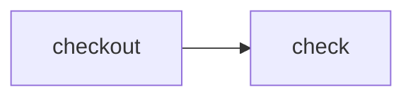

# Run a single check from the CLI

> How do I let an agent or developer run one action without making every internal
> action a public CLI target?



---

The workflow default-exports the complete pipeline and explicitly re-exports only
`check`:

```ts
const workflow = CI.workflow("exported-actions", () => actions.check())

export { check } from "./actions.ts"
export default workflow
```

`checkout` remains an implementation detail even though `check` depends on it. From
this example directory:

```sh
pnpm exec cf-ci list
pnpm exec cf-ci run check
pnpm exec cf-ci run checkout # CI_UNKNOWN_TARGET
```

The CLI discovers `.cloudflare/ci/workflow.ts` from the current directory. It treats
only named exports created by `CI.action` as direct targets, so runner configuration
and ordinary helper functions cannot accidentally become commands.

The [hosted example runner](../../apps/example-runner) executes this same default
workflow on Cloudflare, with live workspace reuse disabled. Its verified instance
`coverage-exported-actions-20261009-2` checks the source after restoring checkout's
durable snapshot. Named exports define the local CLI surface; the host does not
expose an HTTP action-discovery endpoint.

## Verification proof

**Video:** Pending — no same-run recording has been published for this recipe.

**Measured results:** Pending — no structured per-environment timing summary has
been published here. Existing recorded runs and coverage claims remain as documented;
missing media or measurements do not imply those runs failed or were never verified.

Use the [proof-page contract](../PROOF-PAGES.md) for exact revision/environment,
assertions, video/transcript, outcome and cold/warm timings. See the
[coverage matrix](../../README.md#recipes-by-feature) for current backend support.
