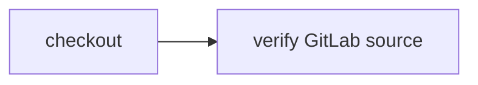

# Clone public GitLab source

> How do I run the same `CI.Source` workflow against a pinned GitLab commit instead of a GitHub repository?



The actions receive only `CI.Source` and a workspace. The hosted adapter uses the
existing Git runner with a public HTTPS GitLab URL, checks the exact fetched HEAD,
then checkpoints the checkout. A separate check restores it and reads `VERSION`.
There is no GitHub-specific source logic and no credential is provided to Git.
This is clone-only verification: it does not execute the external project's code,
initialize its submodules, run GitLab pipelines, or configure private GitLab auth.

The pinned fixture is GitLab's own [gitlab-test repository](https://gitlab.com/gitlab-org/gitlab-test),
commit [ddd0f15](https://gitlab.com/gitlab-org/gitlab-test/-/commit/ddd0f15ae83993f5cb66a927a28673882e99100b).
Its `VERSION` is `6.7.0.pre`. The public API was used to resolve that exact commit;
the workflow never fetches a mutable branch as its source identity. The included
`VERSION` file lets the unchanged check run locally, but is not GitLab clone proof.

```sh
pnpm cf-ci --workflow examples/gitlab-source/.cloudflare/ci/workflow.ts
```

After deploying the [example host](../../apps/example-runner) with `cf deploy`:

```sh
cf workflows instances create effect-ci-example-gitlab-source --body '{"instance_id":"my-gitlab-source-run","params":{"repository":"https://gitlab.com/gitlab-org/gitlab-test.git","revision":"ddd0f15ae83993f5cb66a927a28673882e99100b"}}'
```

The administrative lab accepts only that pinned public repository/revision. A
trusted host can supply another Git source provider without changing actions;
private GitLab credentials require a separate host-owned authentication design,
not reuse of the GitHub App token. No notification is sent by this example.

See [source providers](../source-providers), [R2](../r2-source), [Artifacts](../artifacts-source),
and [Durable Object source](../durable-object-source) for the other input boundaries.
Hosted GitLab clone coverage remains unverified until a real native run completes.
