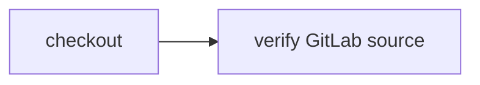

# Checkout from GitLab

> How do I run the same `CI.Source` workflow against a pinned GitLab commit instead of a GitHub repository?



The actions receive only `CI.Source` and a workspace. The hosted adapter uses the
existing Git runner with a public HTTPS GitLab URL, checks the exact fetched HEAD,
then checkpoints the checkout. A separate check restores it and reads `VERSION`.
There is no GitHub-specific source logic and no credential is provided to Git.
This is clone-only verification: it does not execute the external project's code,
initialize its submodules, run GitLab pipelines, or configure private GitLab auth.

The pinned fixture is GitLab's own [gitlab-test repository](https://gitlab.com/gitlab-org/gitlab-test),
commit [ddd0f15](https://gitlab.com/gitlab-org/gitlab-test/-/commit/ddd0f15ae83993f5cb66a927a28673882e99100b).
Its `VERSION` is `6.7.0.pre`. The public API was used to resolve that exact commit;
the workflow never fetches a mutable branch as its source identity. The included
`VERSION` file lets the unchanged check run locally, but is not GitLab clone proof.

```sh
pnpm cf-ci --workflow examples/gitlab-source/.cloudflare/ci/workflow.ts
```

## Owned private deployment

This directory owns [config](./cloudflare.config.ts), [wrapper](./src/worker.ts),
[strict fixture enrollment](./src/reference.ts), [git-enabled image](./Dockerfile)
and [standalone actions](./.cloudflare/ci/standalone.ts). It imports reusable
packages only. The old shared-host wrapper and histories below are unchanged.

The wrapper accepts exactly `{repository,revision}` for the public fixture above.
Mutable refs, different hashes/repos, URL query credentials, extra fields,
accessors and symbols are rejected before container lookup. No App token,
private GitLab credential or project-supplied Workflow code is accepted.
The image contains Git, Node and the existing sandbox shim, not project scripts.

The source action performs an actual network checkout and automatic snapshot.
The downstream action restores that workspace, runs a fixed exact-HEAD shell
assertion and reads `VERSION`. Returning the workspace automatically commits and
releases that consumer container too. It does not run the repository's build,
hooks, submodules or GitLab CI; this is container-backed public clone verification.

From this monorepo (packages are still private workspace dependencies):

```sh
CI=true pnpm_config_pm_on_fail=ignore pnpm install --frozen-lockfile
node --test examples/gitlab-source/src/runtime.test.ts
examples/gitlab-source/node_modules/.bin/tsc -p examples/gitlab-source/tsconfig.json
node packages/cli/src/bin.ts run --workflow examples/gitlab-source/.cloudflare/ci/standalone.ts --format=json
```

The local CLI reads the included filesystem `VERSION`, not GitLab. Local runtime
tests use actual Workflow bindings with **no container binding** to prove input
rejection occurs before container execution. These are not hosted clone proof.

Before creating resources, confirm Worker `effect-ci-gitlab-source`, Workflow
`effect-ci-gitlab-source-checks` and container application
`effect-ci-gitlab-source-workspace` are absent; stop if they already exist.
With an authenticated `cf` authorized for these owned Workers/Workflows/Containers:

```sh
cf workers deployments list --worker effect-ci-gitlab-source --per-page 1
cf containers applications list --name effect-ci-gitlab-source-workspace
cf workflows instances list --workflow-name effect-ci-gitlab-source-checks
cd examples/gitlab-source
cf build
cf deploy --prebuilt
cf workflows instances create effect-ci-gitlab-source-checks --body '{"instance_id":"my-owned-gitlab-source-run","params":{"repository":"https://gitlab.com/gitlab-org/gitlab-test.git","revision":"ddd0f15ae83993f5cb66a927a28673882e99100b"}}'
cf workflows instances get my-owned-gitlab-source-run --workflow-name effect-ci-gitlab-source-checks
```

Use a different bounded instance with `revision:"master"` for rejection: it must
error before any checkout or command. Do not substitute a different identity to
replay pending work. For an ambiguous create/deploy ACK, read the existing resource
or history before taking further action; do not blindly retry.

No new account permissions are needed beyond the existing authorized Worker,
Workflow, SQLite and Container deployment scopes. This Worker has no environment
bindings or secrets, public workers.dev/preview URL, HTTP execution endpoint,
GitHub App, Slack, AI or release connection. Git receives only the pinned public
HTTPS URL; this is **not private GitLab authentication or GitLab CI support**.
Costs include Workflow steps, snapshots/SQLite, image storage and short-lived
`standard-1` container time, plus the public network clone. The source and consumer
containers commit/release normally; this is not a free-execution claim.

Optional cleanup requires explicit owner approval and retained evidence first.
Use Cloudflare's dashboard to remove only this owned Workflow, Worker, workspace
SQLite namespace, container application and snapshots. Never remove the shared
example host or old histories to hide failures. No deletion/reset is part of use.

### Fresh standalone native proof

Exact merged source `b3ede7b150250f8d71cc576efe2c3bfc5f278011` deployed Worker
`18a11254-debf-41e6-a6a4-f0e3dcbc7d39` with only its owned Workflow/workspace
exports, no environment bindings or public URLs, and runnable image
`sha256:7b2ede4459d6738f1465db630f3fe3794fd9c9ba28f8b5a9dffc3900b8df9924`.
The existing committed demo release and shared source histories were unchanged.

`coverage-owned-gitlab-pinned-20261015-1`, native Workflow version
`bab3fab3-7dd6-46c8-939e-8b6af8ff4755`, completed a real public HTTPS GitLab clone,
checkout snapshot `4a3c9ebe-63e8-4608-b8ef-7c12f702250c`, downstream restore,
the exact-HEAD command (exit 0), `VERSION` read `6.7.0.pre`, and consumer snapshot
`63f16af7-f04a-439d-b64d-2cdff27c4f69`. All five steps ran once.
The command retry limit was zero; checkout/snapshot/read transport retained limit
five, with no actual retry. No token or project code was used.

Queue time was 3,114 ms, execution 19,396 ms, total 22,510 ms (one cold orchestration
sample including public network, container and snapshot work, not a benchmark).
`coverage-owned-gitlab-mutable-20261015-1` remains **ERRORED** with zero steps:
`master` was rejected before checkout. Neither original history is replayed or reset.

Read the original histories and recorded version without cloning again:

```sh
LIVE_OWNED_GITLAB_SOURCE=1 CF_BIN=cf node --test examples/gitlab-source/src/live.test.ts
```

## Historical shared-host proof

These older commands require the [shared example host](../../apps/example-runner),
not the owned configuration above:

```sh
cf workflows instances create effect-ci-example-gitlab-source --body '{"instance_id":"my-gitlab-source-run","params":{"repository":"https://gitlab.com/gitlab-org/gitlab-test.git","revision":"ddd0f15ae83993f5cb66a927a28673882e99100b"}}'
```

The administrative lab accepts only that pinned public repository/revision. A
trusted host can supply another Git source provider without changing actions;
private GitLab credentials require a separate host-owned authentication design,
not reuse of the GitHub App token. No notification is sent by this example.

See [source providers](../source-providers), [R2](../r2-source), [Artifacts](../artifacts-source),
and [Durable Object source](../durable-object-source) for the other input boundaries.
Hosted `coverage-gitlab-source-20261012-1` completed a real GitLab HTTPS clone,
checkpoint `6a05adc1-7dc5-45e6-a278-bfb81948088d`, a downstream native exact-HEAD
assertion, and a separate `VERSION` read. Workflow version
`1f7a05b3-fabc-4602-b761-bf67c5982efb`, host deployment
`4d4e80ef-e00c-418b-9a4c-eaabad05956e`. This proves public pinned clone and
checkpoint restoration, not private GitLab authentication or external CI execution.
The local filesystem variant passed independently. PR118's exact-head full suite
also passed the Effect-on-GitHub plan/execute jobs for that portable fixture variant;
the real GitLab network clone proof remains the hosted run above.

## Verification proof

**Video:** Pending — no same-run recording has been published for this recipe.

**Measured results:** Pending — no structured per-environment timing summary has
been published here. Existing recorded runs and coverage claims remain as documented;
missing media or measurements do not imply those runs failed or were never verified.

Use the [proof-page contract](../PROOF-PAGES.md) for exact revision/environment,
assertions, video/transcript, outcome and cold/warm timings. See the
[coverage matrix](../../README.md#recipes-by-feature) for current backend support.
