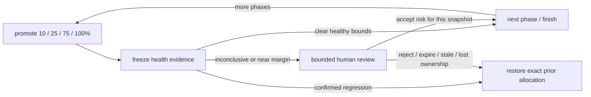

# Review an inconclusive or near-margin Worker rollout

> How do I pause for a human when health data cannot decide, without letting approval bypass a confirmed regression?



---

This is a **separate, opt-in policy** from [strict automatic HMD](../health-mediated-release).
It does not change that example's fail-closed behavior or classify missing data as healthy.
The [trusted hosted controller](../../apps/example-runner/src/hmd-review-controller.ts)
uses real version-attributed HTTP cohorts against the dedicated demo Worker, **not WOBS**.
Local policy tests are implemented; hosted approval execution is not yet verified.

“Within margins” means **near a threshold**, not permission to exceed it silently:
the absolute SLO is 10%, the increase budget is five percentage points, and human
review is required when an otherwise acceptable confidence bound is within two
percentage points of the SLO or one point of the increase budget. These are
explicit example settings, not universal production defaults. Clear healthy bounds
advance automatically; an inconclusive result requests explicit risk acceptance.
Invalid source/version attribution aborts instead of requesting an override.
Confirmed regression always rolls back and never creates an approval request.

Each immutable snapshot contains owner, versions, phase, windows, samples, policy,
decision and a confidence-envelope SVG. Approval must name its exact SHA-256 digest
and include a rationale. Its five-minute deadline is fixed at snapshot creation;
replay cannot refresh it. Each phase needs its own decision. Approval is recorded
as `human-risk-acceptance`, **never** `health`; original uncertainty remains visible.
Rejection, invalid/stale payload or timeout requests restoration of the complete
previous traffic allocation. Lost ownership or external operator drift fails closed;
it must not overwrite another operator's deployment. The broker's independent alarm remains the
backstop if platform termination bypasses JavaScript cleanup.

## Run the dedicated lab

Deploy [apps/example-runner](../../apps/example-runner), then use the authenticated
`cf` CLI. Do not run concurrently with another HMD lab: they share a fixed target.

```sh
cf workflows instances create effect-ci-example-hmd-review --body '{"params":{}}'
cf workflows instances get INSTANCE_ID --workflow-name effect-ci-example-hmd-review --simple true
```

In the dashboard, open the current `health:snapshot-PHASE` checkpoint, review its
evidence, and send event type `hmd-review-PHASE` with this payload (replace the
digest and rationale):

```json
{
  "snapshot": "EXACT_DIGEST_FROM_CURRENT_CHECKPOINT",
  "decision": "approved",
  "reason": "Reviewed the uncertain canary evidence; accept this phase's risk"
}
```

Use `rejected` to abort. An empty event is not approval. Only Cloudflare operators
authorized to send Workflow events can approve this administrative lab; a payload
claiming an actor is not authentication. There is no public review endpoint.
Slack approval delivery is **not wired into this example yet**. That extension
must reuse the existing signature-verified callback, reviewer allowlist and one
updated card, retaining the same snapshot/deadline/ownership constraints.

All four phases have health checks, including 100%. Successful lab cleanup also
restores the baseline: `releaseCommitted: false`. This is not a production release,
WOBS completeness proof, statistically conclusive success or Slack E2E proof.
