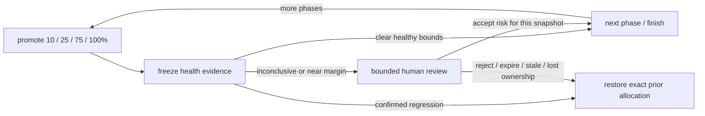

# Review a rollout when health is uncertain

> How do I pause for a human when health data cannot decide, without letting approval bypass a confirmed regression?



---

This is a **separate, opt-in policy** from [strict automatic HMD](../health-mediated-release).
It does not change that example's fail-closed behavior or classify missing data as healthy.
The [trusted hosted controller](../../test/apps/example-runner/src/hmd-review-controller.ts)
uses real version-attributed HTTP cohorts against the dedicated demo Worker, **not WOBS**.
Local policy tests and native administrative event resume are verified. Actual
human approval and Slack delivery are not yet verified.

The negative hosted timeout path is verified: `coverage-hmd-review-timeout-20261010-1`
promoted the dedicated healthy candidate to 10%, recorded inconclusive HTTP evidence,
then waited five native minutes without an approval event. `WorkflowTimeoutError`
triggered exact baseline restoration in deployment
`35c17724-2bfe-4480-ba5c-d05caad654a0`, independently checked through the deployment API.
No 25% promotion or approval-resolution checkpoint ran. This proves timeout rollback,
not a successful human approval, WOBS gate or Slack integration. The run also exposed
native preview truncation; the compact review request below fixes digest visibility.

The separate administrative replay run `coverage-hmd-review-events-20261010-1`
completed all real 10% → 25% → 75% → 100% promotions on the merged controller.
Four snapshot-bound events resumed four native waits, each uncertainty decision
stayed unchanged, and all four complete SVGs survive in the final output. Compact
request previews measured 616–632 bytes; read-only assertions recomputed all four
SHA-256 digests from the exact evidence and checked phase ownership verification.
Final lab cleanup restored baseline 100% in deployment
`7875d9c6-01b2-4f24-866e-0860e49a583a`, independently checked through the deployment API.

These decisions were labelled **AUTOMATED LAB ONLY**. They prove administrative
transport/checkpoint resume, **not real human review**, conclusive health, WOBS
ingestion or a production release. Host version was
`9b946c5b-d796-4962-b272-4e5cd1abee77`, Workflow version
`8e2e4d90-1742-44cc-8afb-a817acb755df`. No Slack notification was sent.

“Within margins” means **near a threshold**, not permission to exceed it silently:
the absolute SLO is 10%, the increase budget is five percentage points, and human
review is required when an otherwise acceptable confidence bound is within two
percentage points of the SLO or one point of the increase budget. These are
explicit example settings, not universal production defaults. Clear healthy bounds
advance automatically; an inconclusive result requests explicit risk acceptance.
Invalid source/version attribution aborts instead of requesting an override.
Confirmed regression always rolls back and never creates an approval request.

Each immutable snapshot contains owner, versions, phase, windows, samples, policy,
decision and a confidence-envelope SVG. Approval must name its exact SHA-256 digest
and include a rationale. Its five-minute deadline is fixed at snapshot creation;
replay cannot refresh it. Each phase needs its own decision. Approval is recorded
as `human-risk-acceptance`, **never** `health`; original uncertainty remains visible.
Rejection, invalid/stale payload or timeout requests restoration of the complete
previous traffic allocation. Lost ownership or external operator drift fails closed;
it must not overwrite another operator's deployment. The broker's independent alarm remains the
backstop if platform termination bypasses JavaScript cleanup.

## Run the dedicated lab

Deploy [test/apps/example-runner](../../test/apps/example-runner), then use the authenticated
`cf` CLI. Do not run concurrently with another HMD lab: they share a fixed target.

```sh
cf workflows instances create effect-ci-example-hmd-review --body '{"params":{}}'
cf workflows instances get INSTANCE_ID --workflow-name effect-ci-example-hmd-review --simple true
```

In the dashboard, open the current compact `review:request-PHASE` checkpoint,
review its risk summary, and send event type `hmd-review-PHASE` with this payload (replace the
digest and rationale). The complete snapshot is retained by the controller, but
native step output previews truncate large values such as SVGs; the compact request
keeps the exact digest and counts visible without relying on those previews:

```json
{
  "snapshot": "EXACT_DIGEST_FROM_CURRENT_CHECKPOINT",
  "decision": "approved",
  "reason": "Reviewed the uncertain canary evidence; accept this phase's risk"
}
```

Use `rejected` to abort. An empty event is not approval. Only Cloudflare operators
authorized to send Workflow events can approve this administrative lab; a payload
claiming an actor is not authentication. There is no public review endpoint.
Slack approval delivery is **not wired into this example yet**. That extension
must reuse the existing signature-verified callback, reviewer allowlist and one
updated card, retaining the same snapshot/deadline/ownership constraints.
The controller now exposes copied, deeply frozen structured observation updates
between native checkpoints, before review waits and after resolution. The host
`apps/effect-ci/src/hmd-card.ts` adapter uses these updates for cumulative confidence
graphs in an existing card; local tests exercise all four phases without nesting
checkpoints. This is not yet a deployed notification callback. A required observer
failure fails closed and restores the allocation; a reporting failure after restoration
cannot initiate another rollback. Original decisions remain unchanged by observers
or human risk acceptance.

All four phases have health checks, including 100%. Successful lab cleanup also
restores the baseline: `releaseCommitted: false`. This is not a production release,
WOBS completeness proof, statistically conclusive success or Slack E2E proof.

## Read-only recorded-run assertions

These tests neither create instances nor send events nor mutate deployments:

```sh
HMD_REVIEW_RESUME_INSTANCE=coverage-hmd-review-events-20261010-1 \
HMD_REVIEW_TIMEOUT_INSTANCE=coverage-hmd-review-timeout-20261010-1 \
node --test test/apps/example-runner/ci/tests/live-hmd-review.test.ts
```

Set `HMD_CF_BIN` if `cf` is not on your path. The positive assertion additionally
checks that its restoration is still the current deployment; another lab run may
supersede that deployment while keeping the same baseline allocation.

The installed `cf` beta.13 generated `workflows instances events send` command
currently accepts no request body and rejects `--body`. Do not send an empty
event as approval. The administrative validation used that installed CLI's local
authenticated request helper to send JSON; it never exported credentials to a
Worker. That private helper is a development workaround, not a supported setup API.
Use the dashboard event form above until the CLI exposes arbitrary event payloads.
