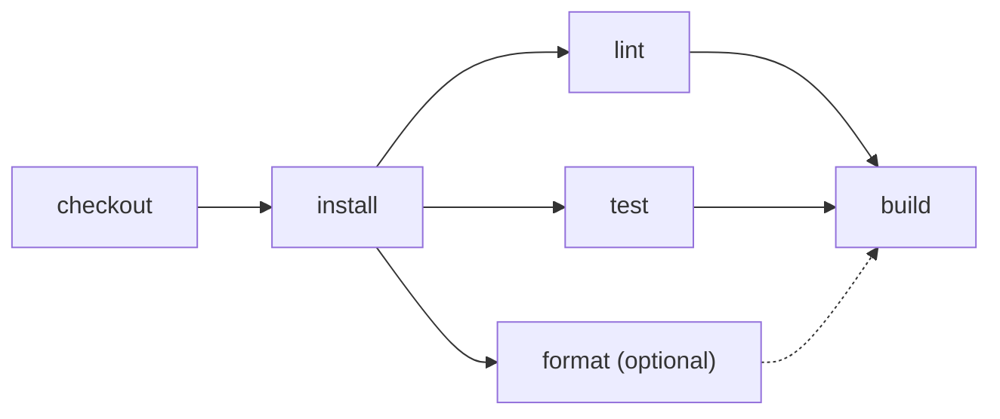

# Keep rerun history and reuse passed steps

> How can I rerun one action without erasing the previous run or recomputing unrelated work?



---

Every Effect CI execution returns an immutable `attempt`. A rerun receives that attempt
and the selected action IDs. Effect CI follows the dependencies derived from yielded actions, restores
the outputs of unaffected actions, and executes only the selected transitive subgraph.

```ts
let failed: CI.WorkflowAttempt | undefined
await CI.runPromise(workflow, {
  onAttempt: (attempt) => { failed = attempt },
}).catch(() => undefined)
const second = await CI.runPromise(workflow, {
  rerun: { previous: failed!, steps: ["test"] },
})
```

The verification proves that rerunning `test`:

- records failed attempt 1, creates attempt 2, and retains attempt 1 unchanged;
- reuses `checkout`, `install`, `lint`, and `format`;
- executes only `test` and its dependent `build`;
- carries Workspace snapshot handles through the reused action outputs.

Run the ordinary workflow locally with:

```sh
pnpm cf-ci --workflow examples/immutable-attempts/.cloudflare/ci/workflow.ts
```

The forced first-attempt failure and selective rerun are test-only scenarios in
[`ci/tests/immutable-attempts.test.ts`](./.cloudflare/ci/tests/immutable-attempts.test.ts).

This is the portable attempt model. A hosted runner can persist each returned attempt
under its own ID and map a reused Workspace revision to Cloudflare snapshots, GitHub
artifacts, or another checkpoint provider.

## Verification proof

**Video:** Pending — no same-run recording has been published for this recipe.

**Measured results:** Pending — no structured per-environment timing summary has
been published here. Existing recorded runs and coverage claims remain as documented;
missing media or measurements do not imply those runs failed or were never verified.

Use the [proof-page contract](../PROOF-PAGES.md) for exact revision/environment,
assertions, video/transcript, outcome and cold/warm timings. See the
[coverage matrix](../../README.md#recipes-by-feature) for current backend support.
