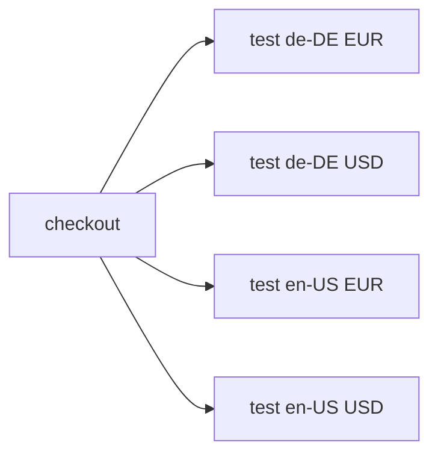

# Run every combination in a matrix

> How do I check every combination of two independent configuration axes?



---

This recipe runs the same currency-formatting check for **two locales × two
currencies**, producing four parallel actions. Every combination runs; this is
coverage expansion, not test splitting. The small fixture needs only Node 24+.
Node versions, browsers or operating systems can also be matrix axes, but require
a runner that supplies those environments; this recipe does not simulate them.

[The actions](./.cloudflare/ci/actions.ts) create a distinct action definition for
each combination. Action IDs include both dimensions because Effect CI memoizes
by action ID, not by arguments. The workflow coordinates them with `CI.parallel`.
The [GitHub comparison](./.github/workflows/github.yml) uses `strategy.matrix` with
the same two axes and `fail-fast: false`.

Expected result: four passing combinations and one shared checkout.
To demonstrate failure, prefix the run command with
`FAIL_COMBINATION="en-US USD"`; that combination fails and the workflow exits nonzero.

Next: [split a suite](../test-splitting) when parallel jobs should run different tests.

From the repository root after `pnpm install`:

```sh
cd examples/matrix
effect-ci plan
effect-ci run --format=text
node --test .cloudflare/ci/tests/matrix.test.ts
```

Compare [plain GitHub Actions](./.github/workflows/github.yml) with the
[Effect-on-GitHub caller](./.github/workflows/effect-on-github.yml). The repository’s
[parallel recipe checks](../../.github/workflows/parallel-recipes.yml) exercise native
matrix jobs, shard report aggregation, and reuse of measured timing history.

See the [recorded execution evidence](../parallel-recipes-verification.md) for the
local, native GitHub, and Effect-on-GitHub runs. Hosted Cloudflare runs are included in that evidence.

## Run on Cloudflare

This recipe owns its [Worker](./src/worker.ts) and [deployment configuration](./wrangler.jsonc).
From this recipe's directory, with Docker running and Wrangler authenticated:

```sh
pnpm exec wrangler deploy
pnpm exec wrangler workflows trigger effect-ci-matrix '{"repository":"https://github.com/ericclemmons/effect-ci-testbed.git","revision":"COMMIT_SHA"}' --id matrix-1
pnpm exec wrangler workflows instances describe effect-ci-matrix matrix-1 --json
```

Use a pushed, full commit SHA. The hosted runner checks out that immutable source;
it does not execute uncommitted local files. Each parallel action gets its own Container.
