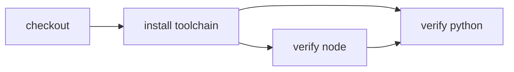

# Install runtimes with Mise

> How do I install every runtime declared by my project's Mise configuration?



---

The project declares Node and Python in [`mise.toml`](./mise.toml). Its action acquires the
workspace-bound Mise capability and returns the workspace after installation:

```ts
export const installToolchain = CI.action("install toolchain", () => function* () {
  const workspace = yield* checkout()
  const mise = yield* CI.Toolchain.Mise(workspace)

  return yield* mise.install()
})
```

`CI.Toolchain.Mise` owns `.effect-ci/cache/mise`; workflows do not need to know Mise's
data or download-cache layout. Commands use `mise.exec(...)` so shell activation is not
required in local or CI environments. The workflow exports its `local` runner so both
the executable entrypoint and Effect CI's GitHub adapter use the same Mise image.

Compare:

- [plain GitHub Actions using `jdx/mise-action`](./.github/workflows/github.yml)
- [Effect CI on GitHub](./.github/workflows/effect-on-github.yml)
- [the portable actions](./.cloudflare/ci/actions.ts)
- [the local-container entrypoint](./.cloudflare/ci/workflow.ts)

With Docker running:

```sh
pnpm cf-ci --workflow examples/mise-toolchain/.cloudflare/ci/workflow.ts
```

The official Mise Debian image supplies only the runner capability. Tool versions stay
in the project configuration, and later runner layers can cache the capability-owned
paths without changing this workflow.

## Verification proof

**Video:** Pending — no same-run recording has been published for this recipe.

**Measured results:** Pending — no structured per-environment timing summary has
been published here. Existing recorded runs and coverage claims remain as documented;
missing media or measurements do not imply those runs failed or were never verified.

Use the [proof-page contract](../PROOF-PAGES.md) for exact revision/environment,
assertions, video/transcript, outcome and cold/warm timings. See the
[coverage matrix](../../README.md#recipes-by-feature) for current backend support.
