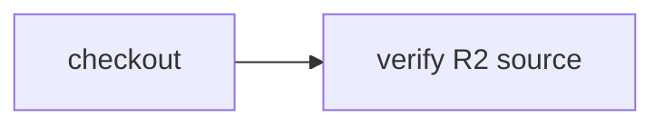

# Checkout from R2

> How do I run CI against a content-addressed R2 source object without sending storage credentials to a container?



---

Actions only use `CI.Source` and the resulting workspace. The runner supplies an R2
provider, reads a bounded manifest through its Worker binding, validates the SHA-256
of the exact object bytes, and materializes files before checkpointing the workspace.
The subsequent check restores that checkpoint. No R2 credentials enter the container.

[`source.json`](./source.json) is the example source object. Its regular-file manifest
supports binary contents and executable bits, not archives, symlinks or submodules.
The adapter rejects traversal, duplicate paths, file/directory conflicts, malformed
base64, wrong digests, and objects over 96 KiB encoded / 64 KiB decoded / 1,000 files.
A mutable object key or an ETag is not a content identity: every read verifies the
caller-pinned SHA-256, so overwriting the key cannot silently change source.

Run the workflow against the included local source directory:

```sh
pnpm cf-ci --workflow examples/r2-source/.cloudflare/ci/workflow.ts
```

Adapter tests:

```sh
node --test packages/cloudflare/src/r2-source.test.ts
```

## Owned Cloudflare deployment

This directory now owns its [Worker wrapper](./src/worker.ts),
[configuration](./cloudflare.config.ts), [minimal image](./Dockerfile), and
[standalone workflow](./.cloudflare/ci/standalone.ts). The wrapper imports the
public `@effect-ci-testbed/cloudflare/r2-source` reader, not another app's
implementation. It needs no Git checkout or storage SDK inside the container.

The standalone workflow has two actions: checkout, then verify restored R2 bytes.
Returning each workspace automatically checkpoints it; a separate downstream
container restores the checkout and a fixed Node command verifies the raw 15-byte
file and checks that known storage-credential environment variables are absent.
This is automatic workspace handoff, not explicit artifact publication.

From this repository (the workspace packages are not published onboarding):

```sh
CI=true pnpm_config_pm_on_fail=ignore pnpm install --frozen-lockfile
node packages/cli/src/bin.ts run --workflow examples/r2-source/.cloudflare/ci/standalone.ts --format=json
node --test examples/r2-source/src/*.test.ts packages/cloudflare/src/r2-source.test.ts
examples/r2-source/node_modules/.bin/tsc -p examples/r2-source/tsconfig.json
```

Local CLI execution uses the included filesystem fixture, not R2. The integration
test uses actual local R2, Workflow and SQLite RPC bindings with a **fake container**;
it proves the boundary and separate snapshot restoration, not native Docker execution.
Wrong digest, missing object, unsafe path and extra parameters fail before materialization.

For a new deployment, first confirm the following owned names are unused. Do not
overwrite an existing bucket, object, Worker or Workflow. With an authenticated
`cf` CLI authorized for Workers, Workflows, Containers and R2 in your account:

```sh
cf r2 buckets get effect-ci-r2-source-input
cf workers deployments list --worker effect-ci-r2-source --per-page 1
cf r2 buckets create --name effect-ci-r2-source-input
cf r2 buckets domains managed list --bucket-name effect-ci-r2-source-input
```

The initial reads should report not found; stop if they find existing resources.
Verify managed `r2.dev` access is disabled and do not attach a public/custom domain.
Upload the unchanged manifest once, independently read it back and verify SHA-256:

```sh
cf r2 objects put source/6759fef7f59ccbd363fb8c42062fb4903d98070d08da56c6ae873d9a75ea41cd.json \
  --bucket-name effect-ci-r2-source-input --file examples/r2-source/source.json --content-type application/json
cf r2 objects get source/6759fef7f59ccbd363fb8c42062fb4903d98070d08da56c6ae873d9a75ea41cd.json \
  --bucket-name effect-ci-r2-source-input
cd examples/r2-source
cf build
cf deploy --prebuilt
cf workflows instances create effect-ci-r2-source-checks --body '{"instance_id":"my-owned-r2-source-run","params":{"repository":"source/6759fef7f59ccbd363fb8c42062fb4903d98070d08da56c6ae873d9a75ea41cd.json","revision":"6759fef7f59ccbd363fb8c42062fb4903d98070d08da56c6ae873d9a75ea41cd"}}'
cf workflows instances get my-owned-r2-source-run --workflow-name effect-ci-r2-source-checks
```

Use a new instance ID for genuine new work. On an ambiguous create/deploy ACK,
read the existing resource/history instead of blindly retrying. The Worker is
private (`workersDev` and preview URLs disabled), has exactly the R2 binding and
its own container/Workflow exports, and has no HTTP execution or writer endpoint.
The source key is restricted to `source/<64 lowercase hex>.json`; `revision` pins
the exact raw SHA-256 independently of the key spelling. Source validation and
commands have zero retries; ordinary snapshot transport retains its runner policy.

For native negative cases, use a wrong digest against the existing object, a
nonexistent content-addressed key, and the owned
[`fixtures/unsafe.json`](./fixtures/unsafe.json) uploaded under its own SHA-256
(`88ffc89ebd9c67ee49ae021e14e4e4e7e4663def3523634da12f281242ecf635`).
Each should error before source materialization. Do not execute uploaded project
scripts as validation or give storage credentials to the container.

Permissions stay at the host: the Worker receives a private R2 binding, not an
account token. The operator needs create/read/deploy permissions for these owned
resources; no GitHub App, AI, Slack, release or additional account scope is needed.
Costs are R2 object storage/operations, Workflow steps, SQLite snapshots and
short-lived `standard-1` container runtime/image storage. Both actions commit and
release their containers; do not leave a verifier VM running. These are real billed
services, not a promise of free execution.

Cleanup is optional and only after explicitly authorizing removal of these exact
owned resources and retaining required evidence. In the Cloudflare dashboard,
remove this recipe's Workflow, Worker, container application and snapshots; never
delete shared example resources. Then delete the two known objects (if uploaded)
and the now-empty owned bucket:

```sh
cf r2 objects delete source/6759fef7f59ccbd363fb8c42062fb4903d98070d08da56c6ae873d9a75ea41cd.json --bucket-name effect-ci-r2-source-input
cf r2 objects delete source/88ffc89ebd9c67ee49ae021e14e4e4e7e4663def3523634da12f281242ecf635.json --bucket-name effect-ci-r2-source-input
cf r2 buckets delete effect-ci-r2-source-input
```

### Fresh standalone native proof

Exact merged source `fb740d7f490dd1b523c581d14708aeac2442dfb9` deployed Worker
`41539d8a-2f86-4934-9052-b892ac0e7246` with only `SOURCE_BUCKET`, two owned
exports, no public URL, and runnable image
`sha256:33bf1e72342987c991bd0aa0ade227e70b0d1e9135d68577fe1b6deeddc4a9fd`.
The new private bucket's managed public access was independently disabled/read back.
Both fixture uploads were absent first and independently matched exact raw bytes
afterward. Shared example resources and the committed demo release were unchanged.

`coverage-owned-r2-valid-20261015-1` completed on native Workflow version
`531ad0b6-25ae-4ae9-8321-7d27db9ff741`: five steps, each one attempt. The binding
read verified the 97-byte manifest, checkout created snapshot
`f1182bd5-39a3-479d-b7cb-ec3a525843fe`, and the downstream action restored and
read `source from r2`. Its **actual native Node command** returned 15 bytes, SHA-256
`de72ee64a002cd0c9d99b35ec1e79a009a0fd73602831346f477d5837041c04f`,
exit 0 and `storageCredentialsPresent:false`. The consumer committed snapshot
`03e83964-6fa7-4e78-bfe4-e1ec1804ee27`, releasing its container too.
This checks the known credential names above; it is not a generic secret-scanning claim.

Queue time was 3,101 ms, execution 17,558 ms, total 20,659 ms (one cold orchestration
sample including container/snapshot/API work, not a benchmark). Source and command
retry limits were zero; snapshot/read transport retained limit five, with no actual retry.

The three original negative histories `coverage-owned-r2-{wrong-digest,missing,unsafe}-20261015-1`
remain **ERRORED**. Each contains only the one failed `source:r2` step, zero retries,
and no checkout commit or downstream command. These are fresh native denials,
separate from the fake-container local test and older shared-host evidence.

Read those retained histories and the recorded Worker version without redispatching:

```sh
LIVE_OWNED_R2_SOURCE=1 CF_BIN=cf node --test examples/r2-source/src/live.test.ts
```

## Historical shared-host proof

The old host adapter remains in [r2-source.ts](../../apps/example-runner/src/r2-source.ts).
It and its bucket/history are unchanged. These commands describe that older host,
not the owned deployment above.

After deploying the [example host](../../apps/example-runner), upload the exact
manifest bytes and create the native Workflow:

```sh
cf r2 objects put source/6759fef7f59ccbd363fb8c42062fb4903d98070d08da56c6ae873d9a75ea41cd.json \
  --bucket-name effect-ci-example-source --file examples/r2-source/source.json
cf workflows instances create effect-ci-example-r2-source --body '{"instance_id":"my-r2-source-run","params":{"repository":"source/6759fef7f59ccbd363fb8c42062fb4903d98070d08da56c6ae873d9a75ea41cd.json","revision":"6759fef7f59ccbd363fb8c42062fb4903d98070d08da56c6ae873d9a75ea41cd"}}'
```

If the manifest changes, calculate a new SHA-256 and use a new object key and digest;
do not reuse this example hash for different bytes. The host's portable source
parameters use `repository` as the R2 key and `revision` as the pinned digest.

Verified native instance `coverage-r2-source-20261010-1`, Workflow version
`eec420bc-6ddf-4650-8edf-2e090e16ddb2`, Worker deployment
`f81462ad-8d98-448c-95de-4e22aef1d632`: real binding read, snapshot
`d309cecf-6d9c-4461-a3a3-8bb8eb7fbbbd`, and a separate downstream read restoring
`source from r2`. This verifies the R2 provider in Cloudflare; the local runner uses
the included filesystem source. GitHub workflow coverage is tracked separately.

## Verification proof

**Video:** Pending — no same-run recording has been published for this recipe.

**Measured results:** Pending — no structured per-environment timing summary has
been published here. Existing recorded runs and coverage claims remain as documented;
missing media or measurements do not imply those runs failed or were never verified.

Use the [proof-page contract](../PROOF-PAGES.md) for exact revision/environment,
assertions, video/transcript, outcome and cold/warm timings. See the
[coverage matrix](../../README.md#recipes-by-feature) for current backend support.
