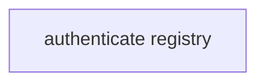

# Use secrets without exposing them to containers

> How does an action require a credential without leaking it into plans, logs, or command environments?



---

```ts
const token = yield* CI.Secret("GITHUB_TOKEN")
```

The plan records only the requirement name. Execution returns an Effect `Redacted`
value from the runner's `SecretResolver`, and JSON/log rendering remains redacted.
`Workspace.exec` deliberately has no `env` or secret injection option: credentials
should be consumed by a host-side capability, RPC service, or an outbound proxy that
substitutes placeholders without exposing values to the workload container.

The default local resolver reads process environment variables. A Varlock adapter,
Cloudflare Secrets Store adapter, or credential-validation approval can implement the
same small resolver contract later.

Run `./examples/secure-secrets/.cloudflare/ci/workflow.ts` locally with a
`GITHUB_TOKEN`, or compare [the conventional GitHub workflow](./.github/workflows/github.yml)
with [Effect on GitHub](./.github/workflows/effect-on-github.yml). Redaction and missing
secret assertions live in
[`tests/secure-secrets.test.ts`](./.cloudflare/ci/tests/secure-secrets.test.ts).

## Hosted Worker resolver

The [example host](../../apps/example-runner/src/secure-secrets.ts) maps this recipe's
`GITHUB_TOKEN` requirement to an **inert test canary**, `env.CI_DEMO_SECRET`, wrapped
in `Redacted`. It is not a GitHub authentication token and does not authenticate a
registry. This isolates the primitive: required-secret resolution and redacted
metadata. The dedicated [outbound example](../secret-outbound) instead proves
host-only credential substitution for an actual outbound request.

Put an inert value in the Git-ignored `apps/example-runner/.secrets.env`, then deploy
from that app directory with `cf deploy --secrets-file .secrets.env`. Do not overwrite
an existing secrets file or put personal OAuth/refresh credentials there.

```sh
cf workflows instances create effect-ci-example-secure-secrets --body '{"instance_id":"my-host-secret-run","params":{"repository":"unused","revision":"unused"}}'
```

The resolver runs only in trusted Worker memory. The workflow returns a plan with
the requirement name, not the value, and this recipe starts no container. A second
administrative scenario uses `event.payload.scenario: "missing"` to request `UNKNOWN`;
it must fail rather than falling back to another host credential. This is a Worker
secret binding adapter, not the separate account-wide Secrets Store product.
Native `coverage-host-secret-20261012-1` completed with only the `GITHUB_TOKEN`
requirement in its plan; `coverage-host-secret-missing-20261012-1` errored with
`Missing required secret: UNKNOWN`. Both had zero native workspace/command steps,
and neither API result contained the canary. Host deployment
`be55cd22-c3c1-4b14-b246-24a99c662446`, Workflow version
`590724dd-82df-4795-8e29-b33623aab149`. This verifies primitive Worker-bound secret
resolution/redaction and no credential fallback, not actual GitHub authentication.

## Verification proof

**Video:** Pending — no same-run recording has been published for this recipe.

**Measured results:** Pending — no structured per-environment timing summary has
been published here. Existing recorded runs and coverage claims remain as documented;
missing media or measurements do not imply those runs failed or were never verified.

Use the [proof-page contract](../PROOF-PAGES.md) for exact revision/environment,
assertions, video/transcript, outcome and cold/warm timings. See the
[coverage matrix](../../README.md#recipes-by-feature) for current backend support.
