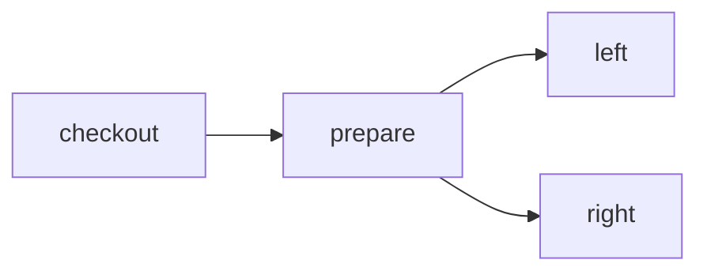

# Run checks in parallel from one workspace

> How can parallel checks start from the same prepared filesystem without mutating each other?



---

The actions express only their real dependency:

```ts
export const left = CI.action("left", () => function* () {
  const workspace = yield* prepare()

  return yield* workspace.exec("...")
})
```

The workflow runs `left()` and `right()` with `CI.parallel`. `prepare()` executes once
and returns a workspace revision. On Cloudflare, each consuming action restores
that same snapshot into a Container selected by the action ID. The two checks both
write `branch.txt`, sleep, and assert their own value remains; they would race and fail
if they shared a filesystem.

[The conventional GitHub version](./.github/workflows/github.yml) expresses the same
shape with a prepared artifact and two matrix jobs. Effect CI does not need an artifact
manifest because the workspace revision is the dependency value.

## Run locally or on GitHub

After `pnpm install` at the repository root:

```sh
cd examples/snapshot-fanout
pnpm exec cf-ci plan
pnpm exec cf-ci run
```

The recipe's `local` adapter gives each action a private filesystem copy and
captures its returned workspace. Both branches inherit the prepared bytes; neither
can mutate the other's copy or the prepared snapshot. Only the public `app/`
fixture is copied; repository-root credentials, dependencies and `.git` are not.
Links and special files are rejected. Temporary copies are removed after execution.

These are trusted shell commands on the host, **not a security sandbox**. This
small recipe-owned adapter does not change the default local runner or native
Cloudflare behavior. The [Effect-on-GitHub caller](./.github/workflows/effect-on-github.yml)
and repository matrix run the same program on GitHub's runner.

## Run on Cloudflare

Run this unchanged workflow in a real Cloudflare account with the
[hosted example app](../../apps/example-runner):

```sh
pnpm --filter @effect-ci-testbed/example-runner exec cf deploy
cf workflows instances create effect-ci-example-snapshot-fanout \
  --body '{"instance_id":"fanout-1","params":{"repository":"https://github.com/ericclemmons/effect-ci-testbed.git","revision":"COMMIT_SHA"}}'
```

## Verified runs

GitHub source `3305adef308102d82a258219d981cc86fa3812ea` passed the actual
[Effect CI execution](https://github.com/ericclemmons/effect-ci-testbed/actions/runs/39056001284/job/117463981220)
and [plan](https://github.com/ericclemmons/effect-ci-testbed/actions/runs/39056001284/job/117463981261).
The four action checks passed once. The separate
[filesystem regressions](https://github.com/ericclemmons/effect-ci-testbed/actions/runs/39056001284/job/117463979990)
verified distinct branch results, unchanged prepared bytes, restoration, a genuine
failed-command negative, and excluded root metadata/links. The
[Cloudflare-local run](https://github.com/ericclemmons/effect-ci-testbed/actions/runs/39056001284/job/117463980028)
also passed; it is Local coverage, not a new deployed Cloudflare proof.

Historical hosted verification: `coverage-snapshot-fanout-20261008-1` completed against
`55be3e8c7bff809aa9a8a910f888bc86613922e0`. Native history shows one prepared
checkpoint and both branch commands starting at the same instant. Both wrote the
same filename and passed their own assertions with live workspace reuse disabled.

## Verification proof

**Video:** Pending.

**Measured results:** Pending.

[Proof requirements](../PROOF-PAGES.md) · [Backend coverage](../../README.md#recipes-by-feature).
