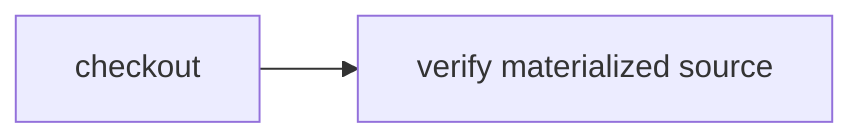

# Checkout from local files or Git

> How do I run one unchanged workflow against a local directory or Git checkout?



---

The workflow knows only `CI.Source`:

```ts
const source = yield* CI.Source
const workspace = yield* source.checkout()
```

[`providers.ts`](./.cloudflare/ci/providers.ts) supplies two real implementations. The
filesystem provider returns an existing directory; the Git provider clones and checks
out an immutable revision. The test runs the identical workflow through both.

The separate [Cloudflare Artifacts source example](../artifacts-source) implements
the same contract through a Worker binding without sending Git credentials to the
container.

Run the local providers:

```sh
node --test examples/source-providers/.cloudflare/ci/tests/source-providers.test.ts
```

The [Durable Object source recipe](../durable-object-source) now supplies immutable
host-only RPC revisions. [GitLab source](../gitlab-source) reuses Git checkout with
a pinned public GitLab repository instead of inventing a platform-specific action.

## Verification proof

**Video:** Pending — no same-run recording has been published for this recipe.

**Measured results:** Pending — no structured per-environment timing summary has
been published here. Existing recorded runs and coverage claims remain as documented;
missing media or measurements do not imply those runs failed or were never verified.

Use the [proof-page contract](../PROOF-PAGES.md) for exact revision/environment,
assertions, video/transcript, outcome and cold/warm timings. See the
[coverage matrix](../../README.md#recipes-by-feature) for current backend support.
