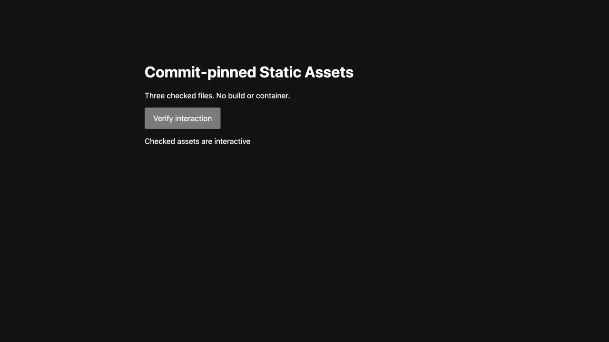
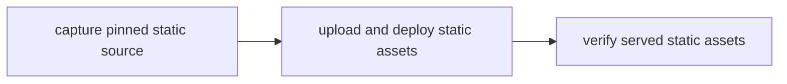

# Publish static files, or compile TypeScript without a container

> Can a DO retain checked, commit-pinned files and publish them through the real Workers Static Assets API?

This owned recipe reads exactly three files from a pinned testbed commit through
a private host service, verifies their Git blob identities and full raw SHA-256,
and retains an immutable SQLite source revision. Its native Workflow uses the
supported Assets upload API and a dedicated Worker version/deployment. No
Container, `npm install`, project-code execution or CLI inside a DO is involved.
**Live native acceptance passed.** The actual three-action Workflow and
independent served-byte, version/allocation and browser checks are recorded in
the [native proof](./verification/native-20261016.md). Local full publication is
still planned; the Local tests below do not grant that matrix cell.

The additional `build` mode compiles a fixed TypeScript fixture in a fresh
Dynamic Worker before using the same publication journal. **Native build and
browser acceptance passed.** See the [actual build proof](./verification/native-build-20261016.md).
This is a bounded TypeScript transform, not a Vite build or arbitrary package installation.

## Bounded build

Use a pushed commit containing `build-site/app.ts`, `build-site/index.html` and
`build-site/style.css`. The private reader authenticates those exact Git blobs;
the Workflow checkpoints their raw manifest before compiling `app.ts` to
`site/app.js`. HTML and CSS pass through unchanged.

```sh
cf workflows instances create effect-ci-static-assets-publish --body \
  '{"instance_id":"my-static-build-checks","params":{"mode":"build-checks","revision":"FULL_40_CHARACTER_COMMIT"}}'
cf workflows instances create effect-ci-static-assets-publish --body \
  '{"instance_id":"my-static-build-run","params":{"mode":"build","revision":"FULL_40_CHARACTER_COMMIT"}}'
```

These are operator commands, not instructions to repeat completed evidence.
First deploy the exact-green App's updated private reader and the broker's
`LOADER` binding using the guarded procedure below. Existing deployments use
`cf deploy --prebuilt` to preserve secrets; the secret-file command below is
**initial provisioning only**. Keep the existing token unchanged.

The compiler is pinned Sucrase 3.35.1, with no project configuration, plugins,
environment bindings or outbound network. Input and emitted JavaScript are each
limited to 32 KiB; the host rechecks source, output and compiler digests. The
child receives a requested 1-second CPU limit and a 5-second host timeout.
Exact CPU enforcement has not been measured; no hard one-second claim is made.

`build-checks` publishes nothing. It checks type erasure, malformed/oversized
input rejection, fresh child state, and denial of network, native process and
known parent-only bundle access. Its revision is a claim, not authentication:
independently bind the deployed Worker/Workflow version to the checked commit.

Builds share the **same 32-revision journal, active-operation fence and pending
mutation history** as no-build publications. SQLite retains bounded raw source
and emitted manifests (at most 96 KiB each) with immutable provenance. A changed
compiler identity conflicts even if emitted bytes match. There is no reset,
eviction, parallel budget or escape from an uncertain upload acknowledgement.
Only the trusted publisher receives the deployment credential; the compiler
receives source text only. A completed receipt binds raw source, compiler and
emitted bytes, but digests alone do not authenticate a Git commit.

Open the [built fixture](https://effect-ci-static-assets-demo.ericclemmons.workers.dev/)
and click **Verify compiled JavaScript**. The live URL now serves this build;
the older no-build screenshot below remains historical evidence, not its current UI.


## Dedicated resources and authority

Eric approved `effect-ci-static-assets-demo` (public),
`effect-ci-static-assets-broker` (private), the
`effect-ci-static-assets-publish` Workflow, `StaticAssetRevisions` SQLite storage,
and the private `StaticAssetSourceReader` export on the existing App.
The [authority record](./AUTHORITY.md) documents the scope and limitations.
The GitHub reader reuses the existing selected-testbed Contents READ capability,
revoking each minted installation token before returning any source receipt.
It never returns a token or permits another repository, path or target.

The operator supplied `STATIC_ASSETS_DEPLOY_TOKEN` in the ignored `.secrets.env`
(mode 600), and explicitly requested leaving it unchanged after inspection. It
is the broader Workers template, not a script-scoped or Scripts-only credential;
the dashboard showed no expiry. The broker's fixed API paths are code fences,
not a cryptographic restriction on that credential. No permission/expiry change
or rotation is performed by this recipe. A narrower dedicated token remains the
recommended setup for other adopters. Never reuse the HMD token or forward local
OAuth into a Worker.

## Setup and run

From a clean exact merged checkout, install frozen workspace dependencies. Deploy
the App's new private export using its existing documented guarded deployment
procedure first: rebuild, verify all existing binding/export identities and
security behavior, preserve secrets, and ensure controllers are idle. App
installation alone does not enroll another repository.

Build each new target locally, then inspect the compiled configuration before
the one guarded deployment. The bootstrap public target returns 404 and has no
bindings or credential. Do not pass the broker secret file to its deployment.

```sh
cd examples/static-assets-source/target
cf build
cf deploy --prebuilt
cd ..
cf build
```

For initial provisioning only, supply `STATIC_ASSETS_DEPLOY_TOKEN` on the private broker through the
supported file-based deployment flag, never via a command argument containing
the value. Confirm that the ignored file contains only that assignment, and do
not pass it to the public target or App:

```sh
cf deploy --prebuilt --secrets-file .secrets.env
```

Record the private create-only intent before this one deployment and independent
readback afterward. These commands do not authorize an unguarded deploy, broader
resources or silent retries.

The authenticated native dispatch is closed to one immutable revision and mode:

```sh
cf workflows instances create effect-ci-static-assets-publish --body \
  '{"instance_id":"my-static-assets-run","params":{"mode":"publish","revision":"FULL_40_CHARACTER_COMMIT"}}'
```

Use a pushed `ericclemmons/effect-ci-testbed` commit containing this directory's
three `site/` files. The only public target is
[the live Static Assets fixture](https://effect-ci-static-assets-demo.ericclemmons.workers.dev/).
In `publish` mode its no-build fixture has **Verify interaction**. The current
live `build` fixture instead has **Verify compiled JavaScript**; do not republish
the old fixture just to reproduce its historical screenshot.



If `cf deploy` uploads the bootstrap but errors afterward, inspect the actual
version and hostname first. Do not deploy again blindly. For the recorded
hostname-only partial failure, the owned helper uses the supported fixed-target
API without another upload; its `enable` mode is only for the still-unbound
bootstrap and requires a private create-only receipt directory:

```sh
node operator/hostname.mjs inspect
node operator/hostname.mjs enable EXPECTED_BOOTSTRAP_VERSION /absolute/private-receipt-directory
node operator/hostname.mjs readback /absolute/private-receipt-directory
```

Create that receipt directory with mode 700. If acknowledgement or propagation
is uncertain, keep the intent and use **readback**, not another enable/deploy.
The current published site is already enabled; do not run bootstrap recovery on it.

## Plan and failure boundaries



The private reader accepts only a lowercase full 40-character Git commit. Source
is exactly `site/app.js`, `site/index.html`, `site/style.css`: regular
non-executable UTF-8, no NUL, at most 32 KiB each and 64 KiB combined. Manifest
bytes are capped at 96 KiB. SQLite retains at most 32 immutable revisions, with
no eviction, overwrite, reset or public writer. Conflicting replay rejects.

Each API mutation has a durable intent before its single attempt. Session and
completion JWTs remain within the host call; only digests/IDs enter receipts.
Unknown ACKs hold the journal, including after a module reload; a new Workflow
cannot bypass the pending operation. A known-version deployment with a lost ACK
can be reconciled through exact deployment annotations/allocation and served-byte
reads, with **zero external writes**. Unknown session/upload/version outcomes
remain held; there is no invented recovery or blind retry.

After deployment there is one fixed 30-second native sleep, followed by one
bounded check of every served asset and the source identity. This is not a
platform convergence guarantee or probe-until-green. Failure does not roll back
an uncertain deployment or claim success. Reconciliation is an explicit separate
mode on the same revision, not permission to upload again.

## Local verification

```sh
node --test ../../packages/cloudflare/src/static-assets-source.test.ts \
  ../../packages/cloudflare/src/static-assets-build.test.ts \
  ../../packages/cloudflare/src/static-assets-github.test.ts \
  ../../packages/cloudflare/src/static-assets-publish.test.ts \
  ../../apps/effect-ci/src/static-assets-read.test.ts \
  ../../apps/effect-ci/src/static-assets-journal-runtime.test.ts
node --test src/runtime.test.ts
VERIFY_STATIC_BUILD_BUNDLE=1 node --test src/compiled-runtime.test.ts
cf-ci plan --workflow .cloudflare/ci/workflow.ts
```

The real local workerd/SQLite test covers concurrency, pending intents across
reload, immutable replay and capacity. API/source tests use fake responses and
credentials: success, lost ACKs, foreign uploads, target drift, corrupt served
bytes, token revocation and redaction. They are **not** native deployment proof.
The build runtime tests use real local WorkerLoader children and SQLite, with
mocked Git/API responses and locally prepared compiler modules. They do not
prove hosted compiler preparation, account limits or a native Assets upload.
The opt-in compiled-broker test builds and loads the actual production bundle,
including worker-bundler/WASM and public pinned compiler dependencies, with no
Git reader or deployment credential. It verifies local preparation and the
eight isolation checks; it is not a native publication.

## Cost and cleanup

Workers, Workflows, SQLite, API and Assets use the existing account plan and may
incur charges; no AI, Container or new provider is required. No custom domain,
DNS, HMD target, existing release allocation or old journal is changed.
Retirement requires an explicit operator decision: revoke this dedicated token,
disable dispatch/private binding, preserve receipts, then remove only these new
targets and their explicitly identified storage. Do not execute cleanup against
the committed Vite release or historical incidents.

## Verification proof

**Video:** Pending — no native feature clip yet.

**Measured results:** [Actual native run, preserved failure/recovery and served-byte proof](./verification/native-20261016.md).
The [native TypeScript build](./verification/native-build-20261016.md) additionally
records compiler isolation, immutable provenance and browser behavior.

Use the [proof-page contract](../PROOF-PAGES.md). Local fake-API timing is not a
deployment benchmark, and the existing DO/Dynamic Worker site is not evidence
for this separate Workers Static Assets API path.
