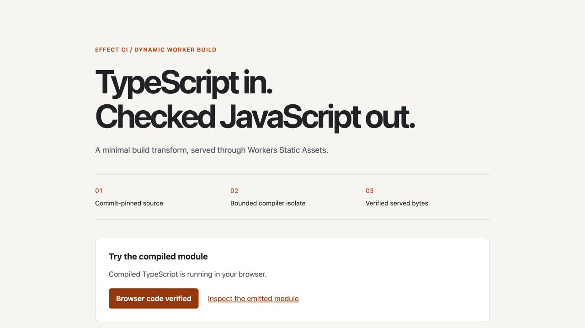

# Native bounded TypeScript build — October 16, 2026 UTC

An authenticated Git source capture, fresh compiler isolate, immutable SQLite
provenance and the trusted Static Assets uploader completed one actual hosted
build-to-served-site run. No Container, new AI call, public-error replay or
repair deployment was used. The main Kumo demo release remained unchanged.

## Exact identities

- Source: `36d7a3bf7df3c8664cdcec5450070ce509c4ebf1`, PR #318.
- Private broker: `3ac809f6-8d4c-436f-8016-59201711f084`.
- Existing CI host/private reader: `1d6fc337-8824-4f10-bf08-f9c17c6261b8`.
- Workflow: `effect-ci-static-assets-publish`, version `607cdbff-a20f-4425-ad84-eec288940f9c`.
- Capability instance: `coverage-owned-static-build-checks-20261016-1`, COMPLETE.
- Build instance: `coverage-owned-static-build-20261016-1`, COMPLETE.
- Public version: `70ca9660-8a05-44da-b515-8e20d1a44f7f`.
- Deployment: `ee5b10c6-63fe-4001-99a2-18356db16aae`, that one version at 100%.

Before deployment, all 287 exact-source CI checks completed: 284 successful,
one intentionally neutral and two intentionally skipped. The host update kept
24 exports, 19 bindings, the exact Container image, secrets and Access fences.
The private broker added only `LOADER`; its source reader, SQLite/Workflow
identities, token and disabled public/preview URLs stayed unchanged.

## Native execution and isolation

| Native work checkpoint | Result |
| --- | --- |
| `source:capture-build-input-1` | Fixed GitHub reader verified raw Git objects and durably captured the bounded raw manifest before compilation |
| `source:build-bounded-1` | Fresh Dynamic Worker compiled TypeScript; host validated complete emitted manifest and retained raw/emitted provenance in the same journal |
| `assets:upload-and-deploy-1` | Existing intent-before-write publisher used the real Assets API and authoritative allocation readback |
| `assets:verify-served-bytes-1` | After one fixed 30-second sleep, all public byte hashes and source identity matched |

Each work checkpoint succeeded in one attempt, retry limit zero, two-minute
timeout. All three CI actions completed with zero Container commands.
Queue **2,134 ms**, execution **45,693 ms**, total **47,827 ms**. One orchestration
sample including the fixed sleep, not a benchmark or convergence guarantee.

The separate native non-publication instance passed all eight fixed checks:
TypeScript erasure, malformed source rejection, oversized source rejection,
empty child bindings, denied network, denied access to a known existing
parent-only bundle, denied native process execution, and fresh child state.
The parent bundle was 1,017,169 bytes, SHA-256
`750bf1b989ff28ec0e9bea0b60052a76508dc7059f5cc5d4e25228fc85980dc4`,
matching the exact uploaded broker bundle. No Assets publication occurred in
that capability instance. CPU was configured at 1,000 ms, subrequests zero,
host wait 5,000 ms; **exact CPU enforcement was not measured**.

The production-bundle local regression first caught a genuine compiler failure:
worker-bundler left `ts-interface-checker` external because its legacy package
`main` omits `.js`. A fixed host-owned alias to pinned 0.1.13's explicit JS entry
resolved it, without adding Node child compatibility or capabilities. The
original failed local receipt is retained; it was not a native publication.
CI now runs that real compiled-bundle test explicitly, not just the locally
prebundled compiler substitute.

## Independent bytes and browser

| Served asset | Bytes | Raw SHA-256 |
| --- | ---: | --- |
| `app.js` | 317 | `a1f54f745e0acd8b10ca02c49a8e6d6aeb6c4b5596533f1def23411489e740d4` |
| `index.html` | 1,136 | `2ed3bba4235c8b339225a90030869dc7d80194e55acf2f0c9cb3f701ebadf4cd` |
| `style.css` | 1,558 | `5783fa446229729d3b7db8cb77aa1deb52bffb7da54560205fdc1fd4cea71a7e` |

Raw source manifest SHA-256:
`dbad8ec1d92d79c30ca7e6a1209b2ab8e7126ec96fd67dce4f0d82b92788ccbd`.
Emitted manifest SHA-256:
`ca610e133ec247677b59b74a371dc70fb70cf6cce2c2cc94b7be306b16ac03bf`.
Asset-set SHA-256:
`89356d27e8feffe608588a7b98e46740d36f573ea45e765dfa7bc8126bcebfcb`.
Compiler-module SHA-256:
`2da12cf0e34f0a6ae3179dff66b660490e9c9cc2a8a1417179d0d4aa588cbbc6`.

Independent HTTP reads reconstructed the complete output manifest from the
authenticated raw fixture and served JavaScript. HTML/CSS exactly matched Git;
generated JavaScript was correctly treated as emitted bytes, not a Git blob.
All assets had the restrictive CSP and `nosniff`; HEAD returned 200, POST 405,
and an unenrolled path 404. The public version had only `ASSETS`, no Git or
deployment credential. Old failed/reconciled/no-build histories were preserved.

The actual built-in browser opened the public fixture and clicked **Verify
compiled JavaScript**. It displayed **Compiled TypeScript is running in your
browser.** and **Browser code verified**.



This is a screenshot, not a recording. Digests bind bytes; the fixed private Git
reader supplies source authentication. Type erasure is not type checking or
arbitrary npm/Vite/native-plugin compatibility. The same 32-revision journal and
pending-operation fences remain; no reset, eviction, new budget or blind retry.

## Read-only revalidation

```sh
LIVE_OWNED_STATIC_BUILD=1 LIVE_OWNED_STATIC_BUILD_CURRENT=1 \
  CF_BIN=apps/effect-ci/node_modules/.bin/cf \
  node --test examples/static-assets-source/src/build-live.test.ts
```

All three checks passed against retained native histories, version metadata,
current allocation and public bytes. Omit `LIVE_OWNED_STATIC_BUILD_CURRENT` after
a legitimate future publication. The reader cannot dispatch, mint a GitHub
token, read a secret file, upload or deploy. Older no-build evidence remains in
[its own proof](./native-20261016.md); its historical checks still apply, but its
old CURRENT check is no longer the current allocation. Never republish it for proof.
