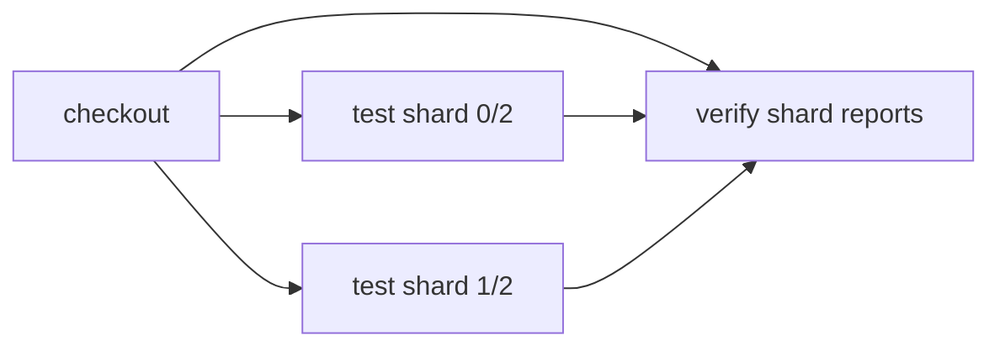

# Split tests across parallel jobs

> How do I split one test suite across jobs without running any test twice?



---

This recipe discovers six test files, sorts their paths, and assigns file `i`
to shard `i % 2`. Each shard receives three files. Their union is the complete
suite and their intersection is empty. No historical timings are required.

[The splitter](./app/scripts/split.mjs) is plain JavaScript;
[the actions](./.cloudflare/ci/actions.ts) create two distinct action IDs and
run them with `CI.parallel`. Calling one memoized action with different arguments
would not create separate shards. Each shard runs real Node tests and writes its
own JSON report under `app/reports/`. An empty shard runs nothing. A failing test
makes its shard, and therefore the workflow, fail.

The fixture includes deliberate unequal delays. Equal file counts do not imply
equal work. The [matrix recipe](../matrix) expands configuration coverage;
this recipe partitions one suite. [Timing-aware splitting](../timing-aware-splitting)
adds duration-based assignment without changing what constitutes a candidate.

Expected result: `a,c,e` on shard 0 and `b,d,f` on shard 1, six passes in total.
Prefix the run command with `FAIL_TEST=a` to demonstrate a failed shard.

The [GitHub comparison](./.github/workflows/github.yml) uses a two-entry shard
matrix and the same standalone script. Reports upload even on test failure.

From the repository root after `pnpm install`:

```sh
pnpm effect-ci --workflow examples/test-splitting/.cloudflare/ci/workflow.ts plan
pnpm effect-ci --workflow examples/test-splitting/.cloudflare/ci/workflow.ts run --format=text
node --test examples/test-splitting/.cloudflare/ci/tests/test-splitting.test.ts
```

Compare [plain GitHub Actions](./.github/workflows/github.yml) with the
[Effect-on-GitHub caller](./.github/workflows/effect-on-github.yml). The repository’s
[parallel recipe checks](../../.github/workflows/parallel-recipes.yml) exercise native
matrix jobs, shard report aggregation, and reuse of measured timing history.

See the [recorded execution evidence](../parallel-recipes-verification.md) for the
local, native GitHub, and Effect-on-GitHub runs. Hosted Cloudflare runs are included in that evidence.

## Run on Cloudflare

This recipe owns its [Worker](./src/worker.ts) and [deployment configuration](./wrangler.jsonc).
From this recipe's directory, with Docker running and Wrangler authenticated:

```sh
pnpm exec wrangler deploy
pnpm exec wrangler workflows trigger effect-ci-test-splitting '{"repository":"https://github.com/ericclemmons/effect-ci-testbed.git","revision":"COMMIT_SHA"}' --id test-splitting-1
pnpm exec wrangler workflows instances describe effect-ci-test-splitting test-splitting-1 --json
```

Use a pushed, full commit SHA. The hosted runner checks out that immutable source;
it does not execute uncommitted local files. Each parallel action gets its own Container.
