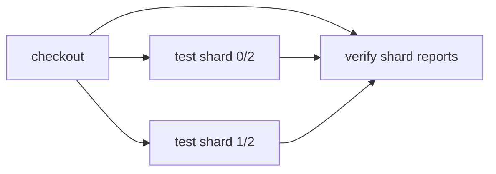

# Split tests across parallel jobs

> How do I split one test suite across jobs without running any test twice?



---

This recipe discovers six test files, sorts their paths, and assigns file `i`
to shard `i % 2`. Each shard receives three files. Their union is the complete
suite and their intersection is empty. No historical timings are required.

The [matrix recipe](../matrix) expands configuration coverage; this recipe
partitions one suite. [Timing-aware splitting](../timing-aware-splitting) adds
duration-based assignment without changing what counts as a candidate.

The snippets on this page come from this example's files, which CI runs end to
end.

## Add a splitter

The splitter is plain JavaScript. It sorts the candidates and deals them out
round-robin:

[`app/scripts/split.mjs`](./app/scripts/split.mjs "source {6}")

## Run one shard

Add a script that discovers the test files, runs only the files for one shard,
and writes a JSON report under `app/reports/`. An empty shard runs nothing. A
failing test sets a nonzero exit code, so its shard, and therefore the workflow,
fails.

[`app/scripts/run-shard.mjs`](./app/scripts/run-shard.mjs "source {12}")

## Check that every test ran once

Add a script that compares the shard reports with the full candidate list:

[`app/scripts/verify-reports.mjs`](./app/scripts/verify-reports.mjs "source {15}")

## Define the actions

Create `.cloudflare/ci/actions.ts`. Start with the imports and a checkout action:

[`.cloudflare/ci/actions.ts`](./.cloudflare/ci/actions.ts#L1-L2 "source")

[`.cloudflare/ci/actions.ts`](./.cloudflare/ci/actions.ts#symbol=checkout "source")

Each shard returns its report as its result:

[`.cloudflare/ci/actions.ts`](./.cloudflare/ci/actions.ts#symbol=ShardReport "source")

Create one action per shard. Each needs its own action ID: calling one memoized
action with different arguments would not create separate shards.

[`.cloudflare/ci/actions.ts`](./.cloudflare/ci/actions.ts#symbol=shards "source {2}")

The final action waits for every shard, then passes their reports to the check
script as one shell-quoted argument:

[`.cloudflare/ci/actions.ts`](./.cloudflare/ci/actions.ts#symbol=shellQuote "source")

[`.cloudflare/ci/actions.ts`](./.cloudflare/ci/actions.ts#symbol=verifyReports "source")

## Define the workflow

Create `.cloudflare/ci/workflow.ts`. It runs both shards with `CI.parallel`,
then verifies them:

[`.cloudflare/ci/workflow.ts`](./.cloudflare/ci/workflow.ts "source {5}")

## Run it

The fixture includes deliberate unequal delays. Equal file counts do not imply
equal work.

From the repository root after `pnpm install`:

```sh
cd examples/test-splitting
effect-ci plan
effect-ci run --format=text
node --test .cloudflare/ci/tests/test-splitting.test.ts
```

Expected result: `a,c,e` on shard 0 and `b,d,f` on shard 1, six passes in total.
Prefix the run command with `FAIL_TEST=a` to demonstrate a failed shard.

## Compare with GitHub Actions

The plain GitHub Actions workflow uses a two-entry shard matrix and the same
standalone script. Reports upload even on test failure.

[Plain GitHub Actions](./.github/workflows/github.yml#L12-L33 "source")

Compare it with the [Effect-on-GitHub caller](./.github/workflows/effect-on-github.yml).
The repository’s [parallel recipe checks](../../.github/workflows/parallel-recipes.yml)
exercise native matrix jobs, shard report aggregation, and reuse of measured
timing history.

See the [recorded execution evidence](../parallel-recipes-verification.md) for the
local, native GitHub, and Effect-on-GitHub runs. Hosted Cloudflare runs are
included in that evidence.

## Run on Cloudflare

This recipe owns its Worker and its [deployment configuration](./wrangler.jsonc):

[Worker](./src/worker.ts "source")

From this recipe's directory, with Docker running and Wrangler authenticated:

```sh
pnpm exec wrangler deploy
pnpm exec wrangler workflows trigger effect-ci-test-splitting '{"repository":"https://github.com/ericclemmons/effect-ci-testbed.git","revision":"COMMIT_SHA"}' --id test-splitting-1
pnpm exec wrangler workflows instances describe effect-ci-test-splitting test-splitting-1 --json
```

Use a pushed, full commit SHA. The hosted runner checks out that immutable source;
it does not execute uncommitted local files. Each parallel action gets its own Container.

## cf ci comparison

[cf ci workflow](./.cloudflare/cf-ci/src/index.ts) runs both shards in parallel.
Each saves its JSON report as an output, even when a test fails, and a final
step checks that every test ran exactly once. It does not use Effect CI.

```sh
(cd examples/test-splitting/.cloudflare/cf-ci && npm ci)
node scripts/cf-ci.mjs test-splitting
```

See [node-npm](../node-npm/README.md#cf-ci-comparison) for how the script
deploys the pipeline and checks the run.
