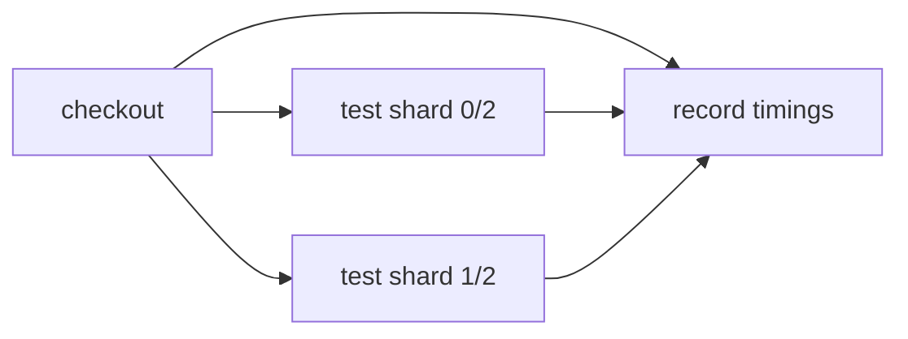

# Balance test shards using recorded timings

> How do I use previous test durations to balance the work across parallel jobs?



---

This extends [deterministic splitting](../test-splitting) with a small, local
feedback loop inspired by [Depot’s timing-based example](https://x.com/depotdev/status/2113673932054421800).
It owns a copy of the fixture and scripts so it remains independently runnable.

1. Discover all six test files.
2. Read `app/timings.json`, if present. Unknown files use the median known duration;
   a first run uses equal weights. Invalid or nonpositive durations use the fallback.
3. Sort by descending estimated duration, then assign each file to the lightest
   shard. Tie breaking is deterministic. Whole files stay together.
4. Run both shards in parallel and write distinct JSON reports.
5. After both pass, merge their durations into `app/timings.json` for the next run.

Run the workflow twice. On a fresh checkout, the first run uses fallback weights;
the second uses the timings just recorded. History changes **which files run in
each shard**. The shard count remains two: choosing that count is a separate tuning
decision. The assertions also demonstrate a fixed illustrative history where six
files partition into four and two files with equal estimated loads of 160 each.
Those illustrative weights are not measured benchmark results.

The [runner](./app/scripts/run-shard.mjs) measures wall time for a separate Node test
process per file, including startup. It runs files serially within each shard and
writes a compact JSON report, rather than parsing JUnit or integrating Depot.
[The recorder](./app/scripts/update-history.mjs) accepts exactly one report for
every shard, rejects duplicate candidates and failed measurements, and replaces
the previous history only after a successful run. A failed workflow leaves previous
history intact. Prefix the run command with `FAIL_TEST=a` to demonstrate this.

The [GitHub comparison](./.github/workflows/github.yml) restores prior timings,
runs the two shard jobs, downloads their reports, then saves the merged history
in a new cache entry. Native runner execution is verified; cross-run cache
persistence in that standalone comparison remains unverified.
The local Effect runner shares a filesystem; an isolated snapshot runner would need
artifact publication and aggregation before recording timings. Cloudflare support
is unverified. This is a disposable proof, not a general test analytics service.

Expected result: six tests run exactly once, two shard reports, and six positive
recorded durations. Reports and timing history are ignored by Git. Delete
`app/timings.json` to repeat the cold-start case. A tiny delayed fixture proves
assignment and feedback behavior; it is not evidence of a CI speedup.

From the repository root after `pnpm install`:

```sh
pnpm cf-ci --workflow examples/timing-aware-splitting/.cloudflare/ci/workflow.ts plan
pnpm cf-ci --workflow examples/timing-aware-splitting/.cloudflare/ci/workflow.ts run --format=text
node --test examples/timing-aware-splitting/.cloudflare/ci/tests/timing-aware-splitting.test.ts
```

Compare [plain GitHub Actions](./.github/workflows/github.yml) with the
[Effect-on-GitHub caller](./.github/workflows/effect-on-github.yml). The repository’s
[parallel recipe checks](../../.github/workflows/parallel-recipes.yml) exercise native
matrix jobs, shard report aggregation, and reuse of measured timing history.

See the [recorded execution evidence](../parallel-recipes-verification.md) for the
local, native GitHub, and Effect-on-GitHub runs. Cloudflare remains unverified.
