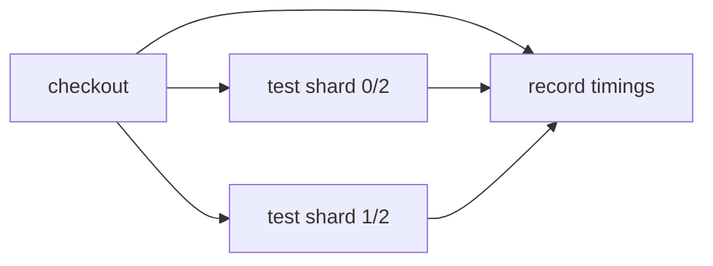

# Balance test shards using recorded timings

> How do I use previous test durations to balance the work across parallel jobs?



---

This extends [deterministic splitting](../test-splitting) with a small, local
feedback loop inspired by [Depot’s timing-based example](https://x.com/depotdev/status/2113673932054421800).
It owns a copy of the fixture and scripts so it remains independently runnable.

1. Discover all six test files.
2. Read `app/timings.json`, if present. Unknown files use the median known duration;
   a first run uses equal weights. Invalid or nonpositive durations use the fallback.
3. Sort by descending estimated duration, then assign each file to the lightest
   shard. Tie breaking is deterministic. Whole files stay together.
4. Run both shards in parallel and write distinct JSON reports.
5. After both pass, merge their durations into `app/timings.json` for the next run.

This is a disposable proof, not a general test analytics service.

The snippets on this page come from this example's files, which CI runs end to
end.

## Add a timing-aware splitter

The splitter weighs each file by its recorded duration, then gives the next
heaviest file to the lightest shard:

[`app/scripts/split.mjs`](./app/scripts/split.mjs "source {11-16}")

## Run one shard

The runner reads the recorded history, if any, and runs the files for one shard.
It measures wall time for a separate Node test process per file, including
startup. It runs files serially within each shard and writes a compact JSON
report, rather than parsing JUnit or integrating Depot.

[`app/scripts/run-shard.mjs`](./app/scripts/run-shard.mjs "source {12-13}")

## Record the timings

The recorder accepts exactly one report for every shard, rejects duplicate
candidates and failed measurements, and replaces the previous history only after
a successful run. A failed workflow leaves previous history intact.

[`app/scripts/update-history.mjs`](./app/scripts/update-history.mjs "source {29}")

## Define the actions

Create `.cloudflare/ci/actions.ts`. Start with the imports and a checkout action:

[`.cloudflare/ci/actions.ts`](./.cloudflare/ci/actions.ts#L1-L2 "source")

[`.cloudflare/ci/actions.ts`](./.cloudflare/ci/actions.ts#symbol=checkout "source")

Each shard returns its report, including the history it used, as a durable
action result:

[`.cloudflare/ci/actions.ts`](./.cloudflare/ci/actions.ts#symbol=ShardReport "source")

Create one action per shard. Each needs its own action ID, because the runtime
memoizes actions by ID, not by arguments:

[`.cloudflare/ci/actions.ts`](./.cloudflare/ci/actions.ts#symbol=shards "source {2}")

The join waits for both shards and passes their reports to the recorder as one
shell-quoted argument. It materializes those reports in its own filesystem, so
it works with isolated Containers as well as local runs:

[`.cloudflare/ci/actions.ts`](./.cloudflare/ci/actions.ts#symbol=shellQuote "source")

[`.cloudflare/ci/actions.ts`](./.cloudflare/ci/actions.ts#symbol=recordTimings "source")

## Define the workflow

Create `.cloudflare/ci/workflow.ts`. It runs both shards in parallel, then
records their timings:

[`.cloudflare/ci/workflow.ts`](./.cloudflare/ci/workflow.ts "source {5-6}")

## Run it

From the repository root after `pnpm install`:

```sh
cd examples/timing-aware-splitting
effect-ci plan
effect-ci run --format=text
node --test .cloudflare/ci/tests/timing-aware-splitting.test.ts
```

Run the workflow twice. On a fresh checkout, the first run uses fallback weights;
the second uses the timings just recorded. History changes **which files run in
each shard**. The shard count remains two: choosing that count is a separate tuning
decision. The assertions also demonstrate a fixed illustrative history where six
files partition into four and two files with equal estimated loads of 160 each.
Those illustrative weights are not measured benchmark results.

Expected result: six tests run exactly once, two shard reports, and six positive
recorded durations. Reports and timing history are ignored by Git. Delete
`app/timings.json` to repeat the cold-start case. Prefix the run command with
`FAIL_TEST=a` to show that a failed run keeps the previous history.

A tiny delayed fixture proves assignment and feedback behavior; it is not
evidence of a CI speedup.

## Compare with GitHub Actions

The plain GitHub Actions workflow restores prior timings, runs the two shard
jobs, downloads their reports, then saves the merged history in a new cache
entry:

[Plain GitHub Actions](./.github/workflows/github.yml#L11-L63 "source")

Native runner execution is verified; cross-run cache persistence in that
standalone comparison remains unverified.

Compare it with the [Effect-on-GitHub caller](./.github/workflows/effect-on-github.yml).
The repository’s [parallel recipe checks](../../.github/workflows/parallel-recipes.yml)
exercise native matrix jobs, shard report aggregation, and reuse of measured
timing history.

See the [recorded execution evidence](../parallel-recipes-verification.md) for the
local, native GitHub, and Effect-on-GitHub runs. Hosted Cloudflare runs are
included in that evidence.

## Run on Cloudflare

This recipe owns its Worker and its [deployment configuration](./wrangler.jsonc).
The Worker checkpoints the join's workspace and restores only `app/timings.json`
through its runner cache on the next instance:

[Worker](./src/worker.ts "source {11-15}")

From this recipe's directory, with Docker running and Wrangler authenticated:

```sh
pnpm exec wrangler deploy
pnpm exec wrangler workflows trigger effect-ci-timing-aware-splitting '{"repository":"https://github.com/ericclemmons/effect-ci-testbed.git","revision":"COMMIT_SHA"}' --id timing-aware-splitting-1
pnpm exec wrangler workflows instances describe effect-ci-timing-aware-splitting timing-aware-splitting-1 --json
```

Use a pushed, full commit SHA. The hosted runner checks out that immutable source;
it does not execute uncommitted local files. Each parallel action gets its own Container.

Run a second instance with a different ID and the same revision to exercise restored history.
