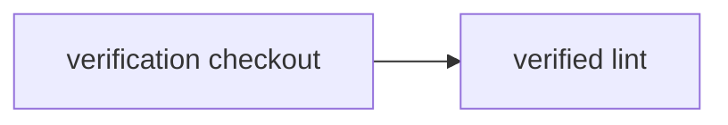

# Reuse verified checks for a commit

> If the exact commit already passed lint locally, can trusted CI avoid doing the same work again?



---

A reusable assertion is a `CI.check`, not an ordinary state-producing action:

```ts
CI.check("lint", () => function* () {
  const workspace = yield* checkout()

  yield* workspace.exec("node --check app/index.js")
}, {
  reuse: { scope: "commit" },
})
```

`CI.check` can only return `void`: success or failure is its entire public result. That
does not magically prove purity—the command must still avoid modifying external state
or producing a workspace consumed later—but it makes the contract visible and prevents
the check from returning a new workspace revision or deployable artifact.

The fingerprint binds repository, commit, workflow, check, policy, and command—not a
machine-specific checkout path. `gitNotesCheckCache` signs it with Ed25519 and stores the
envelope under `refs/notes/effect-ci`. Recording requires a private key; CI receives
only the enrolled public key. A valid note skips the command. A missing note, changed
revision, invalid signature, or lookup error runs it normally.

```ts
const local = gitNotesCheckCache({ cwd, privateKey, publicKey })
const ci = gitNotesCheckCache({ cwd, publicKey })
```

Git notes do not change the commit hash, so evidence can be attached after an agent
finishes checking the commit. The notes ref must be pushed and fetched explicitly:

```sh
git push origin refs/notes/effect-ci
git fetch origin refs/notes/effect-ci:refs/notes/effect-ci
```

Trust is repository policy, not something the signature decides:

- **Developer-authorized:** a collaborator with push access signs both the commit and
  the verification envelope using an enrolled GPG, SSH, or device key. This proves who
  asserted the result, not that an independent machine observed the execution. It is a
  pragmatic policy for lint, formatting, type checking, and ordinary tests.
- **Managed-agent:** only keys issued to approved agent sandboxes are accepted. This
  reduces trust in arbitrary developer machines while still allowing agents to finish
  checks before pushing.
- **Remote-attested:** local execution dispatches a trusted remote runner, which signs
  the result and returns asynchronously. This gives stronger execution provenance but
  intentionally does not save remote compute.

A signed Git commit by itself is insufficient because it contains no assertion about
which action ran or what result it produced. The evidence needs its own signature (or
must be included in signed commit content) and must bind to that exact commit. The
GitHub App verifies the configured policy and publishes the required check; GitHub is
never asked to trust an arbitrary status submitted by the developer. Repositories can
mix policies—for example, accepting developer proofs for lint while always rerunning
release and security checks remotely.

Only side-effect-free checks belong here. Checkout, install, builds, migrations,
deployments, and artifact-producing work remain ordinary actions even if a runner can
separately cache their bytes or workspace snapshots.

## Commit first, then attest

Commits are checkpoints, not assertions that checks passed. An authorized agent
should commit its changes, run checks against that exact commit, and attach signed
evidence as a Git note after success. Failed checks do not invalidate the usefulness
of the commit: fix the failure in another commit and verify that new commit.

The agent-facing flow is:

1. Commit the intended changes, preserving unrelated user edits.
2. Check the exact committed revision using the required action, toolchain and policy.
3. On success, attach its signed verification envelope under `refs/notes/effect-ci`.
4. Push the commit and notes ref; CI verifies the signature and exact-commit fingerprint.

Use notes for post-check evidence: adding a trailer by amending the checked commit
changes its hash and requires checking that new commit again. Creating a commit does
not itself authorize a push, merge or release; those remain separately scoped actions.

Local checks may still run against a dirty working tree for feedback, but that result
is not reusable attestation. The current adapter neither reuses nor publishes evidence
for old `HEAD` when local edits were tested. A separate dirty-tree fingerprint and
pre-commit-to-commit proof handoff are intentionally **not part of the roadmap**.
Dependency/toolchain and policy fingerprints still matter for commit-bound evidence;
a clean Git status alone does not prove those inputs match.

The [gittifacts example](https://gittifacts.decroockjovi.workers.dev/) illustrates
portable Ed25519 evidence attached to exact commits and a separate intent/review
policy. Its demo is a design reference, not evidence that this testbed implements
its review lanes or merge queue. Plain operator notes under
`refs/notes/effect-ci-verification` record our run history but are **advisory**:
they are not signed envelopes and never authorize this cache to skip checks.

Run the canonical workflow locally with
`./examples/verification-evidence/.cloudflare/ci/workflow.ts`, or through
[Effect on GitHub](./.github/workflows/effect-on-github.yml). The executable test
creates a real Git repository, records a signed note, verifies it with a public-only
runner, and proves that changing the commit forces execution again.
