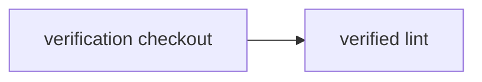

# Reuse verified checks for a commit

> If the exact commit already passed lint locally, can trusted CI avoid doing the same work again?

The local recipe below demonstrates signed check reuse. The owned Cloudflare demo
also has a narrower, live-verified enrollment: one pure TypeScript syntax check.
It does **not** yet reuse lint or the test suite. See
[retained native evidence](#retained-native-demo-evidence) for the distinction.



---

A reusable assertion is a `CI.check`, not an ordinary state-producing action:

```ts
CI.check("lint", () => function* () {
  const workspace = yield* checkout()

  yield* workspace.exec("node --check app/index.js")
}, {
  reuse: { scope: "commit" },
})
```

`CI.check` can only return `void`: success or failure is its entire public result. That
does not magically prove purity—the command must still avoid modifying external state
or producing a workspace consumed later—but it makes the contract visible and prevents
the check from returning a new workspace revision or deployable artifact.

The fingerprint binds repository, commit, workflow, check, policy, and command—not a
machine-specific checkout path. `gitNotesCheckCache` signs it with Ed25519 and stores the
envelope under `refs/notes/effect-ci`. Recording requires a private key; CI receives
only the enrolled public key. A valid note skips the command. A missing note, changed
revision, invalid signature, or lookup error runs it normally.

```ts
const local = gitNotesCheckCache({ cwd, privateKey, publicKey })
const ci = gitNotesCheckCache({ cwd, publicKey })
```

Git notes do not change the commit hash, so evidence can be attached after an agent
finishes checking the commit. The notes ref must be pushed and fetched explicitly:

```sh
git push origin refs/notes/effect-ci
git fetch origin refs/notes/effect-ci:refs/notes/effect-ci
```

Trust is repository policy, not something the signature decides:

- **Developer-authorized:** a collaborator with push access signs both the commit and
  the verification envelope using an enrolled GPG, SSH, or device key. This proves who
  asserted the result, not that an independent machine observed the execution. It is a
  pragmatic policy for lint, formatting, type checking, and ordinary tests.
- **Managed-agent:** only keys issued to approved agent sandboxes are accepted. This
  reduces trust in arbitrary developer machines while still allowing agents to finish
  checks before pushing.
- **Remote-attested:** local execution dispatches a trusted remote runner, which signs
  the result and returns asynchronously. This gives stronger execution provenance but
  intentionally does not save remote compute.

A signed Git commit by itself is insufficient because it contains no assertion about
which action ran or what result it produced. The evidence needs its own signature (or
must be included in signed commit content) and must bind to that exact commit. The
GitHub App verifies the configured policy and publishes the required check; GitHub is
never asked to trust an arbitrary status submitted by the developer. Repositories can
mix policies—for example, accepting developer proofs for lint while always rerunning
release and security checks remotely.

### Hosted exact-input verifier

The Cloudflare package now provides `hostedCheckBytes` and
`verifyHostedCheckEvidence`: a bounded, read-only WebCrypto Ed25519 verifier with
no Git subprocess or signer secret. Its versioned identity binds the canonical
repository URL, full commit, workflow/check/command, policy digest, toolchain
digest and prepared-source digest. The host supplies the expected identity and
explicitly enrolled public keys; project code must not choose either.

Malformed, missing, mismatched, legacy/advisory or unknown-key evidence returns a
miss. This new format deliberately does not accept the older local Git-note
envelope, whose policy field only binds the commit reuse scope and does not bind
toolchain or prepared-source digests. Neither format authorizes ordinary actions
or deployment reuse; the host still has to enforce eligibility for a genuinely
side-effect-free `CI.check`.

Node tests and an actual local workerd test use ephemeral lab keys to prove
exact-input signature verification and fail-closed misses. The workerd test pins
expected inputs and only raw public-key bytes in host bindings; an incoming
request cannot substitute its own expected identity. Raw key import avoids
Node/workerd differences in exported JWK algorithm labels.
These verifier tests alone are not hosted cache reuse proof. The separately
enrolled demo now supplies trusted note fetching, host-computed input identities,
an approved signer and actual native execute-versus-reuse histories; that narrow
integration is recorded below. General check enrollment and the remaining
comparison work in [#144](https://github.com/ericclemmons/effect-ci-testbed/issues/144)
are not complete.

`readGitHubCheckNote` supplies a separate host-only retrieval primitive for the
dedicated `refs/notes/effect-ci-hosted-checks-v1` namespace. It pins the notes
commit before reading its tree/blob, supports flat and fanout Git-note paths,
and verifies the decoded bytes against their Git blob object ID. It uses fixed
GitHub GET endpoints and a host-owned request callback; project code receives
neither that callback nor GitHub credentials. Responses are size-bounded, with
a ten-second overall deadline; missing/auth/redirect/truncation/ambiguity or
integrity errors return a miss without reflected upstream errors.

Retrieval is **not authorization**. The returned text still needs the exact-input
signature verifier and approved trust policy. Retrieval unit tests use mocked
GitHub responses; the demo's native integration uses the fixed dedicated notes
ref. The operator's advisory `effect-ci-verification` notes are never read as
reusable proof.

Only side-effect-free checks belong here. Checkout, install, builds, migrations,
deployments, and artifact-producing work remain ordinary actions even if a runner can
separately cache their bytes or workspace snapshots.

### Read-only hosted cache adapter

`hostedCheckCache` from `@effect-ci-testbed/cloudflare/check-cache` now composes the
dedicated immutable Git-note reader with the enrolled exact-input verifier and the
actual `CI.CheckCache` interface. Runner-owned `identify(request)` must compute
source/toolchain/policy digests from the **actual prepared workspace and runtime**,
and return `undefined` for dirty, incomplete or non-pure inputs. Project-provided
hashes, event payloads, command names and a clean Git status are not substitutes.
The adapter cross-checks repository, full revision, workflow, step and command
against the CI request before reading the note. It snapshots expected inputs before
network access; incoming evidence cannot replace them.

Only a matching host enrollment and signature return a hit. Missing or malformed
notes, network failures, changed inputs, unknown/revoked keys and ineligible checks
are misses; CI executes normally. `record` is deliberately a no-op: the hosted
adapter has no private key and never writes notes or enrolls signers. Ordinary
actions remain outside the cache even when their command matches a signed check.

Reproduce the adapter, integrity and trust regressions from the repository root:

```sh
node --test packages/cloudflare/src/check-cache.test.ts packages/cloudflare/src/check-evidence.test.ts packages/cloudflare/src/check-note.test.ts
pnpm --filter @effect-ci-testbed/cloudflare check
```

The integration test uses actual CI orchestration and real **local** Node syntax
checks for misses, with four ordinary action executions preserved across two signed
check hits. GitHub replies, identity digests and ephemeral signing keys are lab
fixtures. Those adapter tests generate/enroll no production signer, skip no native
command, and push no Git note. No external permissions, credentials, resource creation
or paid services are needed; the temporary local fixture contains only `app.js`.
The demo's separate host input computation, signer enrollment and retained native
execute/reuse/fallback evidence are described below. This adapter must be
installed by trusted runner code, not exposed as a project-selected bypass.

### Demo enrollment and revocation

The operator has authorized a **dedicated demo signing key**, not a repository-wide
trust bypass. Enrollment is a host-controlled allowlist binding a public key to one
demo repository and explicit side-effect-free checks. A project cannot enroll itself,
choose the verifier's expected inputs, or opt a build/deploy/release into reuse.
The private key stays on the local signing machine; only the public key belongs in
the hosted verifier configuration. The installed demo enrollment applies only to
its fixed syntax-check identity, not to this recipe's illustrative lint command.

The intended user journey is:

1. Commit the change. Run the approved check against that exact clean commit.
2. The local signer binds the successful result to the repository, full commit,
   workflow, check, exact command, policy, toolchain and prepared-source digests.
3. Attach the signed envelope as a Git note and push the dedicated
   `refs/notes/effect-ci-hosted-checks-v1` ref alongside the source commit.
4. The hosted runner prepares the actual source and computes its own identity.
   It reads the note and verifies it using the host's enrolled public key and
   repository/check allowlist. An exact match may reuse **only that check**.
5. Missing notes, changed inputs, wrong repository/check, unknown keys, invalid
   signatures or lookup failures execute the check normally. Checkout, installation,
   builds, artifacts and deployment continue normally even after a valid check hit.

Removing the public key from the host allowlist revokes reuse for that signer.
Removing one check from the policy revokes reuse for that check. Rotation means
enrolling a new public key and removing the old one; old notes do not acquire trust
merely because they remain in Git. Changes to the policy digest invalidate earlier
proofs. Git note transport and cryptographic validity alone never grant authority.

This is **developer/agent-signed verification**: an authorized signer asserts that
the check passed. It does not prove execution on independent hardware, guarantee a
compromise-free signing machine, or turn an advisory operator note into trusted
evidence.

### Retained native demo evidence

Seven retained Cloudflare runs checked commit
`b22f6cfc30b7feb480cb25e30a86576a431276cb`. With a valid exact-input note, the
host verified the pure syntax check and omitted its parser command. Missing
evidence, a tampered signature, wrong commit, changed prepared-input digest,
changed policy digest and an unknown key all executed the parser normally.
The input inspector and all six ordinary package commands ran in every case,
with zero command retries. These are historical acceptance runs, not a claim
that every later preview is healthy.

The fixed parser strips TypeScript and constructs an **unlinked**
`vm.SourceTextModule`: it does not import or evaluate project code. Its identity
binds the actual committed input bytes, Linux Node runtime, repository, full
commit, command and host policy. The private key stays local; the host receives
only the enrolled public key. Whole-container cross-run snapshot transport is
disabled for this attested host so project-modified system executables cannot
be restored as trusted inspection tools.

Read the existing histories without signing, pushing notes or dispatching work:

```sh
LIVE_DEMO_SIGNED_CHECKS=1 CF_BIN="$PWD/apps/effect-ci/node_modules/.bin/cf" \
  node --test apps/effect-ci/src/live-demo-signed-check.test.ts
```

See [exact native instances, observed timings and retained failures](../../apps/effect-ci/README.md#enrolled-demo-syntax-check-reuse).
The timings include orchestration and are not an isolated performance benchmark.
Full test-suite reuse, the remaining backend/developer-loop comparison in
[#144](https://github.com/ericclemmons/effect-ci-testbed/issues/144), and
[cross-merge provenance](https://github.com/ericclemmons/effect-ci-testbed/issues/229)
remain unfinished. Copying an old signature to a merge commit does not authorize
reuse, and this documentation change grants no new signer or trust authority.

## Commit first, then attest

Commits are checkpoints, not assertions that checks passed. An authorized agent
should commit its changes, run checks against that exact commit, and attach signed
evidence as a Git note after success. Failed checks do not invalidate the usefulness
of the commit: fix the failure in another commit and verify that new commit.

The agent-facing flow is:

1. Commit the intended changes, preserving unrelated user edits.
2. Check the exact committed revision using the required action, toolchain and policy.
3. On success, attach its signed verification envelope under `refs/notes/effect-ci`.
4. Push the commit and notes ref; CI verifies the signature and exact-commit fingerprint.

Use notes for post-check evidence: adding a trailer by amending the checked commit
changes its hash and requires checking that new commit again. Creating a commit does
not itself authorize a push, merge or release; those remain separately scoped actions.

Local checks may still run against a dirty working tree for feedback, but that result
is not reusable attestation. The current adapter neither reuses nor publishes evidence
for old `HEAD` when local edits were tested. A separate dirty-tree fingerprint and
pre-commit-to-commit proof handoff are intentionally **not part of the roadmap**.
Dependency/toolchain and policy fingerprints still matter for commit-bound evidence;
a clean Git status alone does not prove those inputs match.

The [gittifacts example](https://gittifacts.decroockjovi.workers.dev/) illustrates
portable Ed25519 evidence attached to exact commits and a separate intent/review
policy. Its demo is a design reference, not evidence that this testbed implements
its review lanes or merge queue. Plain operator notes under
`refs/notes/effect-ci-verification` record our run history but are **advisory**:
they are not signed envelopes and never authorize this cache to skip checks.

Run the canonical workflow locally with
`./examples/verification-evidence/.cloudflare/ci/workflow.ts`, or through
[Effect on GitHub](./.github/workflows/effect-on-github.yml). The executable test
creates a real Git repository, records a signed note, verifies it with a public-only
runner, and proves that changing the commit forces execution again.

## Verification proof

**Video:** Pending — no same-run recording has been published for this recipe.

**Measured results:** Pending — no structured per-environment timing summary has
been published here. Existing recorded runs and coverage claims remain as documented;
missing media or measurements do not imply those runs failed or were never verified.

Use the [proof-page contract](../PROOF-PAGES.md) for exact revision/environment,
assertions, video/transcript, outcome and cold/warm timings. See the
[coverage matrix](../../README.md#recipes-by-feature) for current backend support.
