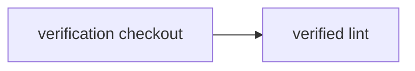

# Reuse verified checks for a commit

> If the exact commit already passed a check, can CI reuse that result?

This recipe demonstrates developer-signed Git notes. The deployed demo now uses
**host-issued receipts** for its fixed demo test suite and build snapshot:
[remote execution → SCM reuse → PR approval](../../apps/effect-ci/TRUSTED-REMOTE.md).
That proof does not enroll arbitrary projects or turn this recipe into a hosted
signer. Local feedback, trusted execution and approval policy are separate things.



## Try the recipe

```sh
pnpm cf-ci --workflow examples/verification-evidence/.cloudflare/ci/workflow.ts
node --test examples/verification-evidence/.cloudflare/ci/tests/verification-evidence.test.ts
```

The local test creates a Git repository and signs a note with an ephemeral key.
A public-key-only consumer reuses the exact committed check; changed, staged or
untracked source executes normally. Its command executor is a test fixture, not
a claim that this test independently executed lint on trusted remote compute.
The [conventional YAML](./.github/workflows/github.yml) runs the syntax check
normally; [Effect on GitHub](./.github/workflows/effect-on-github.yml) runs the recipe.

## Choose a reusable check

```ts
CI.check("lint", () => function* () {
  const workspace = yield* checkout()
  yield* workspace.exec("node --check app/index.js")
}, {
  reuse: { scope: "commit" },
})
```

A `CI.check` returns only success or failure, never a workspace or artifact.
It still needs a side-effect-free implementation and an operator-approved input
contract. A type alone does not establish purity.

Ordinary actions, builds, migrations and deployments do not become skippable
because a check passed. Reusing build output is a separate contract: verify the
producer, inputs and runtime, then restore available output bytes. See
[trusted-runner receipts](../../packages/cloudflare/src/trusted-runner-receipts.md).

## Commit first, then record proof

```ts
import { gitNotesCheckCache } from "@effect-ci-testbed/github"

const writer = gitNotesCheckCache({ cwd, privateKey, publicKey })
const reader = gitNotesCheckCache({ cwd, publicKey })
```

1. Commit the intended changes.
2. Run the approved check against that exact clean commit.
3. Let the configured writer sign successful evidence.
4. Push the commit and its notes ref; the consumer verifies its own expected identity.

```sh
git push origin refs/notes/effect-ci
git fetch origin refs/notes/effect-ci:refs/notes/effect-ci
```

The local envelope binds repository, commit, workflow, check, reuse policy and
command. It does not provide the hosted format's prepared-source/toolchain
guarantees. Dirty-tree results remain feedback; amending a checked commit changes
its identity and needs new evidence. A signed commit alone says nothing about
which checks ran.

## Host policy owns trust

The host supplies expected inputs and enrolled public keys. A note cannot enroll
its signer or replace the identity being verified. Removing a key or check from
policy revokes reuse. Advisory `refs/notes/effect-ci-verification` notes never
authorize a skip.

For a Worker-compatible consumer, use
`hostedCheckCache` from `@effect-ci-testbed/cloudflare/check-cache`.
It reads the dedicated `refs/notes/effect-ci-hosted-checks-v1` namespace and
verifies repository, full commit, workflow/check/command, policy, toolchain and
prepared-source digests. Trusted runner code computes these from the actual
prepared workspace and runtime—not project-supplied hashes or Git status alone.

The reader pins the notes commit, verifies Git blob integrity and applies bounded
retrieval plus the enrolled signature policy. Missing, malformed, mismatched,
unknown-key or unavailable evidence is a miss: execute the check. It has no
signing key and writes no notes. The older local envelope is not accepted as
hosted exact-input proof.

```sh
node --test packages/cloudflare/src/check-cache.test.ts packages/cloudflare/src/check-evidence.test.ts packages/cloudflare/src/check-note.test.ts
```

These adapter tests use ephemeral keys and mocked GitHub replies. They do not
enroll a production signer or prove a live private-repository integration.
[General execution observations](../../packages/cloudflare/src/execution-receipt.md)
and the [private commit journal](../../packages/cloudflare/src/execution-journal.md)
are separate SDK contracts; storing a signed commitment does not restore files
or automatically authorize reuse.

## Retained native demo evidence

The historical Git-note acceptance checked commit
`b22f6cfc30b7feb480cb25e30a86576a431276cb`: a valid note skipped only the pure
TypeScript syntax parser. Missing notes, invalid signatures, wrong commits,
changed prepared inputs/policy and unknown keys executed it normally.
The inspector and all six ordinary package commands ran in every case.
The private signing key stayed local; only the enrolled public key reached the host.

```sh
LIVE_DEMO_SIGNED_CHECKS=1 CF_BIN="$PWD/apps/effect-ci/node_modules/.bin/cf" \
  node --test apps/effect-ci/src/live-demo-signed-check.test.ts
```

This reads existing histories; it does not sign, push notes or dispatch work.
[Exact native instances and retained failures](../../apps/effect-ci/README.md#enrolled-demo-syntax-check-reuse)
remain separate from the newer
[host-issued test/build proof](../../apps/effect-ci/TRUSTED-REMOTE.md).
Neither proof implies automatic suite enrollment or fresh-account setup.

Remaining environment/developer-loop coverage is tracked in
[#144](https://github.com/ericclemmons/effect-ci-testbed/issues/144).
Cross-merge provenance is [#229](https://github.com/ericclemmons/effect-ci-testbed/issues/229):
squash/rebase does not inherit a different commit's signature.
PR approval is a workflow policy decision, not a consequence of caching.
