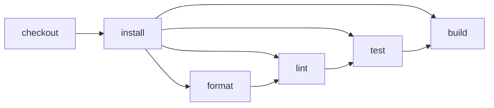

# Discover checks automatically

> How do I get an inspectable CI workflow by adding an empty `ci.ts`?



---

The empty [`.cloudflare/ci/ci.ts`](./.cloudflare/ci/ci.ts) is the opt-in. An explicit
local `cf-ci run` in a package with conventional scripts and no discovered workflow
creates this empty marker automatically, then executes the inferred workflow.
`cf-ci run lint` creates it and runs the selected inferred target. A known package
manager declaration or lockfile is needed for installation. Existing workflows
are never overwritten; unknown targets and packages without supported scripts
are rejected before creating the marker. Initialization refuses symlinked config
directories. `plan`, `list`, explicit workflow paths and remote dispatch remain
non-initializing. With the marker in place, `cf-ci`
discovers `package.json`, detects conventional `format`, `lint`, `check`, `typecheck`,
`test`, and `build` scripts, and synthesizes ordinary CI actions before planning.

Nothing special executes behind the plan: checkout and installation remain visible,
every inferred script is a node, and each script becomes an intentional direct target:

```sh
pnpm exec cf-ci list
pnpm exec cf-ci plan --format=mermaid
pnpm exec cf-ci run lint
pnpm exec cf-ci run
```

Adding an explicit default workflow later replaces CLI inference completely.

Bare `cf-ci` (or `cf-ci --help`) prints usage, including list/plan/Mermaid
commands and the configured project's targets; it does not execute or initialize.
`cf-ci run` without a target executes the whole default workflow.

Inference currently uses a conservative serial script order. This is not proof
of automatic dependency-driven parallelism or of Vite/Node execution in an isolate.
The CLI bootstrap regression executes a real dependency-free npm package from a
fresh temporary directory; it is local proof, not a new hosted coverage result.

The [hosted example runner](../../test/apps/example-runner) uses the same SDK inference,
but reads `package.json` from the requested immutable GitHub revision in a native
Workflow step. It then runs checkout, installation, and the inferred tasks in the
Cloudflare workspace layer. No task definitions are copied into the host, and the
consumer's `ci.ts` remains empty. This proof supports public GitHub source; arbitrary
private repository discovery and executing a source-defined workflow module are
separate concerns.
