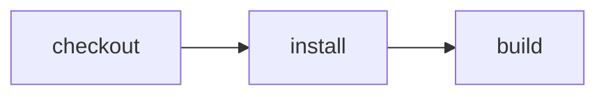

# Demo recording maintenance

Historical captures keep their original `developer-loop` recipe name, source
paths, release tags and digests after the rename to `test/fixtures/demo`.

Maintainer-only documentation, recording, relay and artifact tests run separately:

```sh
pnpm test:integration
```

The app's `pnpm test` / `cf-ci run test` runs its Vitest suite, not these maintainer
checks. The adoption regression in `scripts/demo-adoption.test.ts` changes the
workflow YAML and message in a temporary app, then executes its actual test task.
The guide's pre-adoption YAML is a stable fixture, not the user's editable workflow.

### Record the local user journey

After installing dependencies, **commit the recipe first**, then run:

```sh
npm run verify:browser
npm run verify:browser -- --negative
```

The recipe owns its preview, browser config and test fixtures. The first command
runs the real `cf-ci run build`, opens its built application in a fresh local
Chromium context, checks the visible release message, clicks **Test JavaScript**,
and asserts the explicit browser-code success result. Historical captures below
retain the original **Show message** interaction; they are not footage of this UI.
The second deliberately uses a wrong expectation: it must retain a failed E2E
outcome and failed-run video. The verification wrapper succeeds only when that
expected negative outcome is preserved; it does not relabel the application test.
No agent steps/model calls or signed-in account pages are involved.

Both retain separate, uniquely named ignored `.e2e/` recordings/traces (reruns do
not replace prior media) and a create-only `.verification/`
manifest: exact commit, scenario, expected/actual outcome, real browser/runner,
independently timed build/browser processes, observed warm-input conditions and
media SHA256. Source changes during the run fail verification. The preview binds
only loopback and refuses to reuse an unrelated existing server. First use may
download the framework's official Chromium binary.

These are **local, quarantined outputs**, not hosted Cloudflare proof, signed
attestation or an automatic public upload. The framework marks videos as
redaction-incomplete; review captured content and validate playback before
publication. Timing is one observed sample, not a benchmark or assumed cache hit.
Kitesurf remains a separate compatibility probe, not a silent fallback.

To review an existing capture without rerunning CI or the browser:

```sh
npm run proof:preview -- <recorded-run-UUID>
```

This validates the report's actual assertions, outcome, timing and video digest,
then creates `.verification/<run-UUID>.md` with the selected command's generated
plan, same-run video/transcript links and raw timings. It refuses to overwrite an
existing review. Failed tests stay labelled failed; unknown queue/wait times stay
unknown. Open that Markdown file locally to inspect the footage and transcript.
It neither uploads media nor edits this README, and it does not certify redaction,
playback or signed trust. Publish only after those separate reviews.

**Video:** [Local browser recording + original manifest and assertion transcript](https://github.com/ericclemmons/effect-ci-testbed/releases/tag/proof-developer-loop-4ebc193).
The WebM shows the actual generated build preview, click and visible assertion;
it does not show the CLI or a hosted deployment. Footage is unedited and was
played through to completion and reviewed before publication. It is deliberately
small: a proof of interaction, not a polished Friday demo recording.

**Measured results:** [Published capture receipt](./published/local-4ebc193.json),
historical source [`4ebc193`](https://github.com/ericclemmons/effect-ci-testbed/commit/4ebc193aba8b828b87bff44b6328e860583d8dea),
recorded October 13, 2026 — **not a latest-HEAD badge**.

Recorded command's plan (from that same-run manifest, not the full inferred suite):



| Environment                  | This recorded result                                    | Observed timing                                                               |
| ---------------------------- | ------------------------------------------------------- | ----------------------------------------------------------------------------- |
| Effect CI Local              | Build + browser assertion passed                        | Build process 1286 ms; browser process 1436 ms; total recorder window 2860 ms |
| GitHub Actions               | Historical checks linked above; no browser capture here | Not measured by this recording                                                |
| Effect CI GitHub             | Historical checks linked above; no browser capture here | Not measured by this recording                                                |
| Hosted Cloudflare / Kitesurf | Not verified by this capture                            | Unknown                                                                       |

One sample on Node 26.8.2 / darwin arm64, e2e 0.19.0 / web 0.14.0,
Chromium 153.0.8010.12. Dependencies and a prior build artifact were present;
cache hits were not independently measured. Queue and decision waits are unknown,
not zero. Timing includes process startup/cleanup and is not a speedup benchmark.

The original manifest retains recording-time quarantine/redaction-incomplete
labels; the separate receipt documents the capture-specific agent content review.
The positive video is public. The intentional negative capture stays local with
its actual failed assertion and is not falsely presented as a successful test.
Assets have pinned SHA256 values; GitHub release immutability is **not** enabled,
so the links alone do not guarantee the files cannot be replaced. This is unsigned
explanatory evidence, not attestation or permission to skip CI.

Run `npm run proof:verify-published` to check the public tag/source, release asset
metadata, downloaded bytes/digests and original manifest against the receipt.
This is an explicit read-only network check; normal unit tests do not fetch media
or dispatch CI. Missing/replaced media and source drift fail verification rather
than silently refreshing the proof. It does not recertify playback or privacy.

## Native command diagnostics

The diagnostics implementation has actual LOCAL workerd Workflow tests for both
command and policy-bearing action checkpoints. A test-only outer catcher exposes
the failed checkpoint error for inspection; production CI does not catch it into
a successful Workflow. Both output streams and exit7 survive message-only error
serialization with one command execution. Pure retry, rollback and timeout
regressions remain separate. The actual CLI also consumes a fake authenticated
remote NDJSON stream and emits one JSON diagnostic for duplicated step/terminal
errors, without a second dispatch or text-mode rerun.

The versioned transport includes only known command metadata and bounded output,
never arbitrary host causes. Its total UTF-8 error message is limited to32KiB;
streams are tail-clipped, initially at8K characters each, and carry an explicit
truncation flag. Malformed, oversized, context-mismatched and unknown frames are
not promoted to structured command evidence. Output is descriptive untrusted data,
not a command to execute, check-cache proof, retry permission or release approval.

Actual native/remote JSON transport was then verified on October15 with one
normal `AI_AGENT=true cf-ci run --remote` from a clean managed checkout. Exact
host `c57576e09e319b0da5fb611a9e17c0b395ef0957` was built179modules and deployed
once as Worker `478e387d-3973-4108-bb4f-d5e9f0d9db43`, preserving23exports,
19bindings, secret names, Docker image and the committed release.

The dedicated negative source `4005974fd8fb85765008428e21a75e6792cc3fca` produced
Workflow `edbdb213-1ce2-44d2-84ab-40688db4dcb1`, still **ERRORED**. Its new fixture
unexpectedly failed lint first: three real `no-undef` diagnostics for Node globals
were on stdout while stderr contained npm notices. The planned exit7 script did
not run, so its original acceptance flag remains false. Independent full failed
checkpoint output and the actual CLI JSON agree exactly on lint exit1, both
streams, one attempt and zero retries. This proves diagnostics transport, not an
exit7 run or a successful build. No publication, candidate preparation, approval,
Slack message, traffic change or model call followed.

The diagnostics identified the fixture bug without a text-mode rerun. Explicit
Node imports in `47dd64b01b52d9e271780a74ae2f48326e621359` pass local lint; that
fix remains only on `codex/native-command-negative-fixture`, not main/demo/live.
It was **not remotely redispatched** for a prettier result. Both original and
fixed fixture histories are retained; never merge its deliberate failing package
script into the normal demo or replay the consumed public incident for evidence.

Read-only native regression (ordinary CI skips):

```sh
LIVE_NATIVE_COMMAND_DIAGNOSTICS=1 CF_BIN=path/to/installed/cf node --test apps/effect-ci/src/live-command-diagnostics.test.ts
```

An optional `LIVE_NATIVE_COMMAND_CLI_RECEIPT` points to the private original CLI
receipt for equality against independent full native output. The unsigned receipt
is supporting evidence, not reusable trust. The test does not hit a failing URL,
dispatch, execute, publish, approve, spend or write anything remotely.

```sh
node --test packages/ci/src/command-diagnostics.test.ts packages/cli/src/remote-diagnostics.test.ts
node --test packages/cli/src/remote-cli.test.ts test/apps/example-runner/src/command-diagnostics-runtime.test.ts
```

Use the [proof-page contract](../../../../examples/PROOF-PAGES.md) for exact revision/environment,
assertions, video/transcript, outcome and cold/warm timings. See the
[coverage matrix](../../../../README.md#recipes-by-feature) for current backend support.
